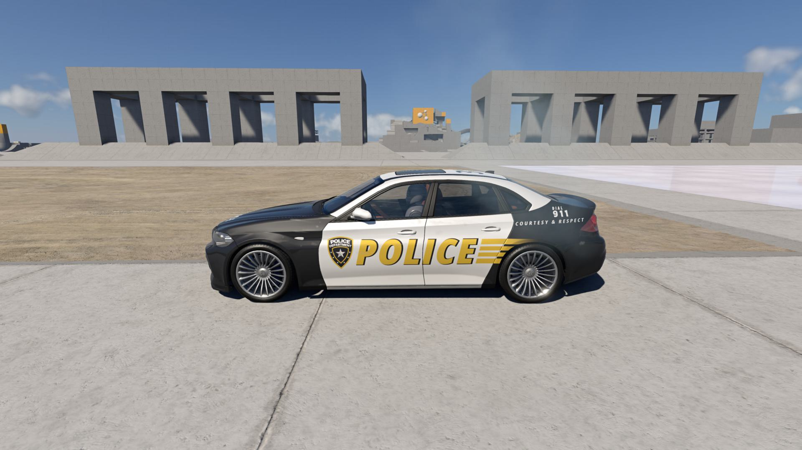
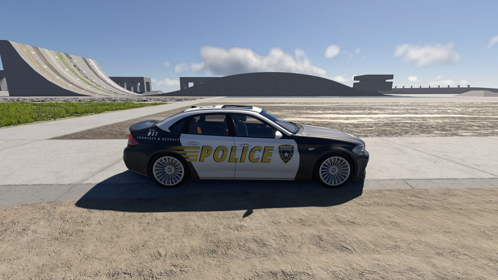
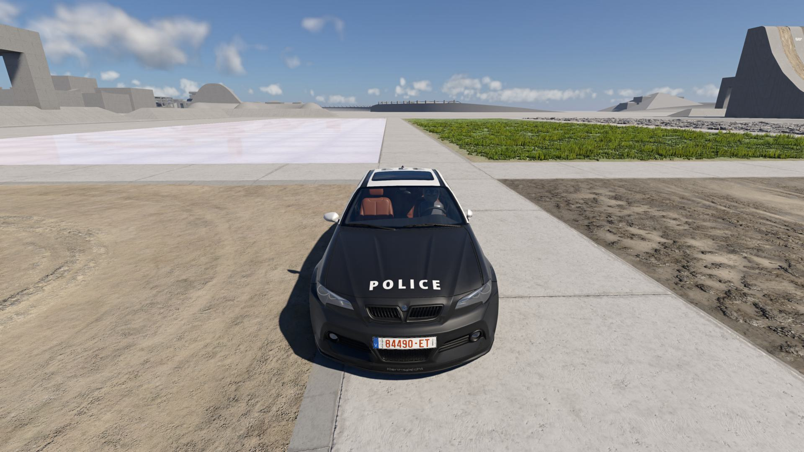
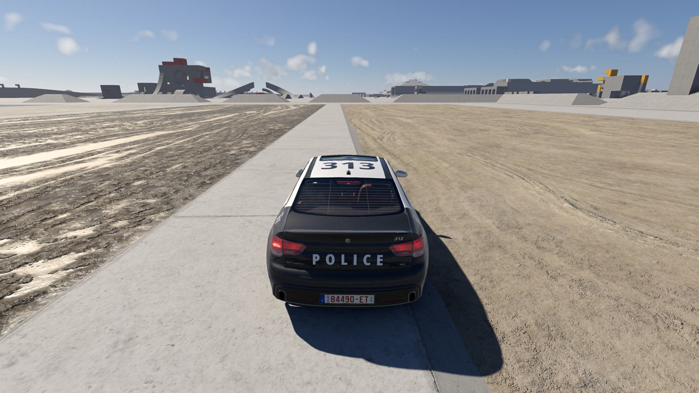
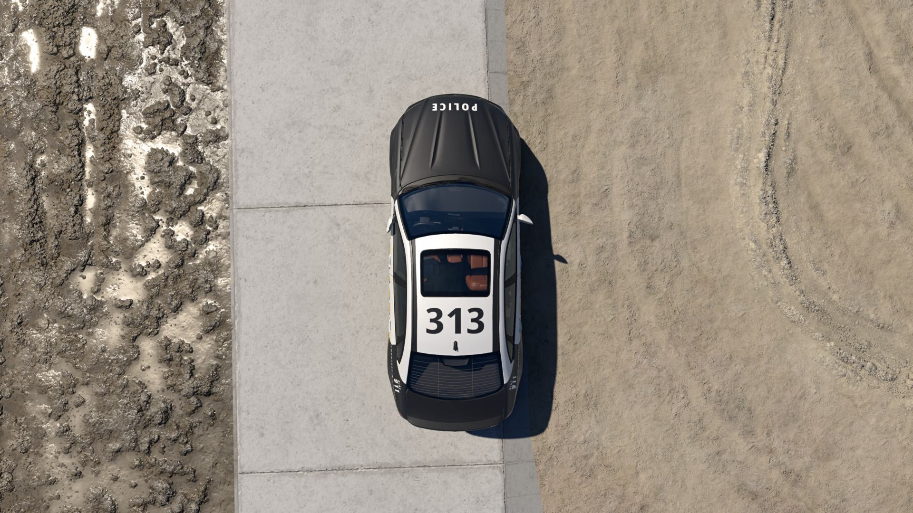

# sideslide - 20261114-212232_sideslide_resumed-half-d3d-wash-drive

_on its side, sliding along the ground at 14 m/s - one long scrape_

Remaining queues: `{"bake": 0, "jobs": 0, "stamps": 0}`

Tuning: `scratches_paint.setDamageResolution(2048); scratches_paint.setBakeBudget(3); scratches_paint.setFlushInterval(0.05); scratches_paint.setPanelGrouping(true); scratches_paint.setCoverageCoalescing(true)`

Settled: True after 4.403 s - 325 frames, 73.6 fps average from sampled wall intervals (background limiter lifted)
Went past upside down: True (lowest up-vector z -0.492)

## Marks

| contacts | passed filters | impacts | streams | stamps | projections | bakes | missed | jobs dropped | deferred frames |
|---|---|---|---|---|---|---|---|---|---|
| 1450 | 730 | 51 | 91 | 87 | 80 | 97 | 0.0% | 0 | 1 |

Rejected contacts: BelowThresh 444, PartExcluded 152, Wheel 123, NormalForce 1

Body materials: METAL 465, PLASTIC 265

Surfaces: ASPHALT 730

## Cost

| | avg | p95 | max |
|---|---|---|---|
| painter (GE), ms/frame | 4.827 | 28.16 | 36.765 |
| whole frame, ms | 11.006 (p50) | 34.904 | 45.082 |
| all GE Lua, ms | | 29.212 | 38.165 |
| physics + vehicle Lua, ms | | 0.09 | 1.417 |
| render, ms | | 2.179 | |

- Painter frames over 4 ms: 79; worst flush (project + bake) 36.681 ms, worst composite 0.151 ms.
- Detector: 3.977 us per contact, 10.624 ms total, worst frame 0.804 ms (profiled; the timer adds a little).

### Worst frames

| t (s) | frame ms | painter ms | GE Lua ms | physics+VLUA ms | render ms |
|---|---|---|---|---|---|
| 3.37 | 45.08 | 33.21 | 0.68 | 0.05 | 1.86 |
| 2.83 | 44.79 | 31.85 | 0.91 | 0.05 | 1.90 |
| 2.69 | 44.14 | 32.24 | 1.26 | 0.05 | 2.05 |
| 3.08 | 43.98 | 32.17 | 0.75 | 0.04 | 1.81 |
| 1.47 | 43.73 | 36.76 | 1.01 | 0.04 | 1.59 |

## Screenshots

