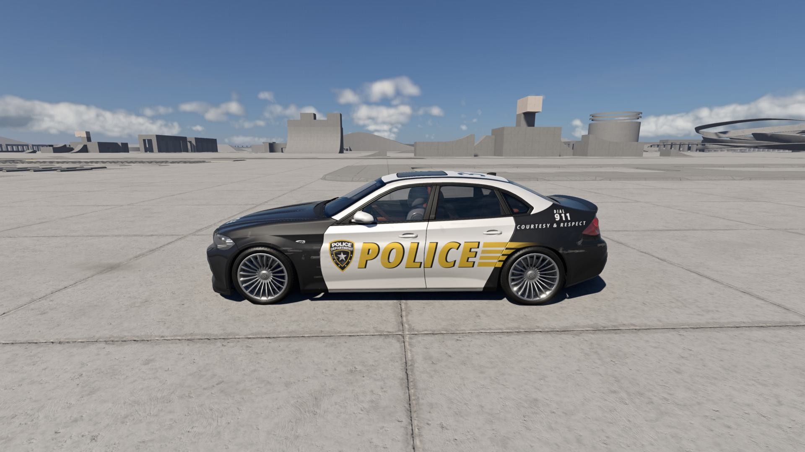
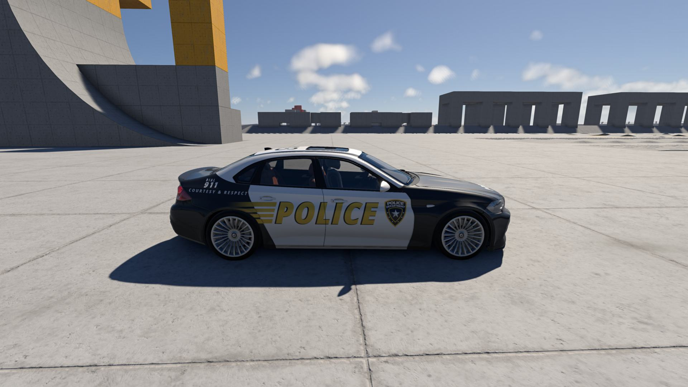
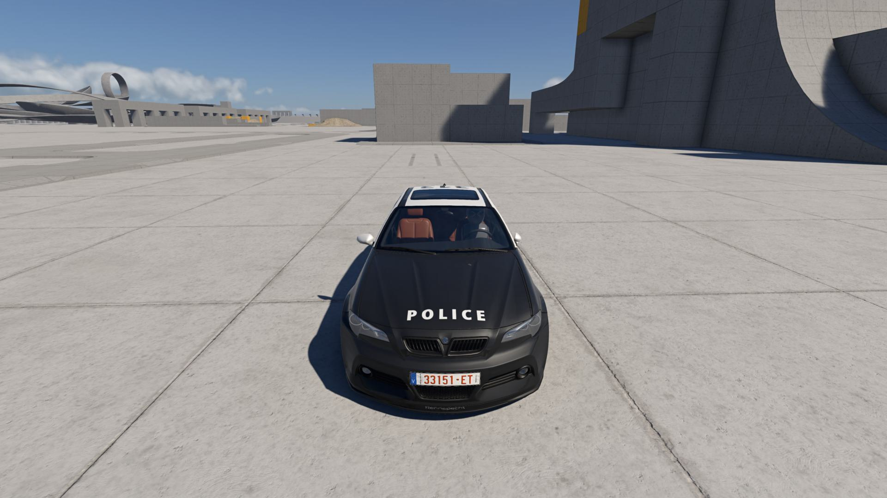
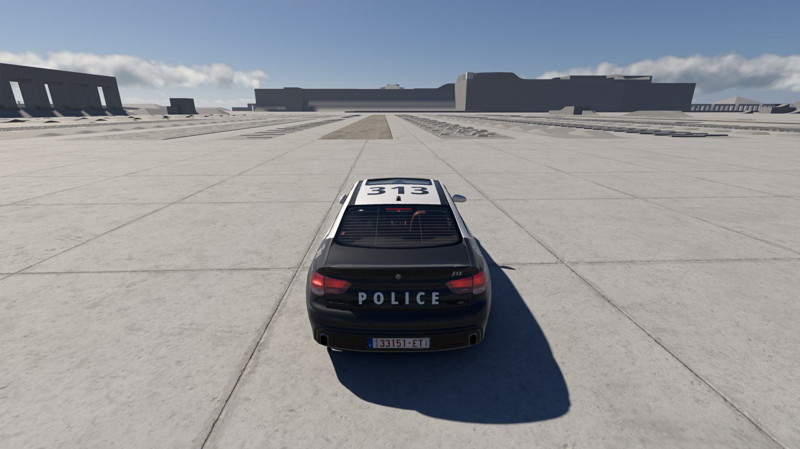
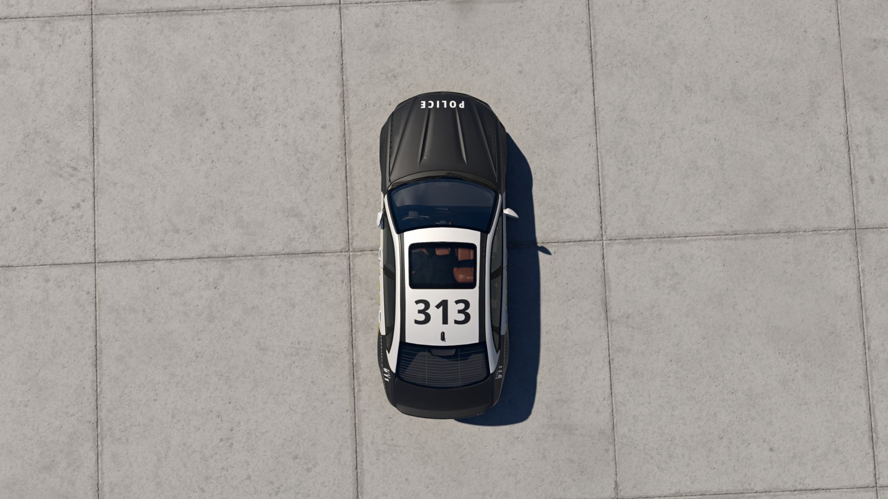

# sideslide - 20261114-195356_sideslide_resumed-selected-full-fast-vulkan-warm_r1

_on its side, sliding along the ground at 14 m/s - one long scrape_

Remaining queues: `{"bake": 0, "jobs": 0, "stamps": 0}`

Tuning: `if scratches_detect then scratches_detect.setPaintEnabled(true) end; scratches_paint.setDamageResolution(4096); scratches_paint.setBakeBudget(3); scratches_paint.setFlushInterval(0.05); scratches_paint.setProjectionBudget(6); scratches_paint.setLayerBudget(24); scratches_paint.setCoverageCoalescing(false); scratches_paint.setPanelGrouping(true)`

Settled: True after 4.096 s - 257 frames, 61.3 fps average from sampled wall intervals (background limiter lifted)
Went past upside down: True (lowest up-vector z -0.16)

## Marks

| contacts | passed filters | impacts | streams | stamps | projections | bakes | missed | jobs dropped | deferred frames |
|---|---|---|---|---|---|---|---|---|---|
| 2558 | 474 | 89 | 94 | 137 | 76 | 132 | 0.0% | 0 | 2 |

Rejected contacts: Wheel 1490, BelowThresh 591, NormalForce 3

Body materials: METAL 354, PLASTIC 120

Surfaces: ASPHALT 474

## Cost

| | avg | p95 | max |
|---|---|---|---|
| painter (GE), ms/frame | 3.669 | 19.274 | 35.163 |
| whole frame, ms | 14.261 (p50) | 32.373 | 46.67 |
| all GE Lua, ms | | 20.435 | 36.055 |
| physics + vehicle Lua, ms | | 0.105 | 0.249 |
| render, ms | | 1.839 | |

- Painter frames over 4 ms: 39; worst flush (project + bake) 35.126 ms, worst composite 0.16 ms.
- Detector: 1.491 us per contact, 8.094 ms total, worst frame 0.627 ms (profiled; the timer adds a little).

### Worst frames

| t (s) | frame ms | painter ms | GE Lua ms | physics+VLUA ms | render ms |
|---|---|---|---|---|---|
| 0.17 | 46.67 | 33.76 | 0.67 | 0.06 | 1.57 |
| 2.17 | 45.49 | 27.32 | 4.64 | 0.19 | 2.20 |
| 0.23 | 42.01 | 35.16 | 2.73 | 0.08 | 1.42 |
| 0.33 | 36.38 | 25.46 | 2.02 | 0.05 | 1.50 |
| 1.71 | 35.60 | 19.53 | 4.04 | 0.06 | 1.40 |

## Screenshots

