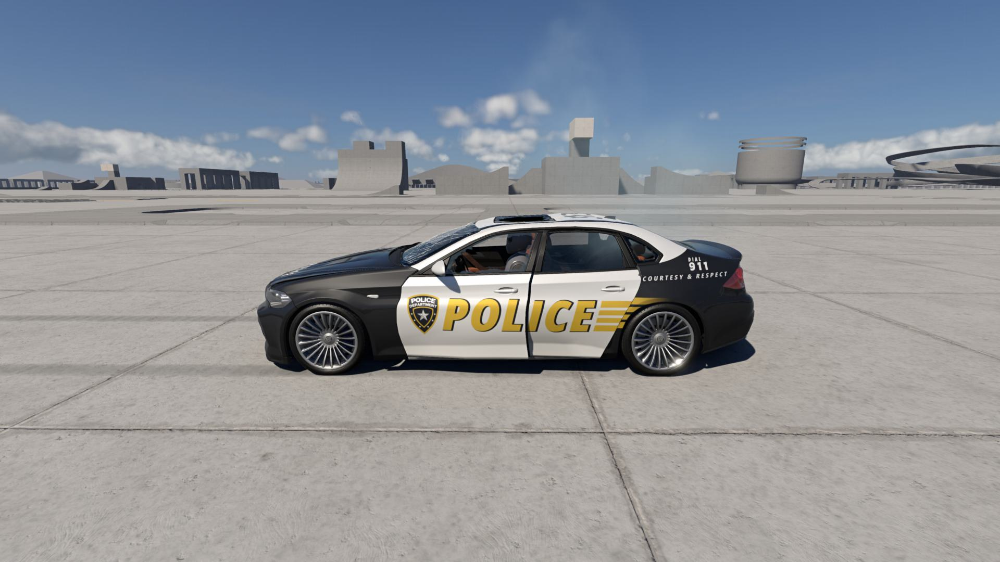
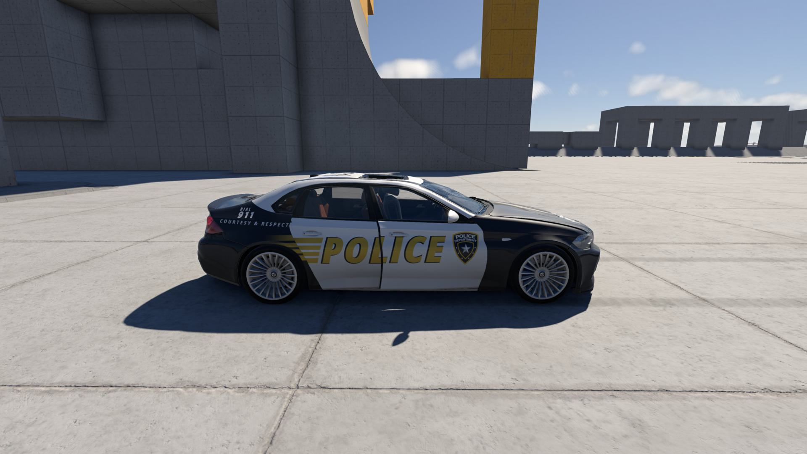
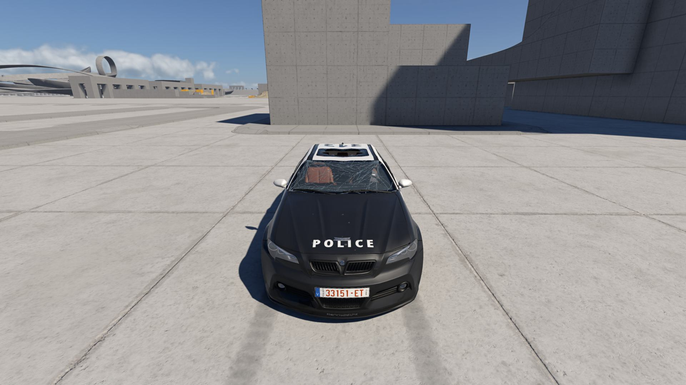
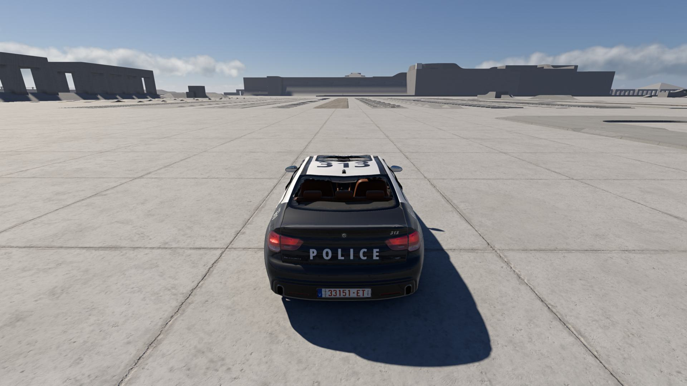
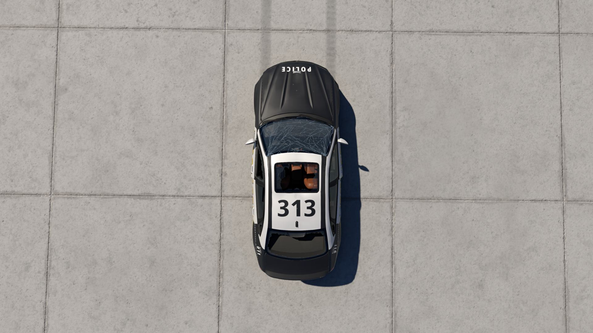

# roofdrop - 20261114-195413_roofdrop_resumed-selected-full-fast-vulkan-warm_r1

_dropped upside down from about 1 m - roof impacts_

Remaining queues: `{"bake": 0, "jobs": 0, "stamps": 0}`

Tuning: `if scratches_detect then scratches_detect.setPaintEnabled(true) end; scratches_paint.setDamageResolution(4096); scratches_paint.setBakeBudget(3); scratches_paint.setFlushInterval(0.05); scratches_paint.setProjectionBudget(6); scratches_paint.setLayerBudget(24); scratches_paint.setCoverageCoalescing(false); scratches_paint.setPanelGrouping(true)`

Settled: True after 5.111 s - 386 frames, 75.3 fps average from sampled wall intervals (background limiter lifted)
Went past upside down: True (lowest up-vector z -1.0)

## Marks

| contacts | passed filters | impacts | streams | stamps | projections | bakes | missed | jobs dropped | deferred frames |
|---|---|---|---|---|---|---|---|---|---|
| 1047 | 50 | 50 | 0 | 56 | 14 | 22 | 0.0% | 0 | 0 |

Rejected contacts: PartExcluded 620, BelowThresh 377

Body materials: METAL 49, PLASTIC 1

Surfaces: ASPHALT 50

## Cost

| | avg | p95 | max |
|---|---|---|---|
| painter (GE), ms/frame | 1.397 | 3.84 | 38.012 |
| whole frame, ms | 12.554 (p50) | 18.026 | 51.793 |
| all GE Lua, ms | | 4.789 | 40.041 |
| physics + vehicle Lua, ms | | 0.081 | 0.151 |
| render, ms | | 1.87 | |

- Painter frames over 4 ms: 19; worst flush (project + bake) 37.987 ms, worst composite 0.057 ms.
- Detector: 1.468 us per contact, 3.959 ms total, worst frame 0.488 ms (profiled; the timer adds a little).

### Worst frames

| t (s) | frame ms | painter ms | GE Lua ms | physics+VLUA ms | render ms |
|---|---|---|---|---|---|
| 0.53 | 51.79 | 35.46 | 0.94 | 0.11 | 2.28 |
| 2.49 | 50.56 | 38.01 | 0.99 | 0.05 | 1.18 |
| 3.68 | 49.10 | 36.16 | 0.74 | 0.03 | 1.28 |
| 0.80 | 48.08 | 35.26 | 0.88 | 0.06 | 1.42 |
| 1.41 | 48.07 | 34.21 | 0.84 | 0.05 | 1.55 |

## Screenshots

