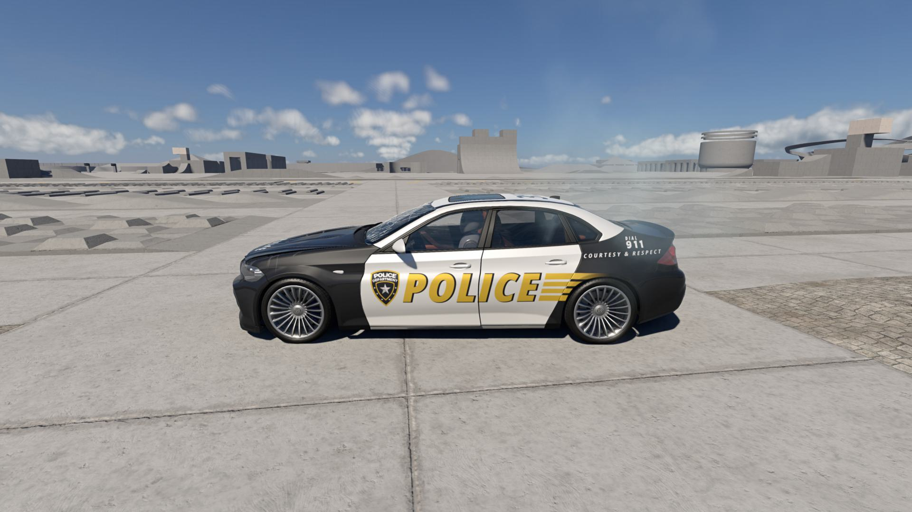
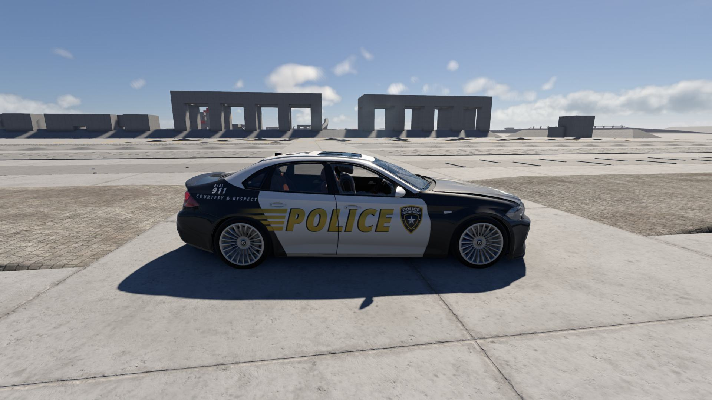
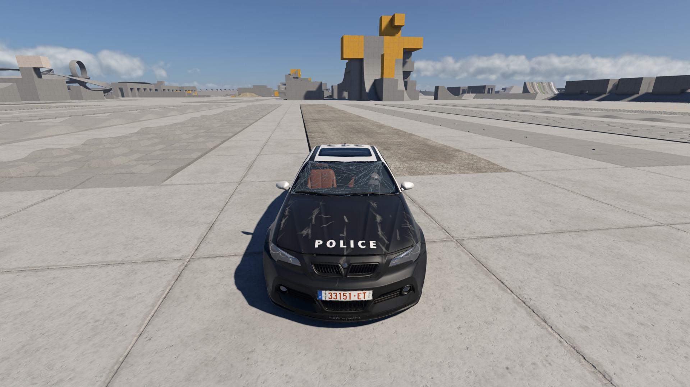
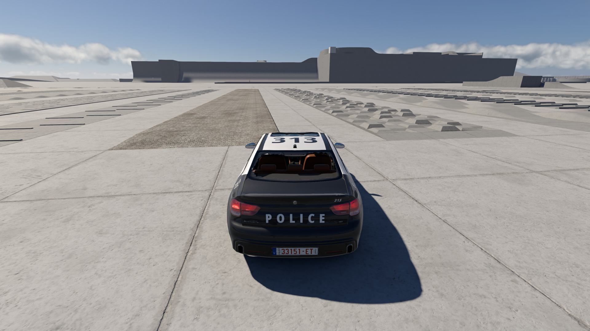
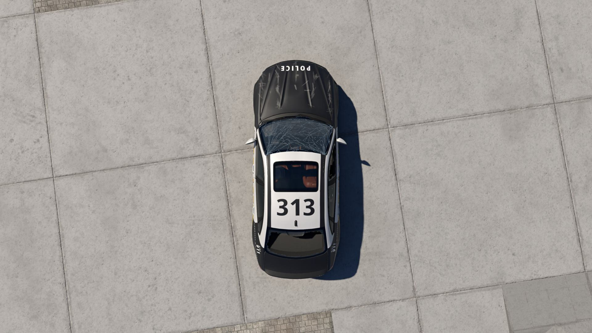

# sustained - 20261114-195430_sustained_resumed-selected-full-fast-vulkan-warm_r1

_assisted roof scrape v2: additive translation to 4 m/s for 30 seconds, preserving internal node motion; real collisions_

Remaining queues: `{"bake": 0, "jobs": 0, "stamps": 0}`

Tuning: `if scratches_detect then scratches_detect.setPaintEnabled(true) end; scratches_paint.setDamageResolution(4096); scratches_paint.setBakeBudget(3); scratches_paint.setFlushInterval(0.05); scratches_paint.setProjectionBudget(6); scratches_paint.setLayerBudget(24); scratches_paint.setCoverageCoalescing(false); scratches_paint.setPanelGrouping(true)`

Settled: False after 30.007 s - 2353 frames, 78.5 fps average from sampled wall intervals (background limiter lifted)
Went past upside down: True (lowest up-vector z -1.0)

## Marks

| contacts | passed filters | impacts | streams | stamps | projections | bakes | missed | jobs dropped | deferred frames |
|---|---|---|---|---|---|---|---|---|---|
| 16252 | 8748 | 32 | 571 | 82 | 153 | 163 | 0.0% | 0 | 0 |

Rejected contacts: PartExcluded 5405, BelowThresh 2069, NormalForce 30

Body materials: METAL 8697, PLASTIC 51

Surfaces: ASPHALT 7956, COBBLESTONE 792

## Cost

| | avg | p95 | max |
|---|---|---|---|
| painter (GE), ms/frame | 1.937 | 25.035 | 36.328 |
| whole frame, ms | 11.783 (p50) | 31.835 | 48.582 |
| all GE Lua, ms | | 25.999 | 37.367 |
| physics + vehicle Lua, ms | | 0.086 | 0.72 |
| render, ms | | 1.883 | |

- Painter frames over 4 ms: 151; worst flush (project + bake) 36.299 ms, worst composite 0.289 ms.
- Detector: 3.347 us per contact, 73.639 ms total, worst frame 0.828 ms (profiled; the timer adds a little).

### Worst frames

| t (s) | frame ms | painter ms | GE Lua ms | physics+VLUA ms | render ms |
|---|---|---|---|---|---|
| 18.91 | 48.58 | 36.33 | 0.71 | 0.05 | 1.40 |
| 25.98 | 48.13 | 34.51 | 1.01 | 0.07 | 1.34 |
| 4.28 | 47.75 | 34.04 | 1.03 | 0.07 | 1.31 |
| 16.39 | 47.61 | 35.39 | 0.75 | 0.06 | 1.22 |
| 16.89 | 47.36 | 35.34 | 0.85 | 0.06 | 1.34 |

## Screenshots

