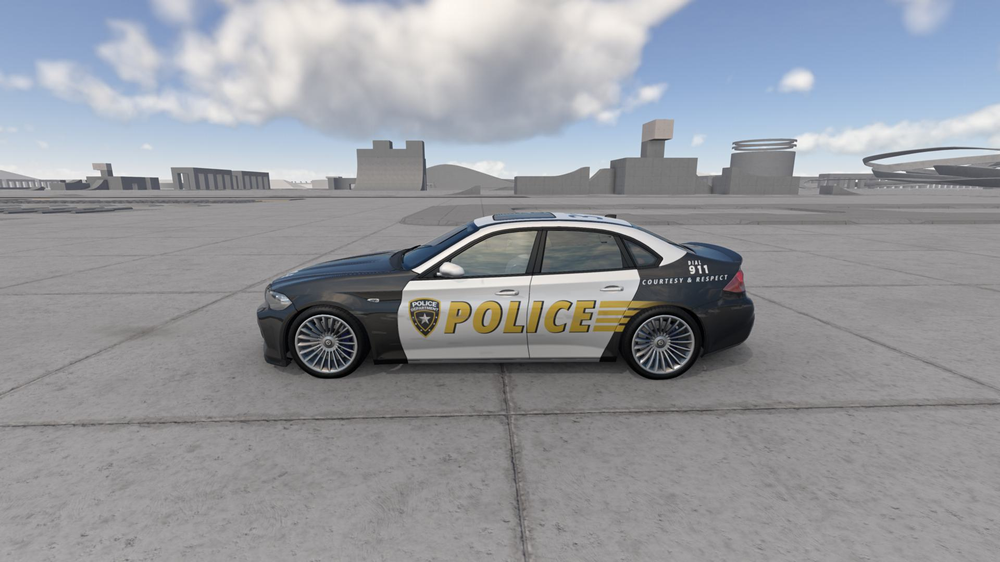
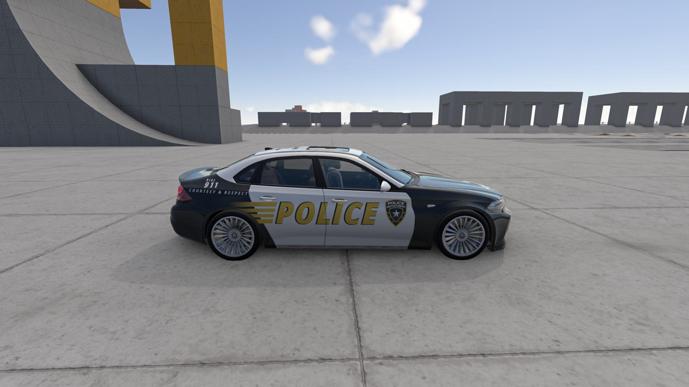
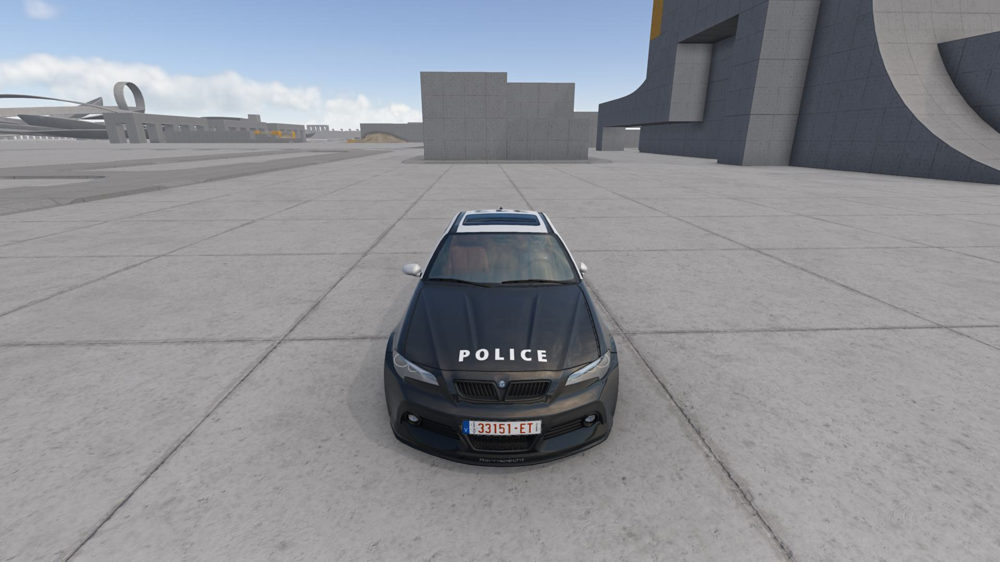
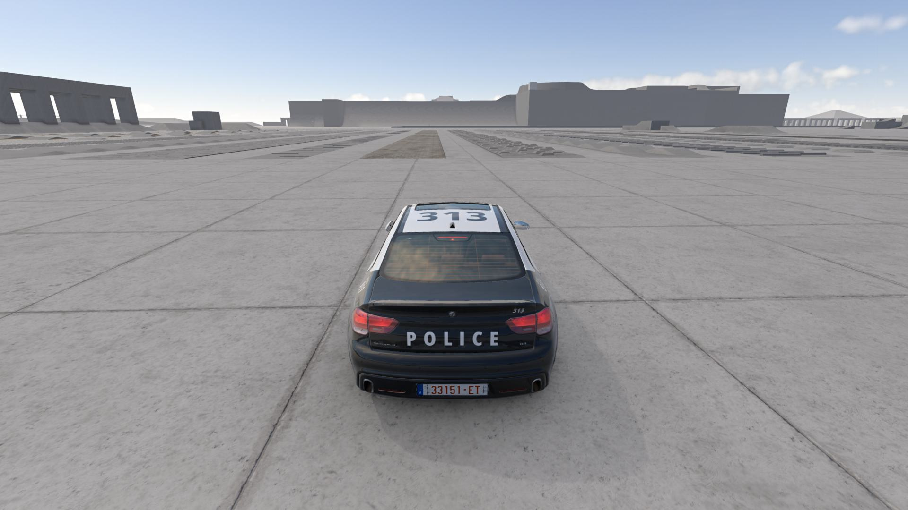
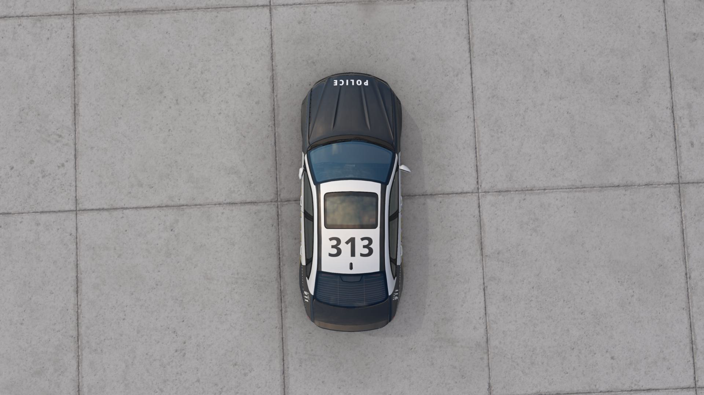

# sideslide - 20261114-192601_sideslide_resumed-selected-half-vulkan-warm_r1

_on its side, sliding along the ground at 14 m/s - one long scrape_

Remaining queues: `{"bake": 0, "jobs": 0, "stamps": 0}`

Tuning: `if scratches_detect then scratches_detect.setPaintEnabled(true) end; scratches_paint.setDamageResolution(2048); scratches_paint.setBakeBudget(3); scratches_paint.setFlushInterval(0.05); scratches_paint.setProjectionBudget(6); scratches_paint.setLayerBudget(24); scratches_paint.setCoverageCoalescing(true); scratches_paint.setPanelGrouping(true)`

Settled: True after 4.098 s - 302 frames, 73.5 fps average from sampled wall intervals (background limiter lifted)
Went past upside down: True (lowest up-vector z -0.159)

## Marks

| contacts | passed filters | impacts | streams | stamps | projections | bakes | missed | jobs dropped | deferred frames |
|---|---|---|---|---|---|---|---|---|---|
| 2992 | 666 | 69 | 123 | 109 | 95 | 140 | 0.0% | 0 | 1 |

Rejected contacts: Wheel 1671, BelowThresh 650, NormalForce 5

Body materials: METAL 501, PLASTIC 165

Surfaces: ASPHALT 666

## Cost

| | avg | p95 | max |
|---|---|---|---|
| painter (GE), ms/frame | 4.791 | 33.691 | 40.858 |
| whole frame, ms | 10.344 (p50) | 42.293 | 50.626 |
| all GE Lua, ms | | 34.697 | 41.66 |
| physics + vehicle Lua, ms | | 0.089 | 0.555 |
| render, ms | | 1.725 | |

- Painter frames over 4 ms: 45; worst flush (project + bake) 40.834 ms, worst composite 0.071 ms.
- Detector: 1.519 us per contact, 9.057 ms total, worst frame 1.073 ms (profiled; the timer adds a little).

### Worst frames

| t (s) | frame ms | painter ms | GE Lua ms | physics+VLUA ms | render ms |
|---|---|---|---|---|---|
| 0.19 | 50.63 | 39.14 | 1.11 | 0.08 | 1.48 |
| 0.47 | 50.29 | 38.65 | 1.99 | 0.05 | 1.39 |
| 2.86 | 48.04 | 35.63 | 0.74 | 0.03 | 1.16 |
| 1.28 | 47.79 | 37.22 | 1.51 | 0.04 | 1.19 |
| 1.59 | 47.55 | 36.51 | 1.46 | 0.06 | 1.22 |

## Screenshots

