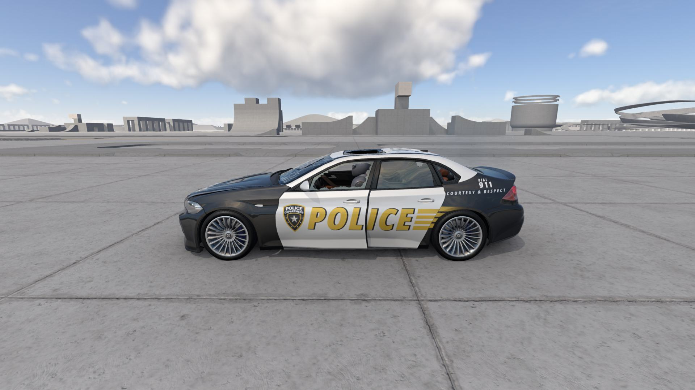
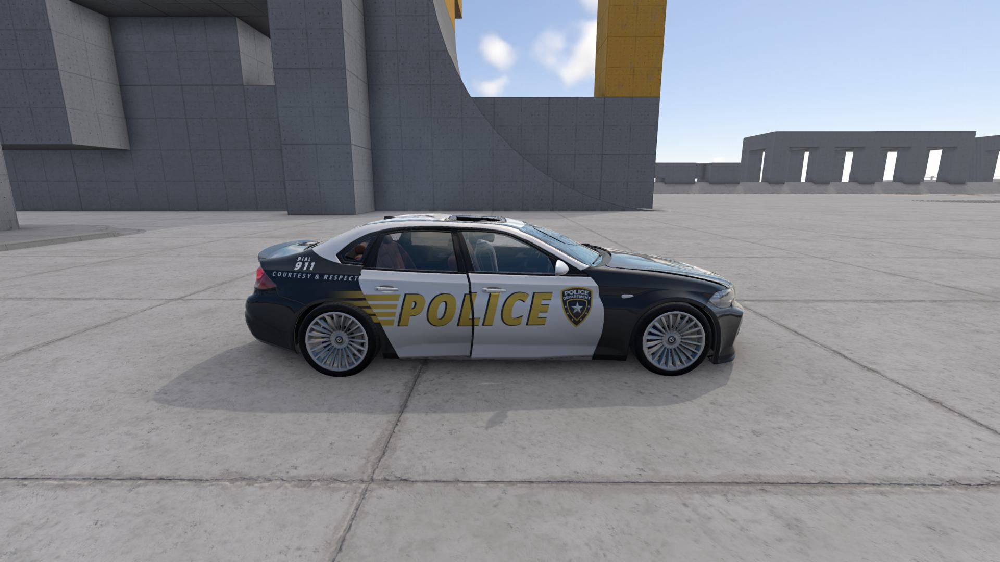
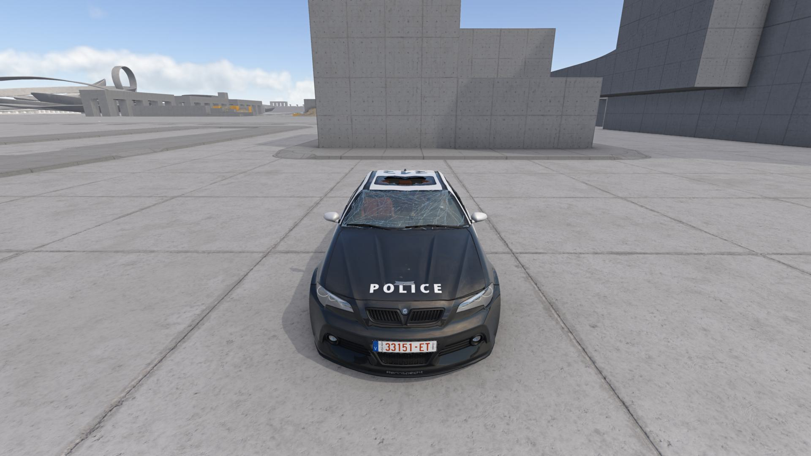
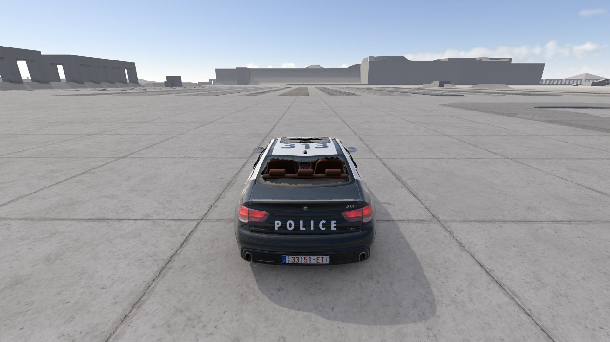
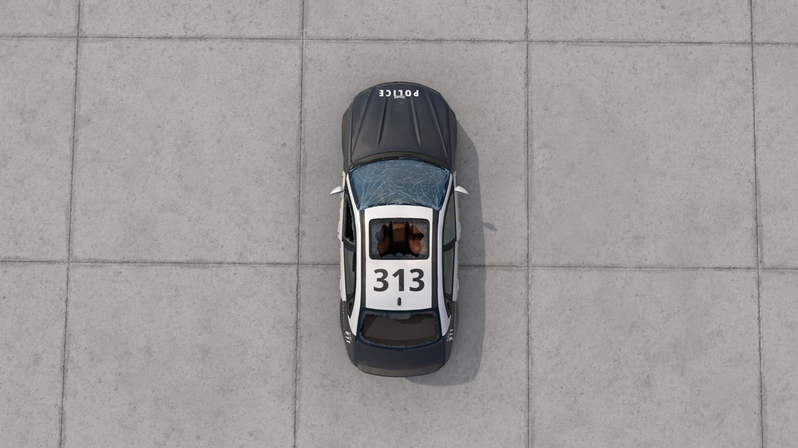

# roofdrop - 20261114-192617_roofdrop_resumed-selected-half-vulkan-warm_r1

_dropped upside down from about 1 m - roof impacts_

Remaining queues: `{"bake": 0, "jobs": 0, "stamps": 0}`

Tuning: `if scratches_detect then scratches_detect.setPaintEnabled(true) end; scratches_paint.setDamageResolution(2048); scratches_paint.setBakeBudget(3); scratches_paint.setFlushInterval(0.05); scratches_paint.setProjectionBudget(6); scratches_paint.setLayerBudget(24); scratches_paint.setCoverageCoalescing(true); scratches_paint.setPanelGrouping(true)`

Settled: True after 5.036 s - 387 frames, 76.6 fps average from sampled wall intervals (background limiter lifted)
Went past upside down: True (lowest up-vector z -1.0)

## Marks

| contacts | passed filters | impacts | streams | stamps | projections | bakes | missed | jobs dropped | deferred frames |
|---|---|---|---|---|---|---|---|---|---|
| 1066 | 47 | 47 | 0 | 56 | 15 | 23 | 0.0% | 0 | 0 |

Rejected contacts: PartExcluded 625, BelowThresh 394

Body materials: METAL 46, PLASTIC 1

Surfaces: ASPHALT 47

## Cost

| | avg | p95 | max |
|---|---|---|---|
| painter (GE), ms/frame | 1.329 | 0.964 | 37.105 |
| whole frame, ms | 12.52 (p50) | 15.18 | 50.374 |
| all GE Lua, ms | | 1.919 | 38.15 |
| physics + vehicle Lua, ms | | 0.07 | 0.14 |
| render, ms | | 1.78 | |

- Painter frames over 4 ms: 17; worst flush (project + bake) 37.078 ms, worst composite 0.044 ms.
- Detector: 1.416 us per contact, 4.382 ms total, worst frame 1.224 ms (profiled; the timer adds a little).

### Worst frames

| t (s) | frame ms | painter ms | GE Lua ms | physics+VLUA ms | render ms |
|---|---|---|---|---|---|
| 3.78 | 50.37 | 37.11 | 1.17 | 0.05 | 1.22 |
| 0.80 | 50.08 | 35.51 | 0.88 | 0.05 | 2.19 |
| 2.48 | 50.07 | 36.70 | 0.99 | 0.06 | 1.30 |
| 1.84 | 48.98 | 36.40 | 0.80 | 0.04 | 1.22 |
| 0.53 | 48.84 | 36.17 | 0.77 | 0.11 | 1.52 |

## Screenshots

