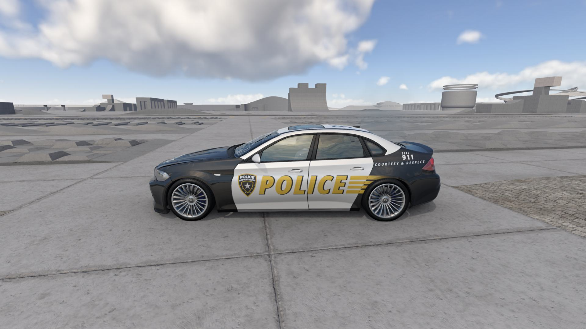
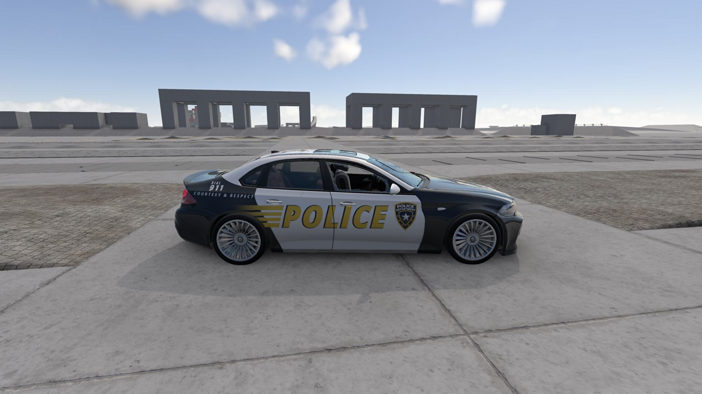
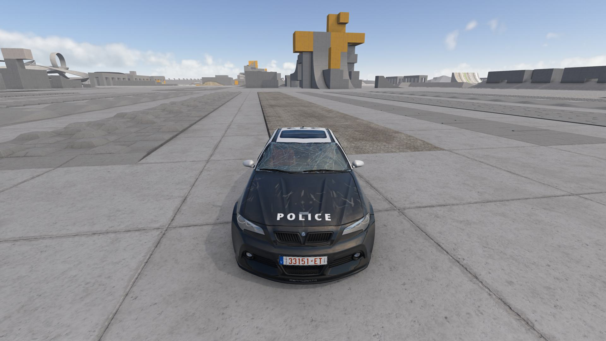
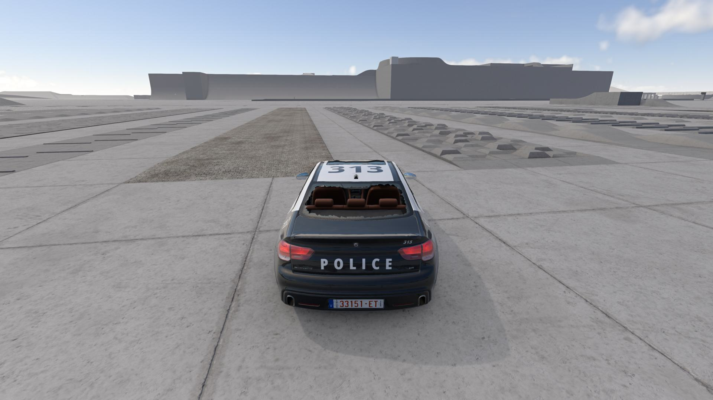
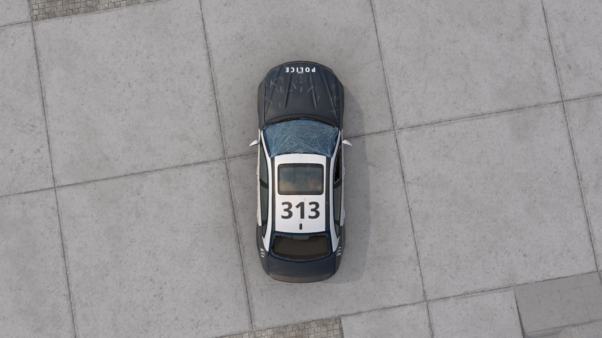

# sustained - 20261114-192635_sustained_resumed-selected-half-vulkan-warm_r1

_assisted roof scrape v2: additive translation to 4 m/s for 30 seconds, preserving internal node motion; real collisions_

Remaining queues: `{"bake": 0, "jobs": 0, "stamps": 0}`

Tuning: `if scratches_detect then scratches_detect.setPaintEnabled(true) end; scratches_paint.setDamageResolution(2048); scratches_paint.setBakeBudget(3); scratches_paint.setFlushInterval(0.05); scratches_paint.setProjectionBudget(6); scratches_paint.setLayerBudget(24); scratches_paint.setCoverageCoalescing(true); scratches_paint.setPanelGrouping(true)`

Settled: False after 30.0 s - 2361 frames, 78.7 fps average from sampled wall intervals (background limiter lifted)
Went past upside down: True (lowest up-vector z -1.0)

## Marks

| contacts | passed filters | impacts | streams | stamps | projections | bakes | missed | jobs dropped | deferred frames |
|---|---|---|---|---|---|---|---|---|---|
| 15469 | 7796 | 60 | 603 | 106 | 178 | 203 | 0.0% | 0 | 0 |

Rejected contacts: PartExcluded 5812, BelowThresh 1842, NormalForce 19

Body materials: METAL 7781, PLASTIC 15

Surfaces: ASPHALT 6702, COBBLESTONE 1094

## Cost

| | avg | p95 | max |
|---|---|---|---|
| painter (GE), ms/frame | 2.216 | 31.19 | 40.605 |
| whole frame, ms | 11.765 (p50) | 37.689 | 52.898 |
| all GE Lua, ms | | 32.272 | 41.728 |
| physics + vehicle Lua, ms | | 0.082 | 1.137 |
| render, ms | | 1.766 | |

- Painter frames over 4 ms: 164; worst flush (project + bake) 40.582 ms, worst composite 0.09 ms.
- Detector: 3.093 us per contact, 70.46 ms total, worst frame 1.484 ms (profiled; the timer adds a little).

### Worst frames

| t (s) | frame ms | painter ms | GE Lua ms | physics+VLUA ms | render ms |
|---|---|---|---|---|---|
| 28.11 | 52.90 | 40.60 | 0.82 | 0.06 | 1.17 |
| 10.24 | 52.37 | 0.01 | 0.94 | 0.05 | 1.55 |
| 12.42 | 49.98 | 38.12 | 1.13 | 0.09 | 1.45 |
| 27.18 | 49.14 | 35.53 | 0.85 | 0.04 | 1.38 |
| 26.42 | 48.16 | 35.67 | 0.89 | 0.05 | 1.21 |

## Screenshots

