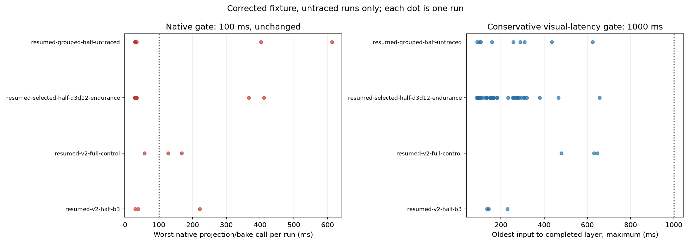

# Resumed milestone 5 measured cohorts

Per-run raw results and full percentile/counter data: [resumed-runs.json](resumed-runs.json).
Stage percentiles there are accumulated native work per frame, not call percentiles.
Physics contacts vary between identical scripted launches. No cache deletion.

| Cohort | Runs | Worst frame p95 / p99 / max (ms) | Native max (ms) | Completed-layer age max (ms) | Queue-cap losses |
| --- | ---: | --- | ---: | ---: | ---: |
| resumed-grouped-half-untraced | 9 | 36.2 / 41.4 / 624.7 | 613.1 | 624.2 | 0 |
| resumed-selected-half-d3d12-endurance | 39 | 34.6 / 42.2 / 458.3 | 411.3 | 656.5 | 0 |
| resumed-v2-full-control | 3 | 40.4 / 48.7 / 181.8 | 167.5 | 645.7 | 0 |
| resumed-v2-half-b3 | 3 | 33.9 / 41.0 / 231.8 | 221.4 | 230.3 | 0 |

These are observed bounds, not guarantees. Disabled controls have no painting latency.
Diagnostic traced cohorts and old v1/reset-invalid runs remain in JSON but are excluded above.

