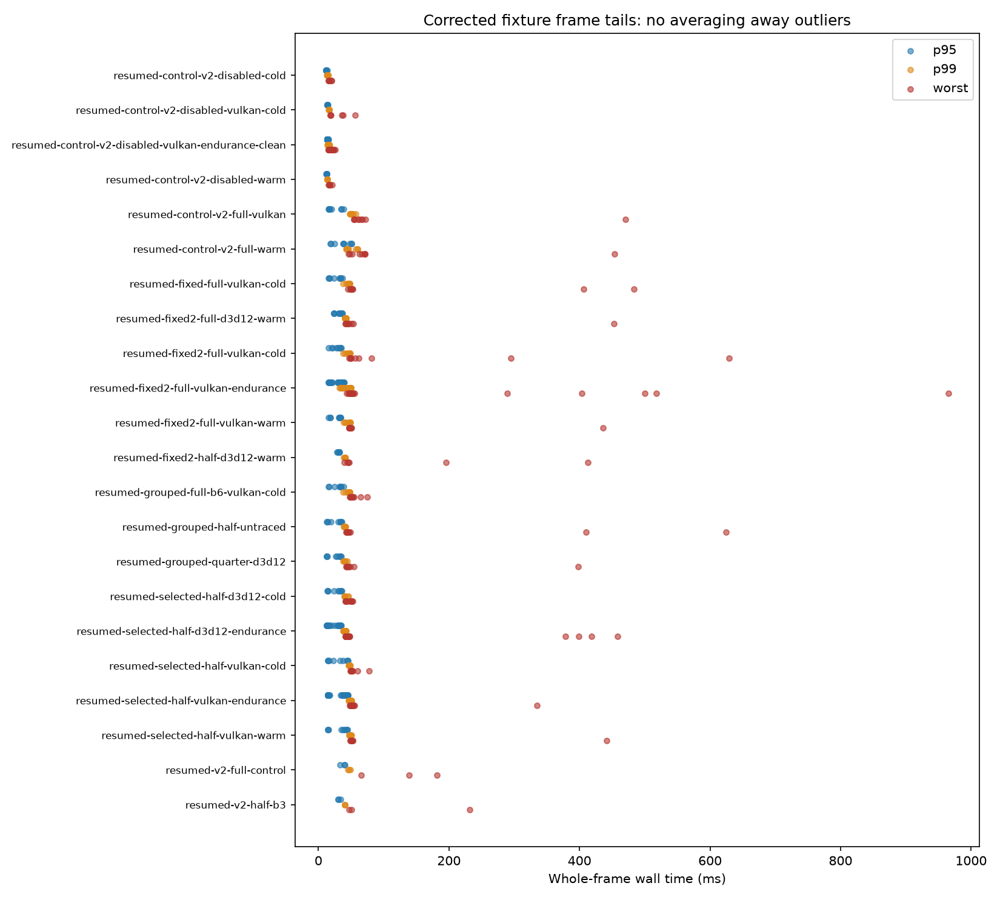

# Resumed milestone 5 measured cohorts

Per-run raw results and full percentile/counter data: [resumed-runs.json](resumed-runs.json).
perFrameStages contains accumulated native work per frame; nativeTimingProfile contains call/batch p95/p99 upper bin bounds where instrumented.
Physics contacts vary between identical scripted launches. No cache deletion.

| Cohort | Runs | Worst frame p95 / p99 / max (ms) | Native max (ms) | Completed-layer age max (ms) | Queue-cap losses |
| --- | ---: | --- | ---: | ---: | ---: |
| resumed-control-v2-disabled-cold | 6 | 13.7 / 15.8 / 20.0 | 0.0 | 0.0 | 0 |
| resumed-control-v2-disabled-vulkan-cold | 6 | 14.7 / 16.4 / 56.5 | 0.0 | 0.0 | 0 |
| resumed-control-v2-disabled-vulkan-endurance-clean | 40 | 15.4 / 16.8 / 25.5 | 0.0 | 0.0 | 0 |
| resumed-control-v2-disabled-warm | 6 | 12.9 / 13.8 / 21.1 | 0.0 | 0.0 | 0 |
| resumed-control-v2-full-vulkan | 9 | 38.2 / 56.9 / 470.6 | 38.8 | 1105.8 | 0 |
| resumed-control-v2-full-warm | 9 | 51.1 / 59.9 / 454.1 | 446.4 | 869.4 | 0 |
| resumed-fixed-full-vulkan-cold | 9 | 36.6 / 48.1 / 483.7 | 477.1 | 487.7 | 0 |
| resumed-fixed2-full-d3d12-warm | 9 | 37.1 / 42.6 / 453.1 | 443.8 | 573.8 | 0 |
| resumed-fixed2-full-vulkan-cold | 9 | 34.8 / 48.4 / 628.9 | 60.8 | 423.7 | 0 |
| resumed-fixed2-full-vulkan-endurance | 39 | 39.6 / 49.5 / 965.1 | 508.5 | 1012.3 | 0 |
| resumed-fixed2-full-vulkan-warm | 9 | 34.1 / 48.7 / 436.3 | 37.8 | 394.4 | 0 |
| resumed-fixed2-half-d3d12-warm | 6 | 32.6 / 41.3 / 412.6 | 183.6 | 263.4 | 0 |
| resumed-grouped-full-b6-vulkan-cold | 9 | 38.7 / 48.1 / 74.5 | 53.9 | 253.5 | 0 |
| resumed-grouped-half-untraced | 9 | 36.2 / 41.4 / 624.7 | 613.1 | 624.2 | 0 |
| resumed-grouped-quarter-d3d12 | 9 | 34.9 / 43.8 / 398.1 | 385.8 | 395.5 | 0 |
| resumed-selected-half-d3d12-cold | 9 | 35.5 / 45.9 / 52.2 | 37.3 | 271.3 | 0 |
| resumed-selected-half-d3d12-endurance | 39 | 34.6 / 42.2 / 458.3 | 411.3 | 656.5 | 0 |
| resumed-selected-half-vulkan-cold | 9 | 45.3 / 49.0 / 77.4 | 57.9 | 318.3 | 0 |
| resumed-selected-half-vulkan-endurance | 39 | 45.2 / 51.1 / 334.9 | 321.2 | 356.9 | 0 |
| resumed-selected-half-vulkan-warm | 9 | 44.3 / 50.6 / 441.6 | 37.7 | 471.7 | 0 |
| resumed-v2-full-control | 3 | 40.4 / 48.7 / 181.8 | 167.5 | 645.7 | 0 |
| resumed-v2-half-b3 | 3 | 33.9 / 41.0 / 231.8 | 221.4 | 230.3 | 0 |

## Native call and batch tails

Each value is the largest per-run percentile bound in that cohort, not a pooled percentile.
Exact worsts are retained separately. Earlier runs without call histograms are omitted here.

| Cohort | Projection p95 / p99 / worst (ms) | Bake batch p95 / p99 / worst (ms) |
| --- | --- | --- |
| resumed-control-v2-disabled-cold | 0.0 / 0.0 / 0.0 | 0.0 / 0.0 / 0.0 |
| resumed-control-v2-disabled-vulkan-cold | 0.0 / 0.0 / 0.0 | 0.0 / 0.0 / 0.0 |
| resumed-control-v2-disabled-vulkan-endurance-clean | 0.0 / 0.0 / 0.0 | 0.0 / 0.0 / 0.0 |
| resumed-control-v2-disabled-warm | 0.0 / 0.0 / 0.0 | 0.0 / 0.0 / 0.0 |
| resumed-control-v2-full-vulkan | 38.9 / 38.9 / 38.8 | 26.7 / 26.7 / 26.6 |
| resumed-control-v2-full-warm | 34.6 / 44.3 / 57.5 | 43.3 / 47.7 / 446.4 |
| resumed-fixed-full-vulkan-cold | 36.4 / 38.3 / 477.1 | 6.2 / 14.8 / 15.5 |
| resumed-fixed2-full-d3d12-warm | 34.5 / 34.9 / 443.8 | 23.4 / 26.9 / 30.1 |
| resumed-fixed2-full-vulkan-cold | 36.6 / 42.1 / 60.8 | 6.8 / 16.4 / 18.8 |
| resumed-fixed2-full-vulkan-endurance | 509.0 / 509.0 / 508.5 | 10.6 / 14.3 / 16.3 |
| resumed-fixed2-full-vulkan-warm | 37.8 / 37.8 / 37.8 | 9.6 / 13.3 / 13.7 |
| resumed-fixed2-half-d3d12-warm | 30.6 / 34.1 / 183.6 | 10.4 / 16.5 / 17.7 |
| resumed-grouped-full-b6-vulkan-cold | 54.0 / 54.0 / 53.9 | 16.2 / 27.6 / 27.6 |
| resumed-grouped-quarter-d3d12 | 31.3 / 33.6 / 385.8 | 12.7 / 13.5 / 13.4 |
| resumed-selected-half-d3d12-cold | 31.9 / 33.9 / 37.3 | 10.1 / 14.4 / 19.5 |
| resumed-selected-half-vulkan-cold | 58.0 / 58.0 / 57.9 | 7.3 / 9.8 / 11.6 |
| resumed-selected-half-vulkan-endurance | 38.1 / 322.0 / 321.2 | 7.4 / 11.6 / 15.6 |
| resumed-selected-half-vulkan-warm | 37.8 / 37.8 / 37.7 | 7.9 / 12.3 / 12.4 |

## Discrete representative coverage

Cells are per-run proxy counts summed, not unique body pixels across the cohort.
Stream shaping, detector caps and spot saturation are separate counters in raw results.

| Cohort | Requests / completed | Deliberately merged | Lost / pending | Missing proxy cells |
| --- | --- | --- | --- | --- |
| resumed-fixed2-half-d3d12-warm | 670 / 670 | 14 | 0 / 0 | 0 |
| resumed-grouped-half-untraced | 835 / 835 | 20 | 0 / 0 | 0 |
| resumed-grouped-quarter-d3d12 | 799 / 799 | 26 | 0 / 0 | 0 |
| resumed-selected-half-d3d12-cold | 785 / 785 | 35 | 0 / 0 | 0 |
| resumed-selected-half-d3d12-endurance | 3565 / 3565 | 132 | 0 / 0 | 0 |
| resumed-selected-half-vulkan-cold | 736 / 736 | 32 | 0 / 0 | 0 |
| resumed-selected-half-vulkan-endurance | 3866 / 3866 | 133 | 0 / 0 | 0 |
| resumed-selected-half-vulkan-warm | 795 / 795 | 26 | 0 / 0 | 0 |
| resumed-v2-half-b3 | 308 / 308 | 16 | 0 / 0 | 0 |

## Full-layer conservation after the stream alias fix

No representative coalescing. Each accepted band keeps its own haze and segments.
All measured fixtures below must pass conservation, empty queues, zero losses and <=1000 ms completed-layer age.
The independent <=100 ms native gate is not waived by retention.
Spot saturation and upstream contact/part/force filters are not equivalent-event merges; their raw counters remain explicit.
This is accepted-layer conservation, not proof of every raw contact or pixel.

| Cohort | Runs / retention passes / throughput passes | Discrete attempted / enqueued | Stream expected / captured | Lost or missed layers | Spot saturation skips |
| --- | --- | --- | --- | --- | --- |
| resumed-fixed-full-vulkan-cold | 9 / 9 / 9 | 850 / 850 | 1646 / 1646 | 0 | 1443 |
| resumed-fixed2-full-d3d12-warm | 9 / 9 / 9 | 948 / 948 | 1544 / 1544 | 0 | 1335 |
| resumed-fixed2-full-vulkan-cold | 9 / 9 / 9 | 854 / 854 | 1490 / 1490 | 0 | 1485 |
| resumed-fixed2-full-vulkan-endurance | 39 / 39 / 38 | 4153 / 4153 | 6172 / 6172 | 0 | 6168 |
| resumed-fixed2-full-vulkan-warm | 9 / 9 / 9 | 898 / 898 | 1368 / 1368 | 0 | 1467 |
| resumed-grouped-full-b6-vulkan-cold | 9 / 9 / 9 | 864 / 864 | 1598 / 1598 | 0 | 1487 |

These are observed bounds, not guarantees. Disabled controls have no painting latency.
Traced, stream-alias diagnostic, explicitly invalidated cohorts and old v1/reset-invalid runs remain in JSON but are excluded above.

