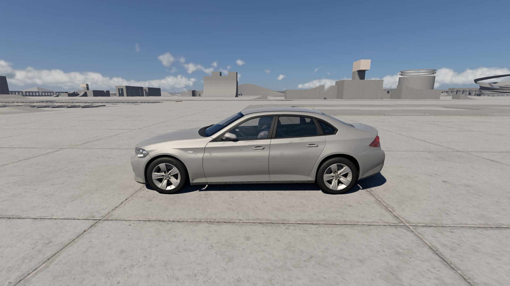
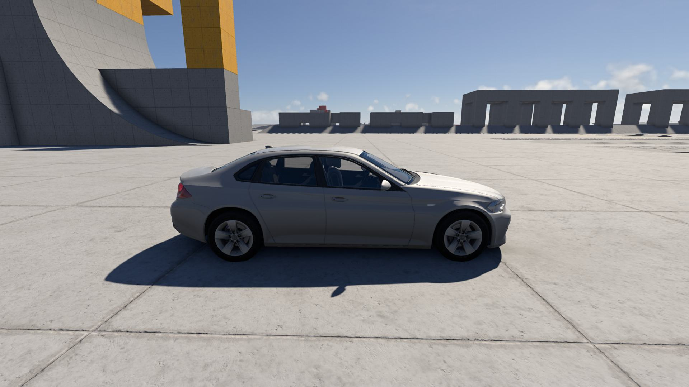
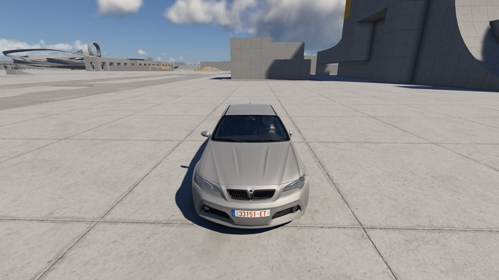
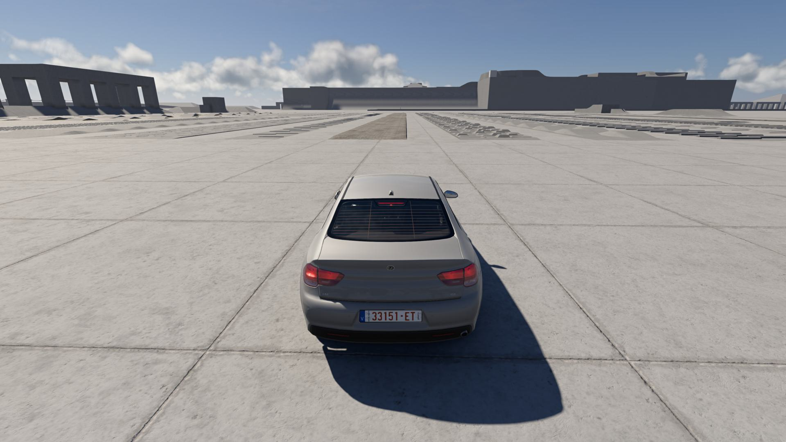
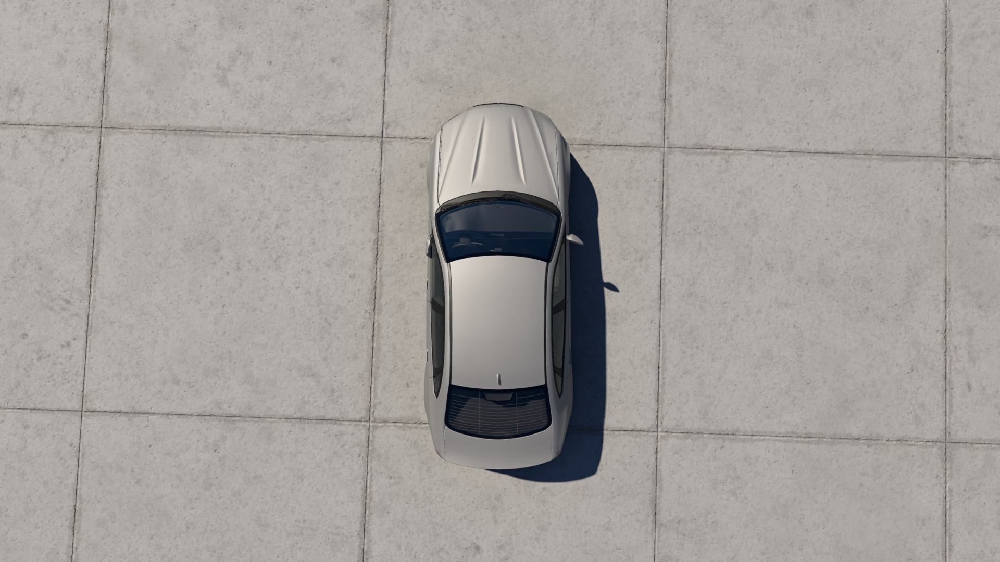

# sideslide - 20261114-174211_sideslide_m5-stock-844_150_A

_on its side, sliding along the ground at 14 m/s - one long scrape_

Remaining queues: `{"bake": 0, "jobs": 0, "stamps": 0}`

Settled: False after 10.007 s - 663 frames, 66.9 fps average from sampled wall intervals (background limiter lifted)
Went past upside down: True (lowest up-vector z -0.479)

## Marks

| contacts | passed filters | impacts | streams | stamps | projections | bakes | missed | jobs dropped | deferred frames |
|---|---|---|---|---|---|---|---|---|---|
| 5354 | 276 | 54 | 51 | 111 | 80 | 48 | 0.0% | 0 | 2 |

Rejected contacts: BelowThresh 3667, Wheel 1388, PartExcluded 23

Body materials: METAL 175, PLASTIC 101

Surfaces: ASPHALT 276

## Cost

| | avg | p95 | max |
|---|---|---|---|
| painter (GE), ms/frame | 3.702 | 40.772 | 54.696 |
| whole frame, ms | 10.862 (p50) | 52.789 | 83.6 |
| all GE Lua, ms | | 42.054 | 55.933 |
| physics + vehicle Lua, ms | | 0.375 | 10.733 |
| render, ms | | 3.176 | |

- Painter frames over 4 ms: 70; worst flush (project + bake) 54.641 ms, worst composite 0.172 ms.
- Detector: 1.713 us per contact, 14.621 ms total, worst frame 1.054 ms (profiled; the timer adds a little).

### Worst frames

| t (s) | frame ms | painter ms | GE Lua ms | physics+VLUA ms | render ms |
|---|---|---|---|---|---|
| 0.39 | 83.60 | 51.89 | 1.11 | 0.06 | 2.69 |
| 0.71 | 69.91 | 45.12 | 50.56 | 0.11 | 2.21 |
| 0.61 | 69.27 | 54.70 | 1.21 | 4.75 | 2.39 |
| 1.25 | 64.15 | 45.57 | 15.01 | 0.21 | 2.40 |
| 1.74 | 63.54 | 47.80 | 1.25 | 5.60 | 2.29 |

## Screenshots

