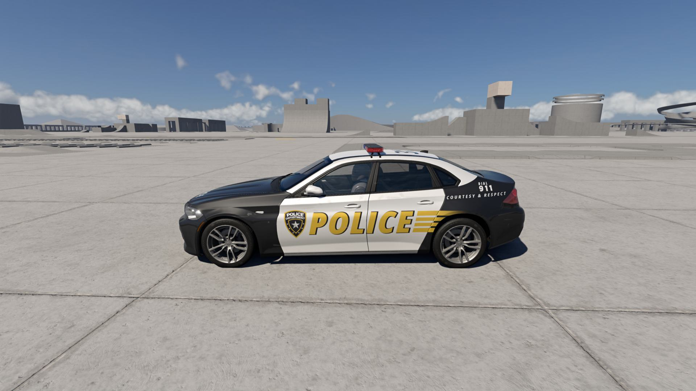
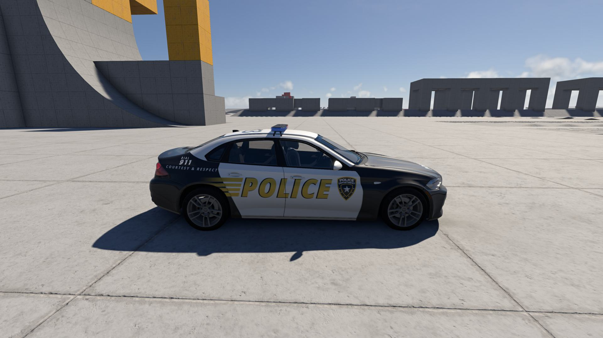
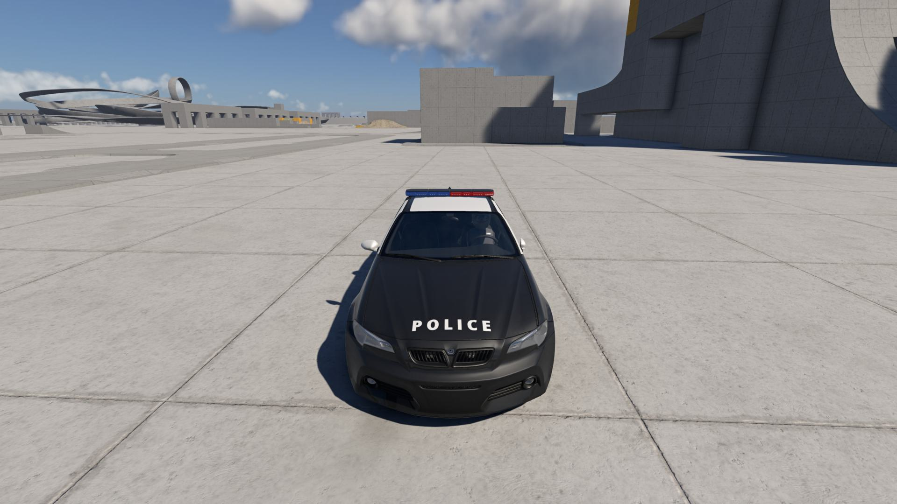
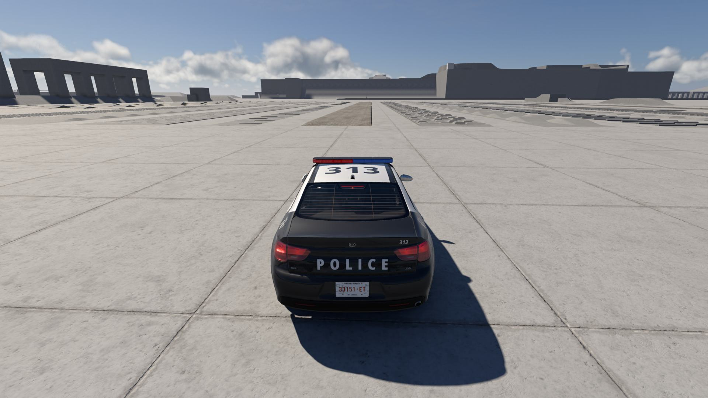
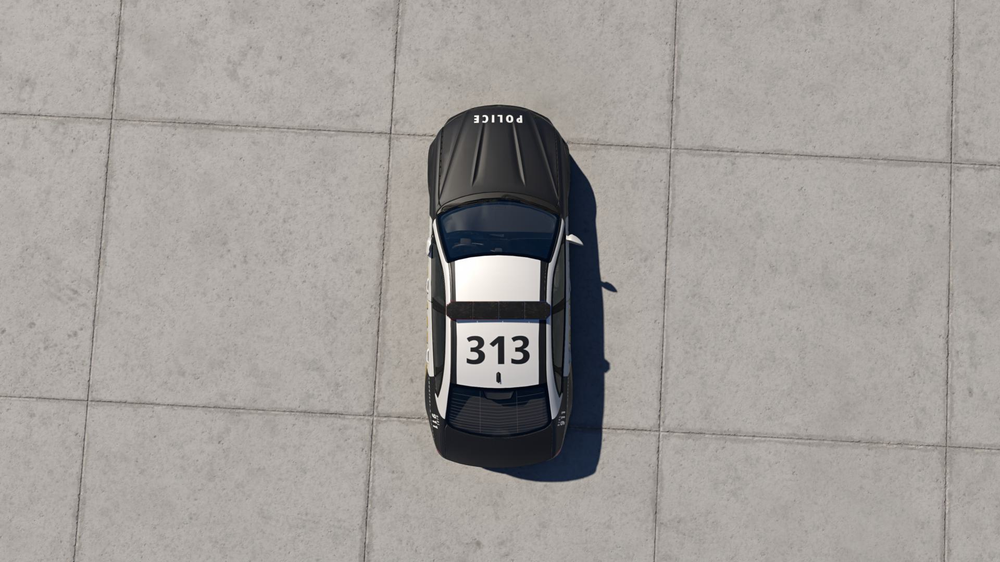

# sideslide - 20261114-174239_sideslide_m5-stock-844_police_A

_on its side, sliding along the ground at 14 m/s - one long scrape_

Remaining queues: `{"bake": 0, "jobs": 0, "stamps": 0}`

Settled: True after 9.937 s - 727 frames, 73.2 fps average from sampled wall intervals (background limiter lifted)
Went past upside down: True (lowest up-vector z -0.48)

## Marks

| contacts | passed filters | impacts | streams | stamps | projections | bakes | missed | jobs dropped | deferred frames |
|---|---|---|---|---|---|---|---|---|---|
| 6049 | 380 | 56 | 66 | 109 | 83 | 55 | 0.0% | 0 | 7 |

Rejected contacts: BelowThresh 3777, Wheel 1861, PartExcluded 31

Body materials: METAL 250, PLASTIC 130

Surfaces: ASPHALT 380

## Cost

| | avg | p95 | max |
|---|---|---|---|
| painter (GE), ms/frame | 3.091 | 31.493 | 62.484 |
| whole frame, ms | 10.929 (p50) | 41.283 | 71.752 |
| all GE Lua, ms | | 32.525 | 63.369 |
| physics + vehicle Lua, ms | | 0.122 | 8.157 |
| render, ms | | 2.591 | |

- Painter frames over 4 ms: 77; worst flush (project + bake) 62.444 ms, worst composite 0.095 ms.
- Detector: 1.238 us per contact, 11.656 ms total, worst frame 0.455 ms (profiled; the timer adds a little).

### Worst frames

| t (s) | frame ms | painter ms | GE Lua ms | physics+VLUA ms | render ms |
|---|---|---|---|---|---|
| 0.39 | 71.75 | 60.96 | 0.87 | 0.06 | 2.08 |
| 0.59 | 68.93 | 62.48 | 0.72 | 0.06 | 1.51 |
| 0.67 | 52.93 | 40.25 | 39.34 | 0.08 | 1.57 |
| 0.19 | 50.94 | 43.73 | 35.31 | 0.08 | 1.85 |
| 0.70 | 48.51 | 36.36 | 41.28 | 0.11 | 1.52 |

## Screenshots

