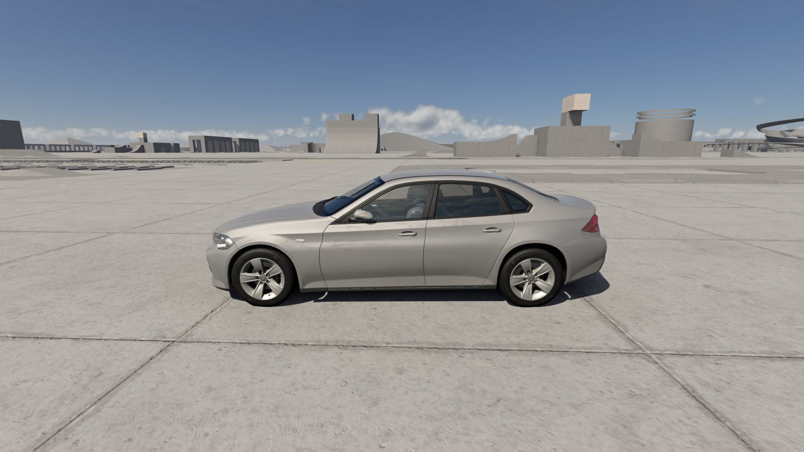
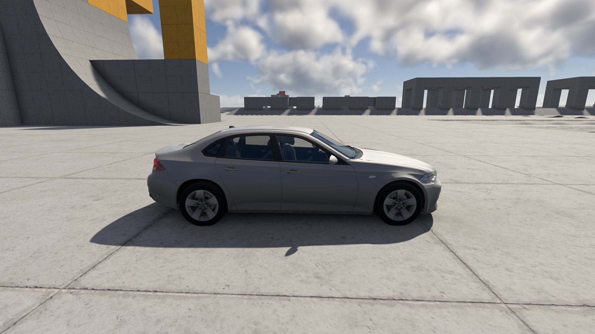
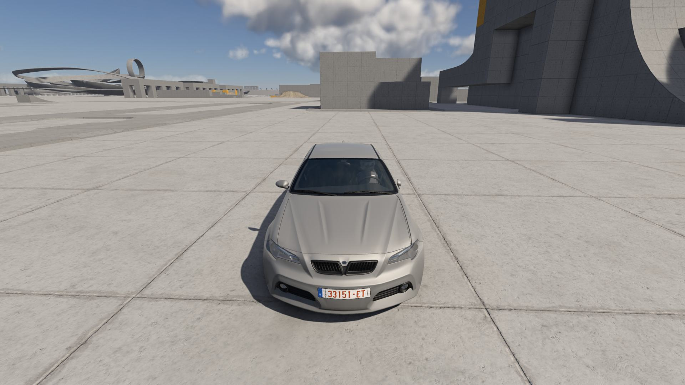
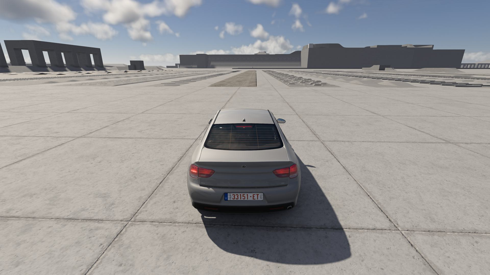
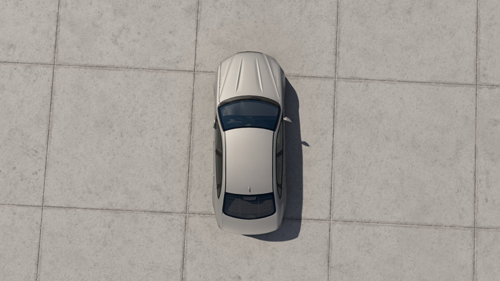

# sideslide - 20261114-225332_sideslide_synth-full-d3d-func-stock-844_150_A

_on its side, sliding along the ground at 14 m/s - one long scrape_

Remaining queues: `{"bake": 0, "jobs": 0, "stamps": 0}`

Tuning: `scratches_paint.setDamageResolution(4096); scratches_paint.setBakeBudget(3); scratches_paint.setFlushInterval(0.05); scratches_paint.setCoverageCoalescing(false); scratches_paint.setPanelGrouping(true)`

Settled: True after 7.633 s - 619 frames, 81.1 fps average from sampled wall intervals (background limiter lifted)
Went past upside down: True (lowest up-vector z -0.481)

## Marks

| contacts | passed filters | impacts | streams | stamps | projections | bakes | missed | jobs dropped | deferred frames |
|---|---|---|---|---|---|---|---|---|---|
| 4373 | 619 | 46 | 81 | 84 | 84 | 99 | 0.0% | 0 | 1 |

Rejected contacts: BelowThresh 2631, Wheel 1070, PartExcluded 51, NormalForce 2

Body materials: METAL 397, PLASTIC 222

Surfaces: ASPHALT 619

## Cost

| | avg | p95 | max |
|---|---|---|---|
| painter (GE), ms/frame | 2.36 | 16.638 | 33.706 |
| whole frame, ms | 10.87 (p50) | 25.421 | 41.845 |
| all GE Lua, ms | | 17.554 | 34.767 |
| physics + vehicle Lua, ms | | 0.094 | 2.723 |
| render, ms | | 2.275 | |

- Painter frames over 4 ms: 99; worst flush (project + bake) 2.311 ms, worst composite 0.096 ms.
- Detector: 1.657 us per contact, 12.497 ms total, worst frame 1.084 ms (profiled; the timer adds a little).

### Worst frames

| t (s) | frame ms | painter ms | GE Lua ms | physics+VLUA ms | render ms |
|---|---|---|---|---|---|
| 0.28 | 41.85 | 33.71 | 24.94 | 0.06 | 1.81 |
| 0.39 | 39.68 | 25.29 | 33.54 | 0.07 | 1.85 |
| 0.24 | 38.99 | 28.09 | 2.82 | 0.06 | 2.30 |
| 0.37 | 38.98 | 32.45 | 3.09 | 0.07 | 1.57 |
| 1.49 | 33.73 | 20.19 | 3.54 | 0.87 | 2.07 |

## Screenshots

