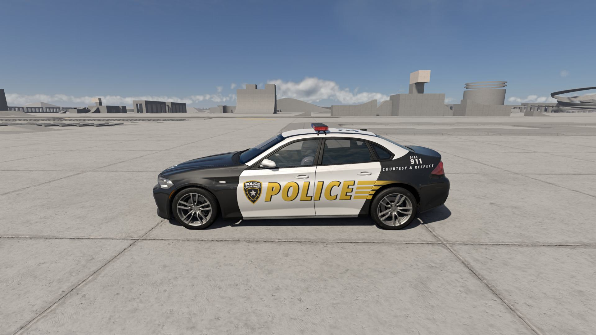
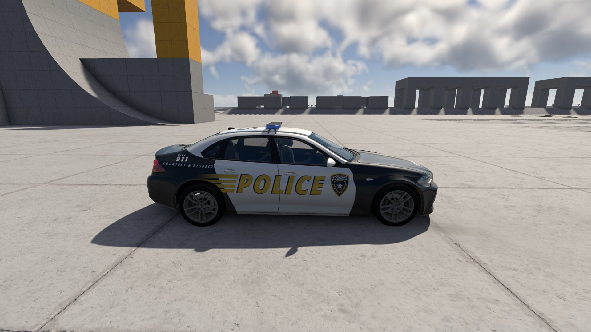
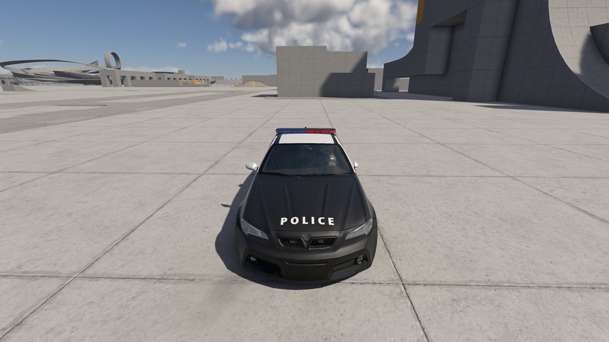
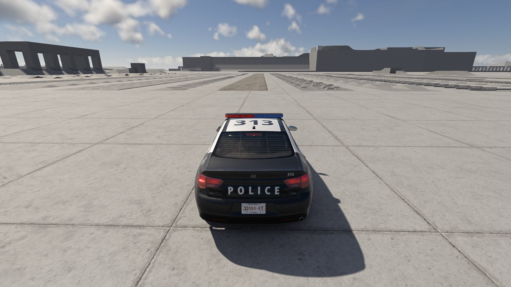
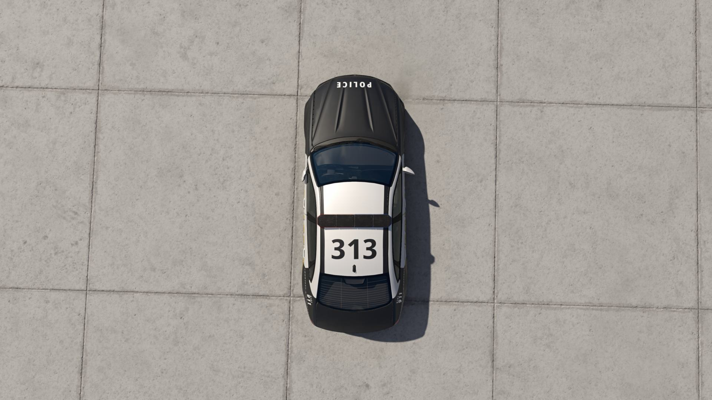

# sideslide - 20261114-225357_sideslide_synth-full-d3d-func-stock-844_police_A

_on its side, sliding along the ground at 14 m/s - one long scrape_

Remaining queues: `{"bake": 0, "jobs": 0, "stamps": 0}`

Tuning: `scratches_paint.setDamageResolution(4096); scratches_paint.setBakeBudget(3); scratches_paint.setFlushInterval(0.05); scratches_paint.setCoverageCoalescing(false); scratches_paint.setPanelGrouping(true)`

Settled: True after 4.406 s - 286 frames, 64.9 fps average from sampled wall intervals (background limiter lifted)
Went past upside down: True (lowest up-vector z -0.48)

## Marks

| contacts | passed filters | impacts | streams | stamps | projections | bakes | missed | jobs dropped | deferred frames |
|---|---|---|---|---|---|---|---|---|---|
| 1292 | 637 | 46 | 85 | 94 | 80 | 100 | 0.0% | 0 | 1 |

Rejected contacts: BelowThresh 461, PartExcluded 125, Wheel 66, NormalForce 3

Body materials: METAL 429, PLASTIC 208

Surfaces: ASPHALT 637

## Cost

| | avg | p95 | max |
|---|---|---|---|
| painter (GE), ms/frame | 5.638 | 19.631 | 33.636 |
| whole frame, ms | 11.337 (p50) | 30.739 | 41.023 |
| all GE Lua, ms | | 20.702 | 34.602 |
| physics + vehicle Lua, ms | | 0.146 | 2.221 |
| render, ms | | 2.666 | |

- Painter frames over 4 ms: 100; worst flush (project + bake) 2.474 ms, worst composite 0.201 ms.
- Detector: 3.691 us per contact, 8.509 ms total, worst frame 0.534 ms (profiled; the timer adds a little).

### Worst frames

| t (s) | frame ms | painter ms | GE Lua ms | physics+VLUA ms | render ms |
|---|---|---|---|---|---|
| 0.36 | 41.02 | 33.64 | 3.33 | 0.06 | 1.75 |
| 2.72 | 40.67 | 23.27 | 2.67 | 0.11 | 2.33 |
| 0.19 | 39.59 | 29.24 | 2.00 | 0.13 | 1.86 |
| 0.24 | 38.08 | 27.89 | 3.08 | 0.08 | 2.65 |
| 0.78 | 35.30 | 17.98 | 18.65 | 0.15 | 1.59 |

## Screenshots

