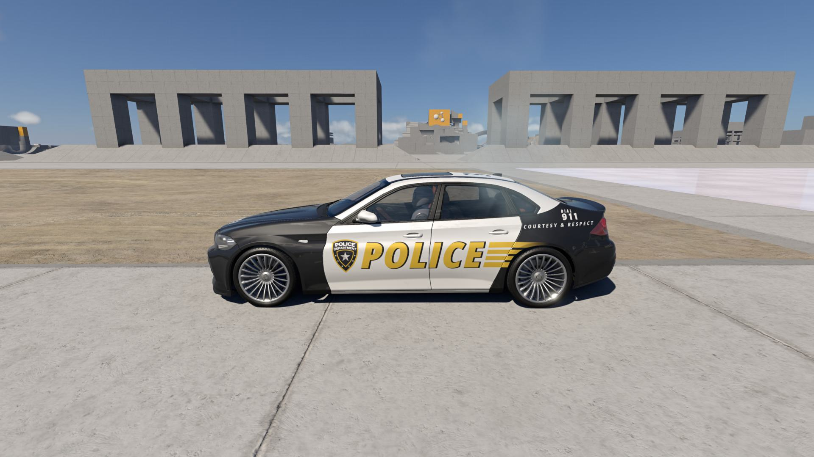
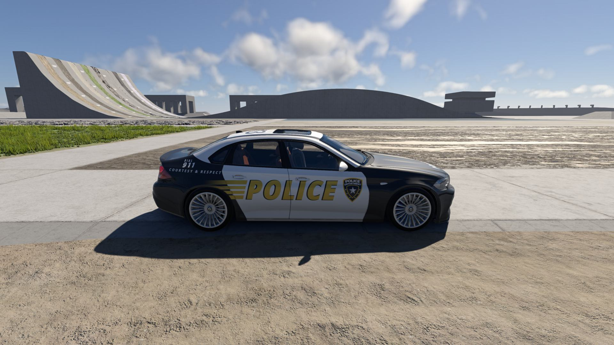
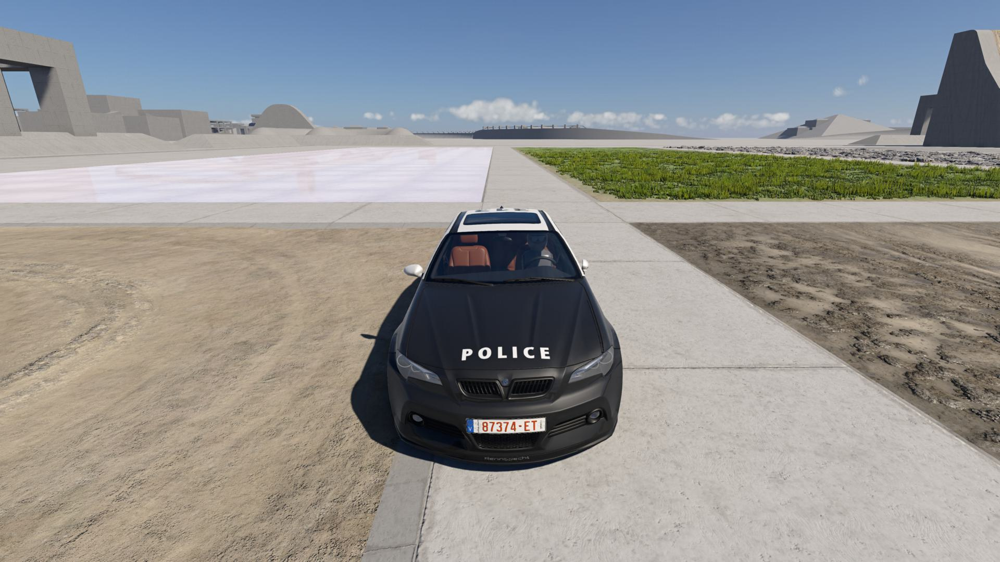
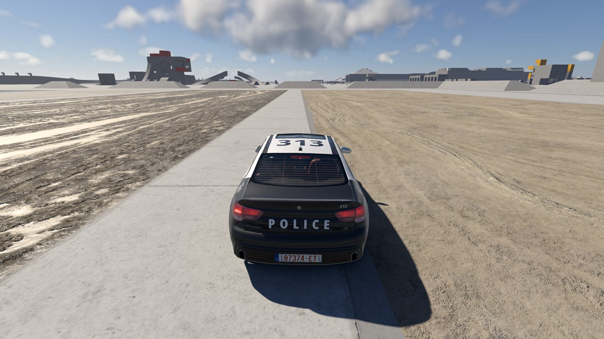
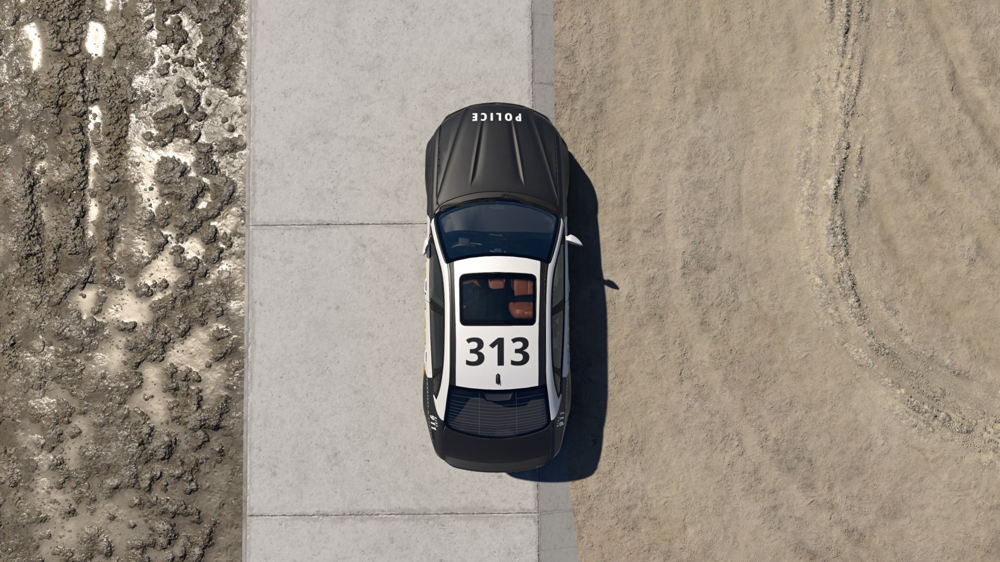

# sideslide - 20261114-225815_sideslide_synth-full-d3d-func-wash

_on its side, sliding along the ground at 14 m/s - one long scrape_

Remaining queues: `{"bake": 0, "jobs": 0, "stamps": 0}`

Tuning: `scratches_paint.setDamageResolution(4096); scratches_paint.setBakeBudget(3); scratches_paint.setFlushInterval(0.05); scratches_paint.setPanelGrouping(true); scratches_paint.setCoverageCoalescing(false)`

Settled: True after 4.402 s - 309 frames, 69.6 fps average from sampled wall intervals (background limiter lifted)
Went past upside down: True (lowest up-vector z -0.485)

## Marks

| contacts | passed filters | impacts | streams | stamps | projections | bakes | missed | jobs dropped | deferred frames |
|---|---|---|---|---|---|---|---|---|---|
| 1288 | 694 | 52 | 84 | 88 | 71 | 97 | 0.0% | 0 | 1 |

Rejected contacts: BelowThresh 371, PartExcluded 121, Wheel 99, NormalForce 3

Body materials: METAL 453, PLASTIC 241

Surfaces: ASPHALT 694

## Cost

| | avg | p95 | max |
|---|---|---|---|
| painter (GE), ms/frame | 4.642 | 17.991 | 30.34 |
| whole frame, ms | 11.955 (p50) | 28.061 | 37.179 |
| all GE Lua, ms | | 19.228 | 31.108 |
| physics + vehicle Lua, ms | | 0.101 | 2.717 |
| render, ms | | 2.378 | |

- Painter frames over 4 ms: 97; worst flush (project + bake) 2.578 ms, worst composite 0.177 ms.
- Detector: 3.649 us per contact, 8.017 ms total, worst frame 0.594 ms (profiled; the timer adds a little).

### Worst frames

| t (s) | frame ms | painter ms | GE Lua ms | physics+VLUA ms | render ms |
|---|---|---|---|---|---|
| 0.35 | 37.18 | 30.34 | 2.71 | 0.07 | 1.63 |
| 0.26 | 33.98 | 26.56 | 24.61 | 0.08 | 1.91 |
| 0.24 | 33.62 | 23.66 | 2.78 | 0.06 | 1.87 |
| 0.37 | 33.42 | 23.73 | 31.11 | 0.05 | 1.81 |
| 1.58 | 31.42 | 20.52 | 2.81 | 0.08 | 2.32 |

## Screenshots

