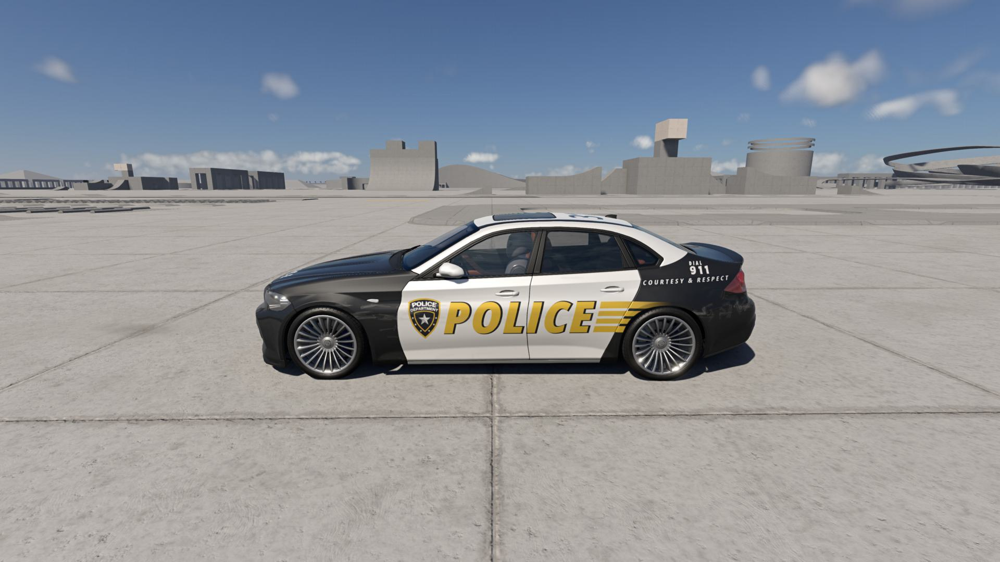
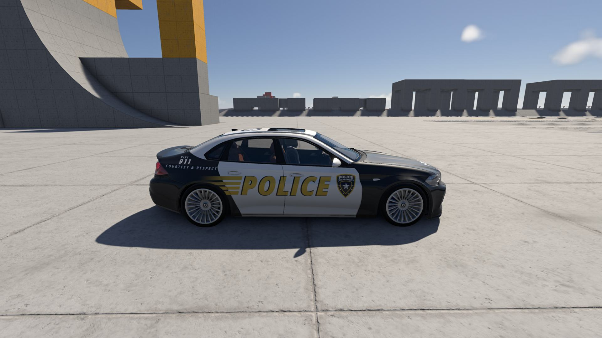
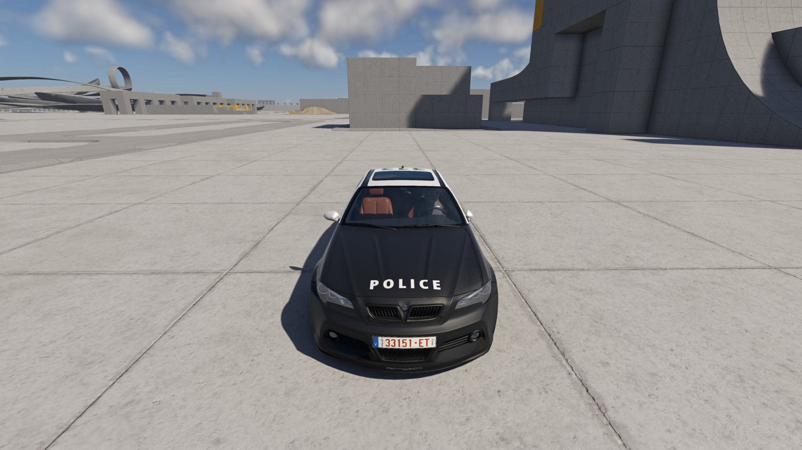
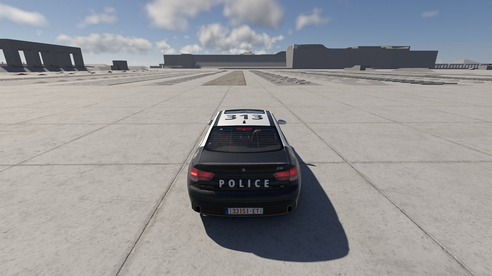
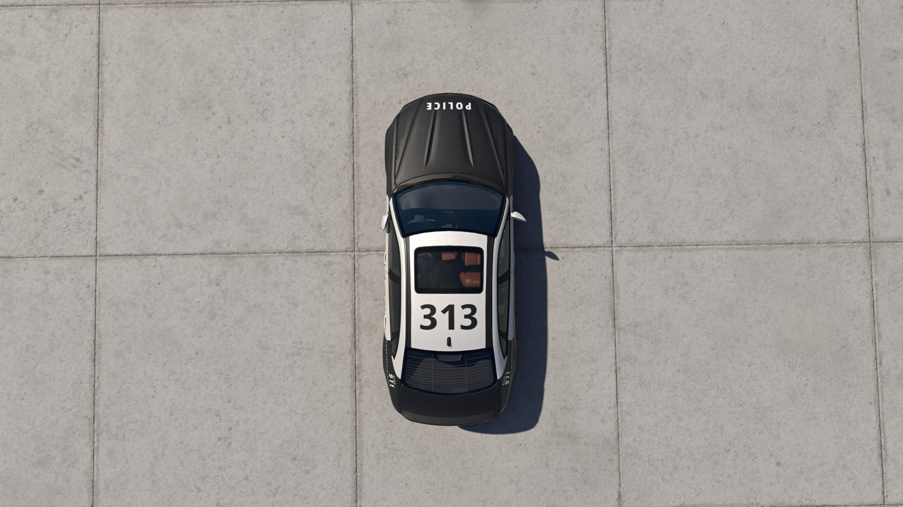

# sideslide - 20261114-223004_sideslide_synth-full-d3d12-cold_r1

_on its side, sliding along the ground at 14 m/s - one long scrape_

Remaining queues: `{"bake": 0, "jobs": 0, "stamps": 0}`

Tuning: `if scratches_detect then scratches_detect.setPaintEnabled(true) end; scratches_paint.setDamageResolution(4096); scratches_paint.setBakeBudget(3); scratches_paint.setFlushInterval(0.05); scratches_paint.setProjectionBudget(6); scratches_paint.setLayerBudget(24); scratches_paint.setCoverageCoalescing(false); scratches_paint.setPanelGrouping(true); scratches_paint.setSyntheticAnchors(true)`

Settled: True after 4.059 s - 296 frames, 59.5 fps average from sampled wall intervals (background limiter lifted)
Went past upside down: True (lowest up-vector z -0.144)

## Marks

| contacts | passed filters | impacts | streams | stamps | projections | bakes | missed | jobs dropped | deferred frames |
|---|---|---|---|---|---|---|---|---|---|
| 3098 | 644 | 73 | 109 | 111 | 100 | 117 | 0.0% | 0 | 1 |

Rejected contacts: Wheel 1700, BelowThresh 749, NormalForce 5

Body materials: METAL 490, PLASTIC 154

Surfaces: ASPHALT 644

## Cost

| | avg | p95 | max |
|---|---|---|---|
| painter (GE), ms/frame | 6.87 | 20.797 | 31.791 |
| whole frame, ms | 11.236 (p50) | 31.324 | 41.423 |
| all GE Lua, ms | | 21.8 | 32.621 |
| physics + vehicle Lua, ms | | 0.109 | 0.772 |
| render, ms | | 2.313 | |

- Painter frames over 4 ms: 117; worst flush (project + bake) 2.097 ms, worst composite 0.098 ms.
- Detector: 1.651 us per contact, 10.413 ms total, worst frame 0.771 ms (profiled; the timer adds a little).

### Worst frames

| t (s) | frame ms | painter ms | GE Lua ms | physics+VLUA ms | render ms |
|---|---|---|---|---|---|
| 0.19 | 41.42 | 30.95 | 1.26 | 0.09 | 1.95 |
| 0.32 | 39.16 | 31.79 | 2.89 | 0.05 | 1.69 |
| 0.26 | 37.70 | 28.20 | 29.11 | 0.08 | 1.86 |
| 0.25 | 37.68 | 27.95 | 25.83 | 0.06 | 2.37 |
| 0.34 | 37.57 | 21.47 | 32.62 | 0.11 | 2.21 |

## Screenshots

