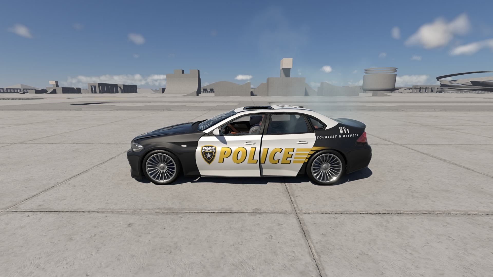
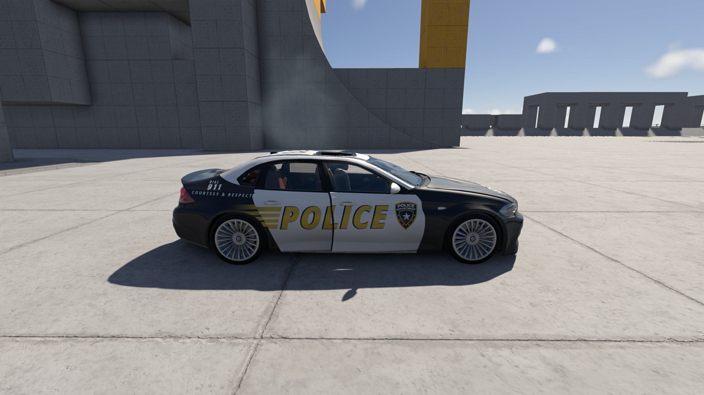
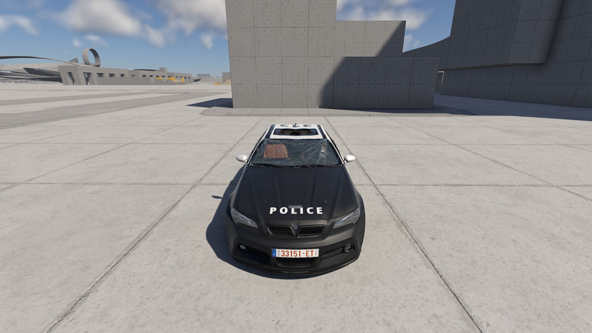
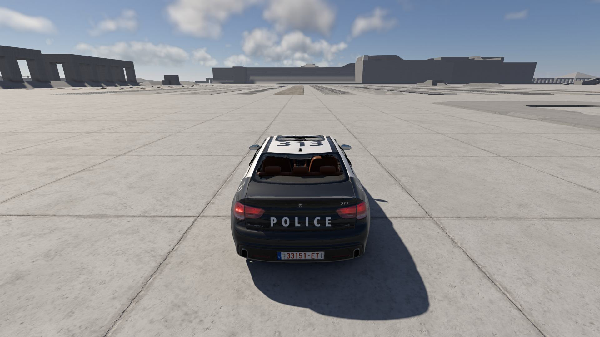
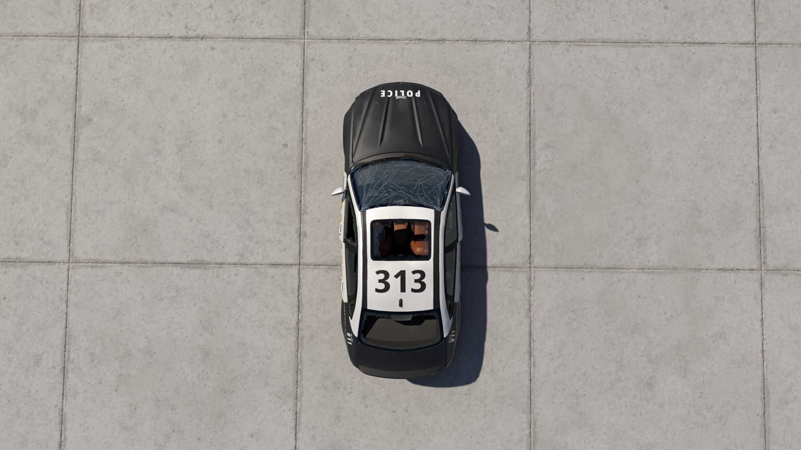

# roofdrop - 20261114-223021_roofdrop_synth-full-d3d12-cold_r1

_dropped upside down from about 1 m - roof impacts_

Remaining queues: `{"bake": 0, "jobs": 0, "stamps": 0}`

Tuning: `if scratches_detect then scratches_detect.setPaintEnabled(true) end; scratches_paint.setDamageResolution(4096); scratches_paint.setBakeBudget(3); scratches_paint.setFlushInterval(0.05); scratches_paint.setProjectionBudget(6); scratches_paint.setLayerBudget(24); scratches_paint.setCoverageCoalescing(false); scratches_paint.setPanelGrouping(true); scratches_paint.setSyntheticAnchors(true)`

Settled: True after 5.133 s - 454 frames, 88.2 fps average from sampled wall intervals (background limiter lifted)
Went past upside down: True (lowest up-vector z -1.0)

## Marks

| contacts | passed filters | impacts | streams | stamps | projections | bakes | missed | jobs dropped | deferred frames |
|---|---|---|---|---|---|---|---|---|---|
| 1235 | 51 | 51 | 0 | 53 | 15 | 22 | 0.0% | 0 | 0 |

Rejected contacts: PartExcluded 712, BelowThresh 472

Body materials: METAL 49, PLASTIC 2

Surfaces: ASPHALT 51

## Cost

| | avg | p95 | max |
|---|---|---|---|
| painter (GE), ms/frame | 0.774 | 0.832 | 27.564 |
| whole frame, ms | 11.01 (p50) | 16.028 | 38.003 |
| all GE Lua, ms | | 1.612 | 28.446 |
| physics + vehicle Lua, ms | | 0.069 | 0.122 |
| render, ms | | 2.177 | |

- Painter frames over 4 ms: 22; worst flush (project + bake) 0.803 ms, worst composite 0.066 ms.
- Detector: 1.398 us per contact, 4.175 ms total, worst frame 0.569 ms (profiled; the timer adds a little).

### Worst frames

| t (s) | frame ms | painter ms | GE Lua ms | physics+VLUA ms | render ms |
|---|---|---|---|---|---|
| 0.54 | 38.00 | 27.56 | 1.65 | 0.10 | 2.40 |
| 0.82 | 32.25 | 20.86 | 1.26 | 0.07 | 2.18 |
| 0.55 | 31.12 | 23.92 | 28.45 | 0.11 | 1.70 |
| 0.90 | 28.30 | 21.59 | 17.77 | 0.05 | 1.59 |
| 1.51 | 28.04 | 16.89 | 1.42 | 0.04 | 1.79 |

## Screenshots

