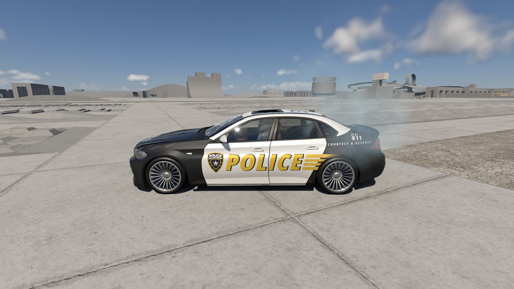
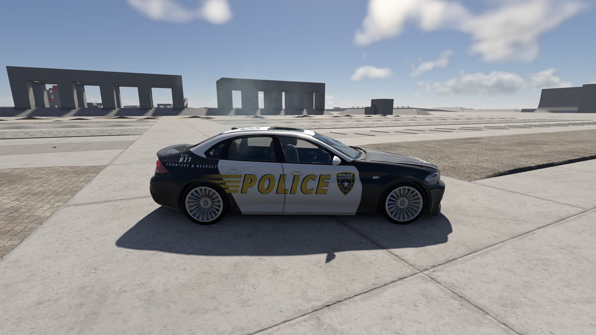
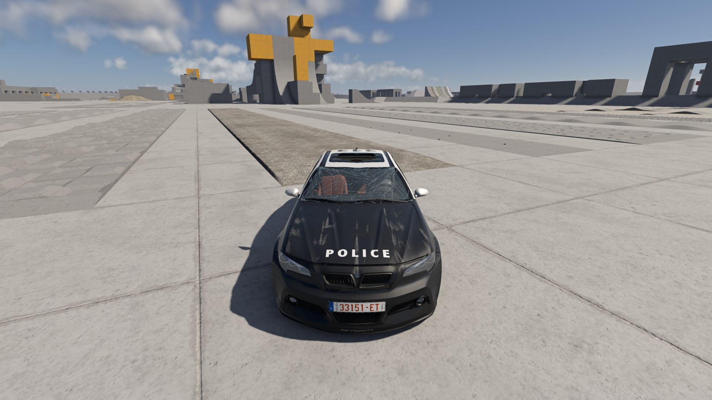
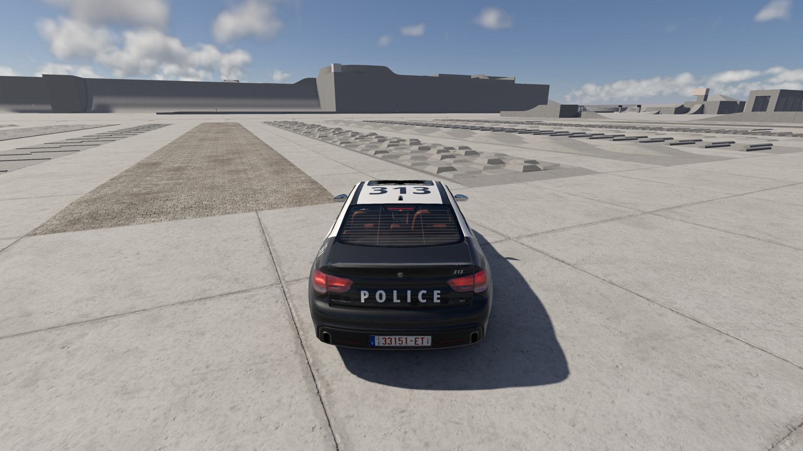
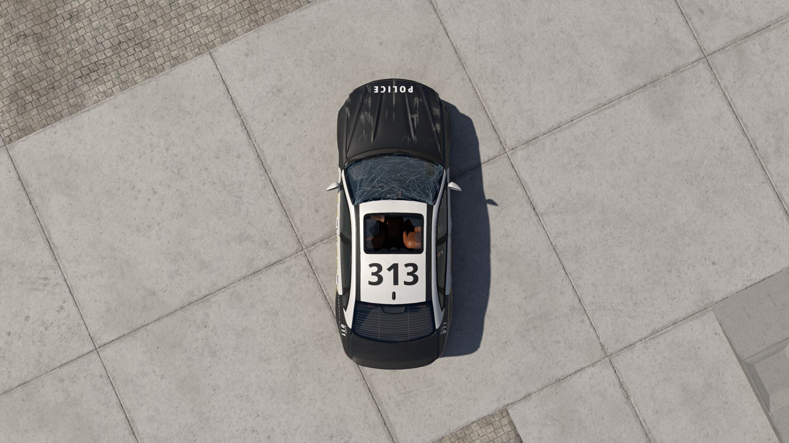

# sustained - 20261114-223039_sustained_synth-full-d3d12-cold_r1

_assisted roof scrape v2: additive translation to 4 m/s for 30 seconds, preserving internal node motion; real collisions_

Remaining queues: `{"bake": 0, "jobs": 0, "stamps": 0}`

Tuning: `if scratches_detect then scratches_detect.setPaintEnabled(true) end; scratches_paint.setDamageResolution(4096); scratches_paint.setBakeBudget(3); scratches_paint.setFlushInterval(0.05); scratches_paint.setProjectionBudget(6); scratches_paint.setLayerBudget(24); scratches_paint.setCoverageCoalescing(false); scratches_paint.setPanelGrouping(true); scratches_paint.setSyntheticAnchors(true)`

Settled: False after 30.005 s - 2698 frames, 89.9 fps average from sampled wall intervals (background limiter lifted)
Went past upside down: True (lowest up-vector z -1.0)

## Marks

| contacts | passed filters | impacts | streams | stamps | projections | bakes | missed | jobs dropped | deferred frames |
|---|---|---|---|---|---|---|---|---|---|
| 18977 | 11771 | 35 | 602 | 82 | 170 | 183 | 0.0% | 0 | 0 |

Rejected contacts: PartExcluded 6114, BelowThresh 1071, NormalForce 21

Body materials: METAL 11761, PLASTIC 10

Surfaces: ASPHALT 10741, COBBLESTONE 1030

## Cost

| | avg | p95 | max |
|---|---|---|---|
| painter (GE), ms/frame | 0.862 | 9.953 | 28.96 |
| whole frame, ms | 10.816 (p50) | 18.887 | 35.958 |
| all GE Lua, ms | | 10.906 | 29.881 |
| physics + vehicle Lua, ms | | 0.076 | 0.614 |
| render, ms | | 2.195 | |

- Painter frames over 4 ms: 183; worst flush (project + bake) 1.648 ms, worst composite 0.103 ms.
- Detector: 3.531 us per contact, 89.21 ms total, worst frame 1.789 ms (profiled; the timer adds a little).

### Worst frames

| t (s) | frame ms | painter ms | GE Lua ms | physics+VLUA ms | render ms |
|---|---|---|---|---|---|
| 0.41 | 35.96 | 28.96 | 1.44 | 0.04 | 1.72 |
| 0.36 | 35.27 | 27.63 | 25.17 | 0.06 | 1.86 |
| 13.01 | 34.36 | 23.90 | 1.48 | 0.05 | 1.86 |
| 0.34 | 34.05 | 24.29 | 1.54 | 0.05 | 1.65 |
| 30.00 | 33.60 | 18.97 | 1.58 | 0.06 | 2.88 |

## Screenshots

