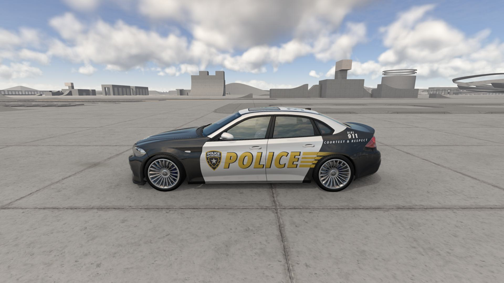
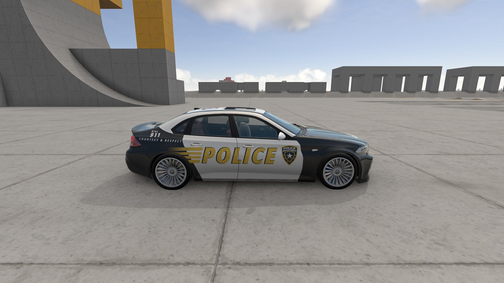
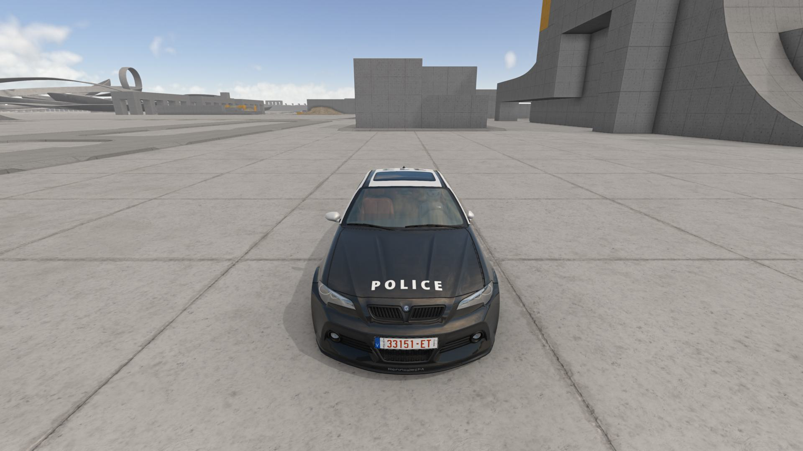
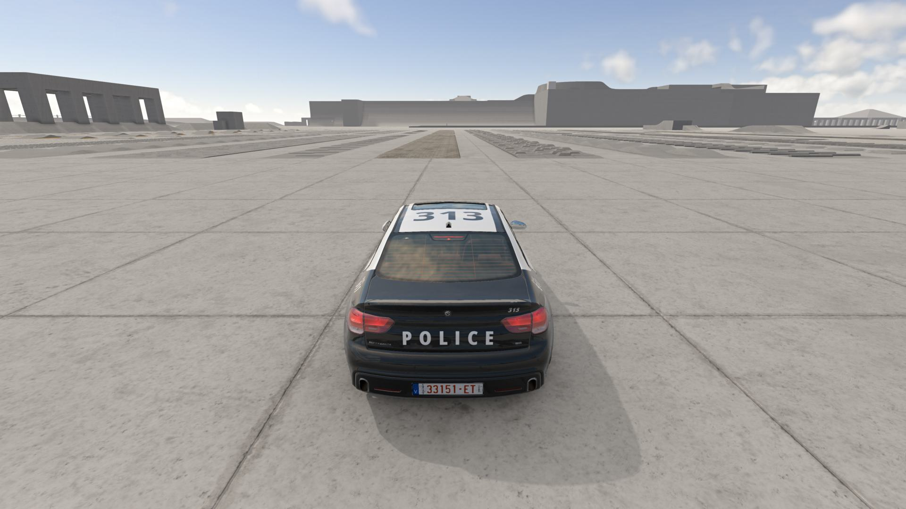
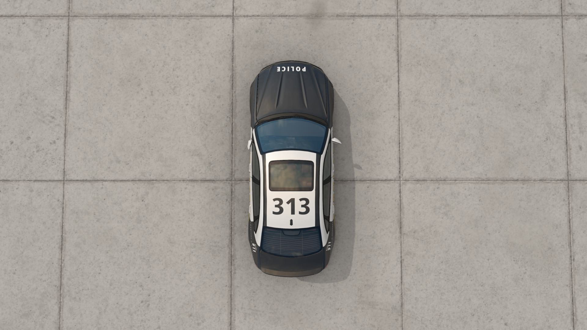

# sideslide - 20261114-223459_sideslide_synth-full-d3d12-warm_r1

_on its side, sliding along the ground at 14 m/s - one long scrape_

Remaining queues: `{"bake": 0, "jobs": 0, "stamps": 0}`

Tuning: `if scratches_detect then scratches_detect.setPaintEnabled(true) end; scratches_paint.setDamageResolution(4096); scratches_paint.setBakeBudget(3); scratches_paint.setFlushInterval(0.05); scratches_paint.setProjectionBudget(6); scratches_paint.setLayerBudget(24); scratches_paint.setCoverageCoalescing(false); scratches_paint.setPanelGrouping(true); scratches_paint.setSyntheticAnchors(true)`

Settled: True after 4.167 s - 258 frames, 59.4 fps average from sampled wall intervals (background limiter lifted)
Went past upside down: True (lowest up-vector z -0.155)

## Marks

| contacts | passed filters | impacts | streams | stamps | projections | bakes | missed | jobs dropped | deferred frames |
|---|---|---|---|---|---|---|---|---|---|
| 2622 | 509 | 70 | 98 | 115 | 81 | 109 | 0.0% | 0 | 1 |

Rejected contacts: Wheel 1465, BelowThresh 645, NormalForce 3

Body materials: METAL 375, PLASTIC 134

Surfaces: ASPHALT 509

## Cost

| | avg | p95 | max |
|---|---|---|---|
| painter (GE), ms/frame | 7.028 | 19.281 | 34.561 |
| whole frame, ms | 11.871 (p50) | 30.577 | 41.245 |
| all GE Lua, ms | | 20.39 | 35.41 |
| physics + vehicle Lua, ms | | 0.119 | 1.242 |
| render, ms | | 2.689 | |

- Painter frames over 4 ms: 109; worst flush (project + bake) 2.499 ms, worst composite 0.105 ms.
- Detector: 1.598 us per contact, 7.459 ms total, worst frame 0.5 ms (profiled; the timer adds a little).

### Worst frames

| t (s) | frame ms | painter ms | GE Lua ms | physics+VLUA ms | render ms |
|---|---|---|---|---|---|
| 0.33 | 41.25 | 34.56 | 3.33 | 0.06 | 1.52 |
| 0.19 | 39.02 | 28.27 | 1.43 | 0.06 | 2.77 |
| 0.24 | 38.85 | 31.00 | 2.71 | 0.07 | 2.07 |
| 0.65 | 37.52 | 20.12 | 18.86 | 0.08 | 1.79 |
| 3.02 | 33.97 | 18.33 | 1.96 | 0.08 | 1.62 |

## Screenshots

