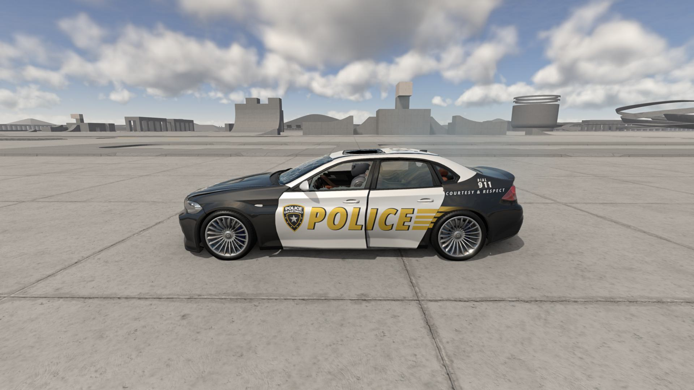
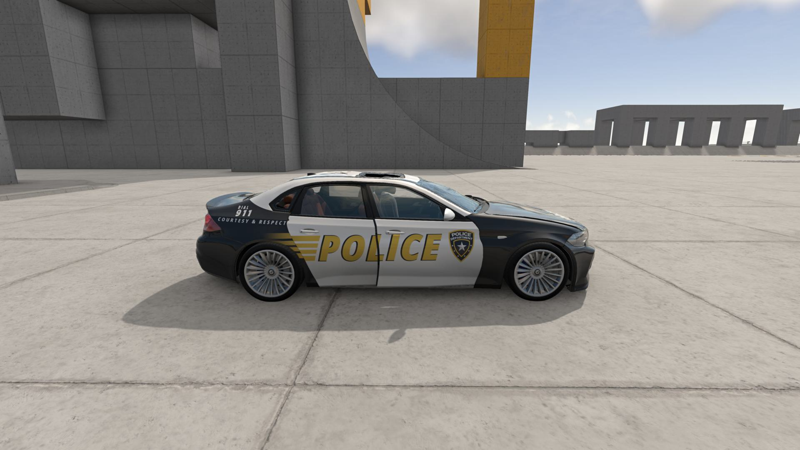
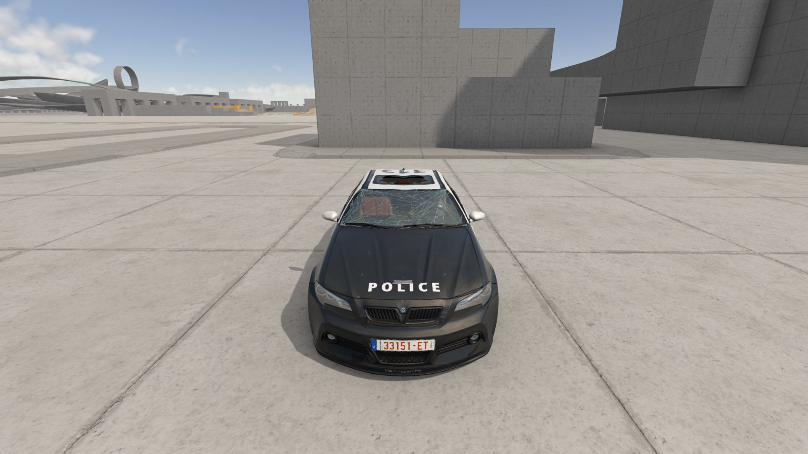
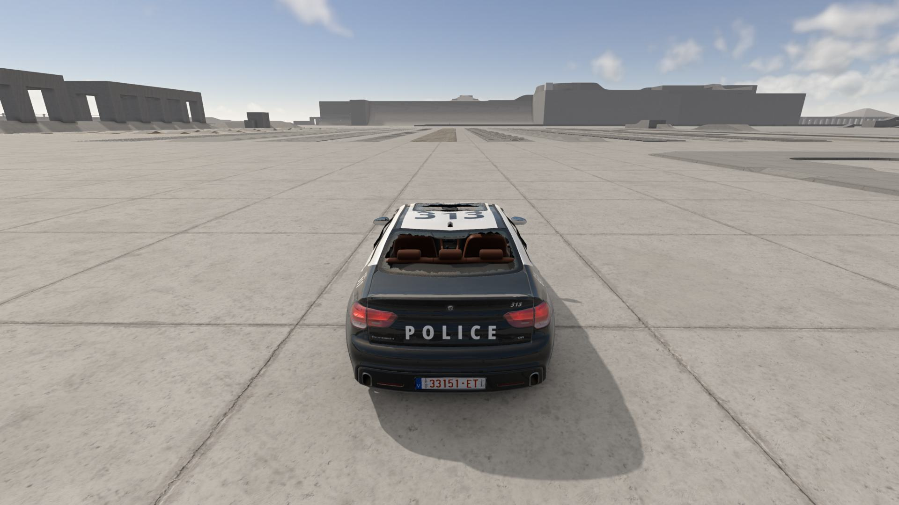
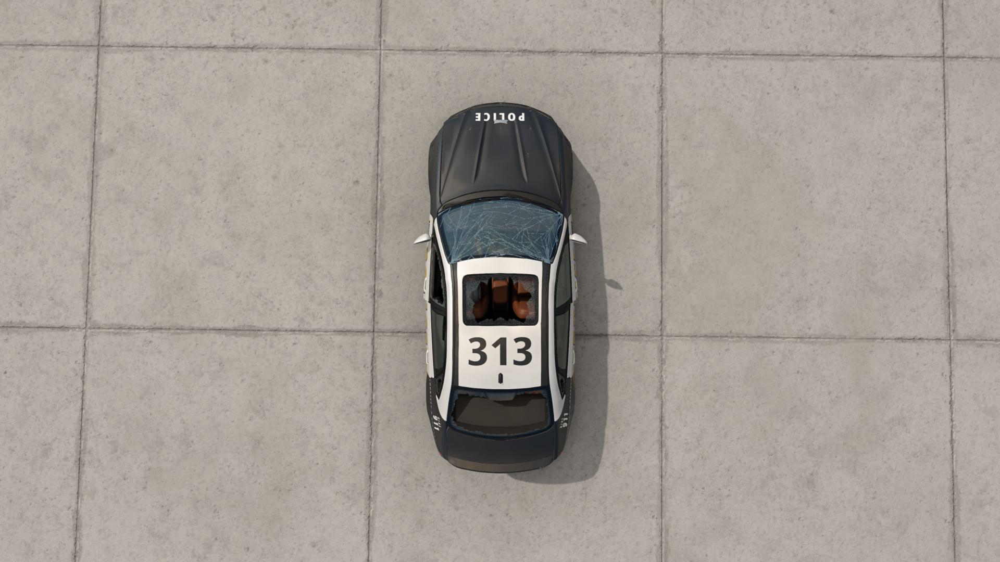

# roofdrop - 20261114-223516_roofdrop_synth-full-d3d12-warm_r1

_dropped upside down from about 1 m - roof impacts_

Remaining queues: `{"bake": 0, "jobs": 0, "stamps": 0}`

Tuning: `if scratches_detect then scratches_detect.setPaintEnabled(true) end; scratches_paint.setDamageResolution(4096); scratches_paint.setBakeBudget(3); scratches_paint.setFlushInterval(0.05); scratches_paint.setProjectionBudget(6); scratches_paint.setLayerBudget(24); scratches_paint.setCoverageCoalescing(false); scratches_paint.setPanelGrouping(true); scratches_paint.setSyntheticAnchors(true)`

Settled: True after 4.978 s - 430 frames, 86.2 fps average from sampled wall intervals (background limiter lifted)
Went past upside down: True (lowest up-vector z -1.0)

## Marks

| contacts | passed filters | impacts | streams | stamps | projections | bakes | missed | jobs dropped | deferred frames |
|---|---|---|---|---|---|---|---|---|---|
| 1175 | 53 | 53 | 0 | 59 | 15 | 25 | 0.0% | 0 | 0 |

Rejected contacts: PartExcluded 669, BelowThresh 453

Body materials: METAL 51, PLASTIC 2

Surfaces: ASPHALT 53

## Cost

| | avg | p95 | max |
|---|---|---|---|
| painter (GE), ms/frame | 0.92 | 6.315 | 27.859 |
| whole frame, ms | 11.217 (p50) | 15.903 | 39.333 |
| all GE Lua, ms | | 8.664 | 28.832 |
| physics + vehicle Lua, ms | | 0.073 | 0.19 |
| render, ms | | 2.136 | |

- Painter frames over 4 ms: 25; worst flush (project + bake) 1.106 ms, worst composite 0.09 ms.
- Detector: 1.363 us per contact, 3.973 ms total, worst frame 0.636 ms (profiled; the timer adds a little).

### Worst frames

| t (s) | frame ms | painter ms | GE Lua ms | physics+VLUA ms | render ms |
|---|---|---|---|---|---|
| 0.54 | 39.33 | 27.86 | 1.54 | 0.10 | 2.31 |
| 0.61 | 32.28 | 25.49 | 22.90 | 0.06 | 1.35 |
| 0.82 | 30.63 | 18.80 | 1.37 | 0.07 | 1.90 |
| 1.47 | 29.35 | 17.47 | 1.18 | 0.04 | 2.37 |
| 1.52 | 29.27 | 17.14 | 1.52 | 0.04 | 1.87 |

## Screenshots

