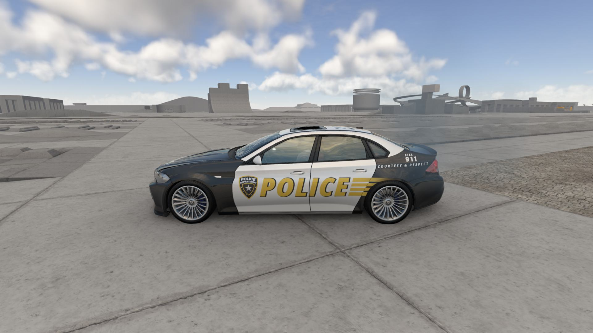
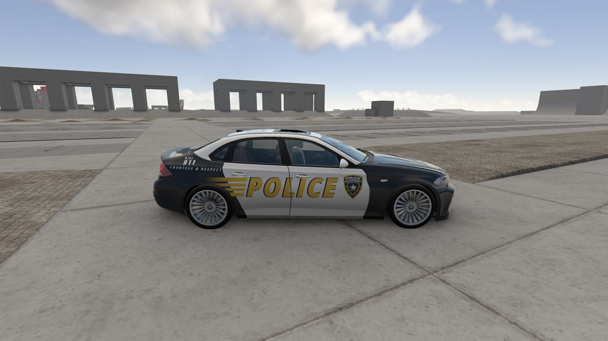
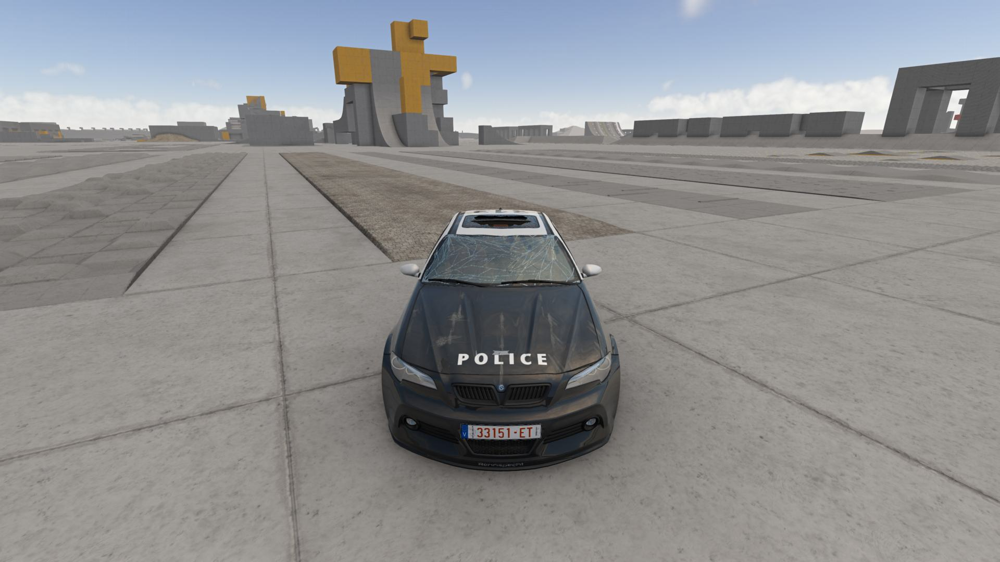
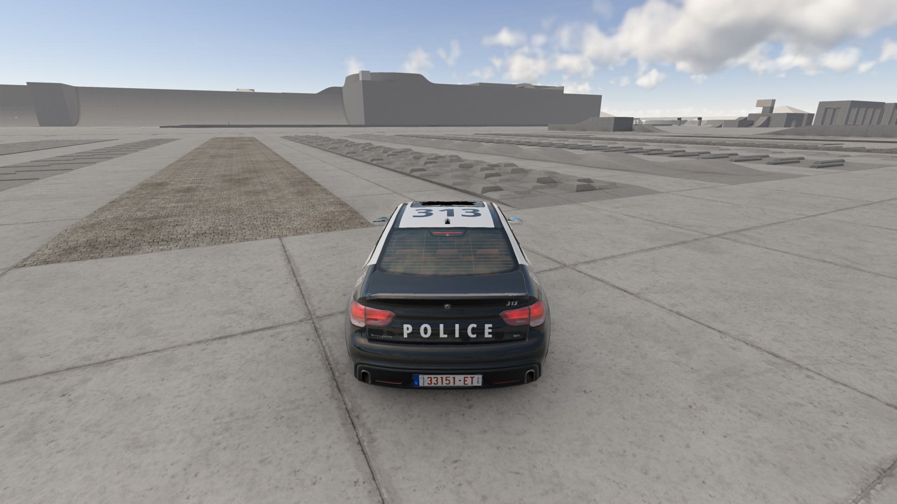
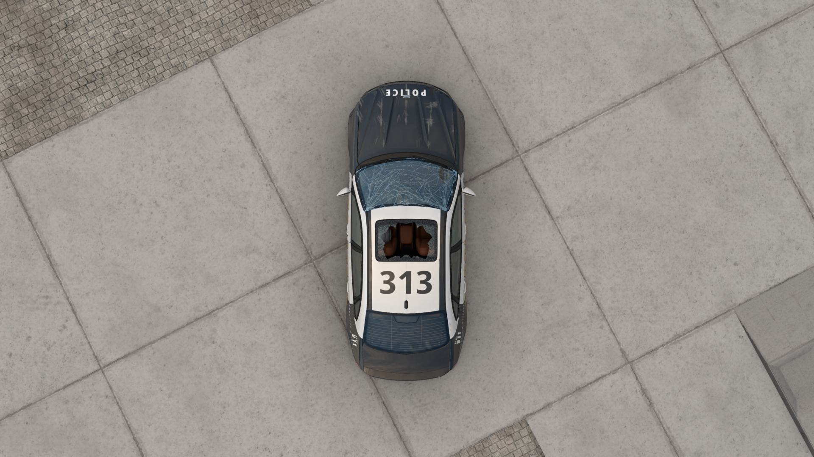

# sustained - 20261114-223534_sustained_synth-full-d3d12-warm_r1

_assisted roof scrape v2: additive translation to 4 m/s for 30 seconds, preserving internal node motion; real collisions_

Remaining queues: `{"bake": 0, "jobs": 0, "stamps": 0}`

Tuning: `if scratches_detect then scratches_detect.setPaintEnabled(true) end; scratches_paint.setDamageResolution(4096); scratches_paint.setBakeBudget(3); scratches_paint.setFlushInterval(0.05); scratches_paint.setProjectionBudget(6); scratches_paint.setLayerBudget(24); scratches_paint.setCoverageCoalescing(false); scratches_paint.setPanelGrouping(true); scratches_paint.setSyntheticAnchors(true)`

Settled: False after 30.011 s - 2637 frames, 87.9 fps average from sampled wall intervals (background limiter lifted)
Went past upside down: True (lowest up-vector z -1.0)

## Marks

| contacts | passed filters | impacts | streams | stamps | projections | bakes | missed | jobs dropped | deferred frames |
|---|---|---|---|---|---|---|---|---|---|
| 16058 | 8006 | 48 | 502 | 95 | 154 | 176 | 0.0% | 0 | 0 |

Rejected contacts: PartExcluded 6664, BelowThresh 1363, NormalForce 25

Body materials: METAL 7954, PLASTIC 52

Surfaces: ASPHALT 7801, COBBLESTONE 205

## Cost

| | avg | p95 | max |
|---|---|---|---|
| painter (GE), ms/frame | 0.88 | 6.644 | 34.943 |
| whole frame, ms | 10.847 (p50) | 18.149 | 43.126 |
| all GE Lua, ms | | 7.829 | 36.044 |
| physics + vehicle Lua, ms | | 0.091 | 1.846 |
| render, ms | | 2.563 | |

- Painter frames over 4 ms: 176; worst flush (project + bake) 2.141 ms, worst composite 0.162 ms.
- Detector: 3.384 us per contact, 76.118 ms total, worst frame 0.558 ms (profiled; the timer adds a little).

### Worst frames

| t (s) | frame ms | painter ms | GE Lua ms | physics+VLUA ms | render ms |
|---|---|---|---|---|---|
| 0.41 | 43.13 | 32.83 | 1.93 | 0.09 | 1.45 |
| 0.35 | 41.85 | 34.94 | 2.17 | 0.07 | 1.63 |
| 3.12 | 36.34 | 26.72 | 1.75 | 0.06 | 2.19 |
| 0.47 | 36.33 | 27.28 | 2.34 | 0.08 | 1.71 |
| 0.29 | 35.68 | 21.41 | 2.70 | 0.09 | 1.96 |

## Screenshots

