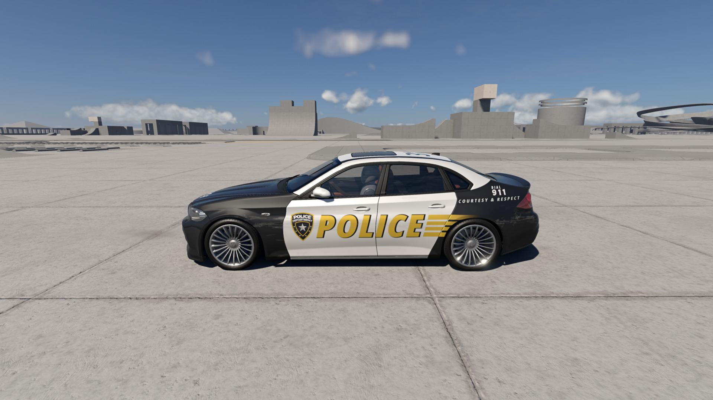
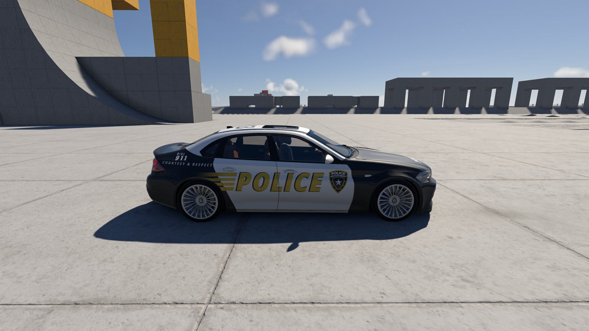
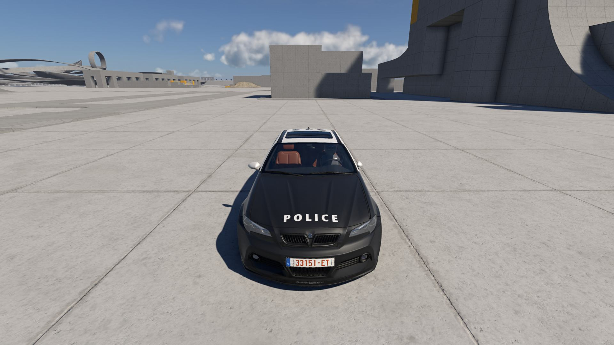
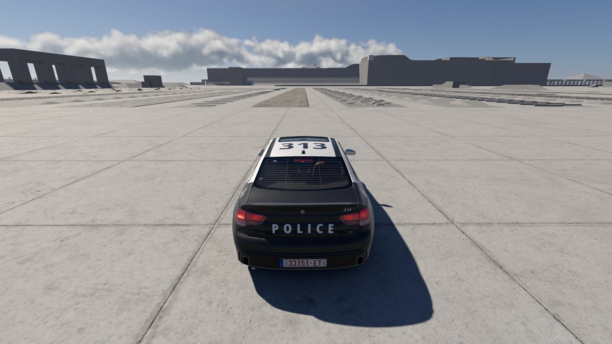
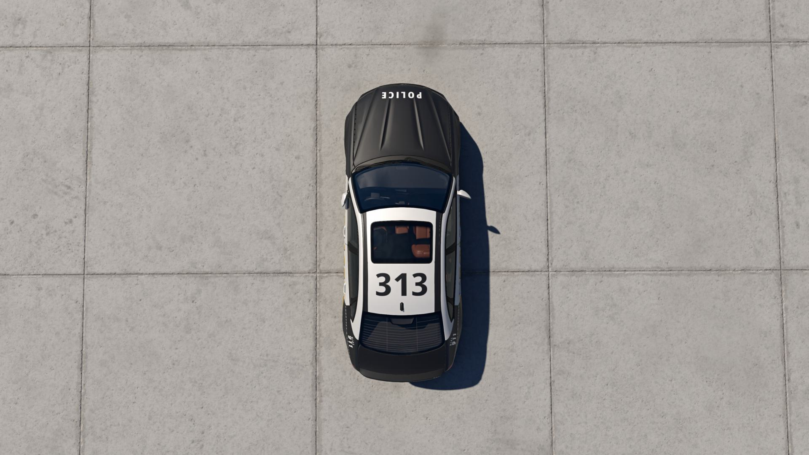

# sideslide - 20261114-220636_sideslide_synth-full-vk-cold_r1

_on its side, sliding along the ground at 14 m/s - one long scrape_

Remaining queues: `{"bake": 0, "jobs": 0, "stamps": 0}`

Tuning: `if scratches_detect then scratches_detect.setPaintEnabled(true) end; scratches_paint.setDamageResolution(4096); scratches_paint.setBakeBudget(3); scratches_paint.setFlushInterval(0.05); scratches_paint.setProjectionBudget(6); scratches_paint.setLayerBudget(24); scratches_paint.setCoverageCoalescing(false); scratches_paint.setPanelGrouping(true); scratches_paint.setSyntheticAnchors(true)`

Settled: True after 4.216 s - 370 frames, 77.6 fps average from sampled wall intervals (background limiter lifted)
Went past upside down: True (lowest up-vector z -0.166)

## Marks

| contacts | passed filters | impacts | streams | stamps | projections | bakes | missed | jobs dropped | deferred frames |
|---|---|---|---|---|---|---|---|---|---|
| 3000 | 772 | 86 | 144 | 99 | 108 | 141 | 0.0% | 0 | 1 |

Rejected contacts: Wheel 1528, BelowThresh 699, NormalForce 1

Body materials: METAL 566, PLASTIC 206

Surfaces: ASPHALT 772

## Cost

| | avg | p95 | max |
|---|---|---|---|
| painter (GE), ms/frame | 1.352 | 4.263 | 13.79 |
| whole frame, ms | 12.276 (p50) | 19.768 | 31.464 |
| all GE Lua, ms | | 5.364 | 14.909 |
| physics + vehicle Lua, ms | | 0.093 | 0.19 |
| render, ms | | 1.836 | |

- Painter frames over 4 ms: 22; worst flush (project + bake) 2.247 ms, worst composite 0.096 ms.
- Detector: 1.627 us per contact, 9.971 ms total, worst frame 1.592 ms (profiled; the timer adds a little).

### Worst frames

| t (s) | frame ms | painter ms | GE Lua ms | physics+VLUA ms | render ms |
|---|---|---|---|---|---|
| 0.32 | 31.46 | 13.79 | 2.65 | 0.05 | 1.38 |
| 0.20 | 26.74 | 12.68 | 2.31 | 0.10 | 1.50 |
| 1.95 | 24.67 | 3.45 | 2.12 | 0.05 | 1.77 |
| 1.74 | 23.64 | 3.46 | 5.65 | 0.05 | 1.37 |
| 2.36 | 21.62 | 3.05 | 6.43 | 0.09 | 1.32 |

## Screenshots

