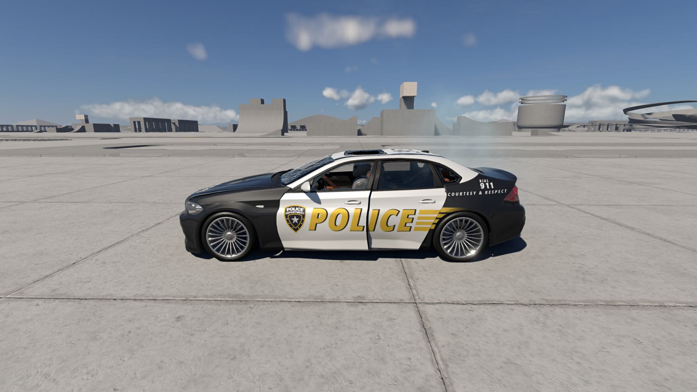
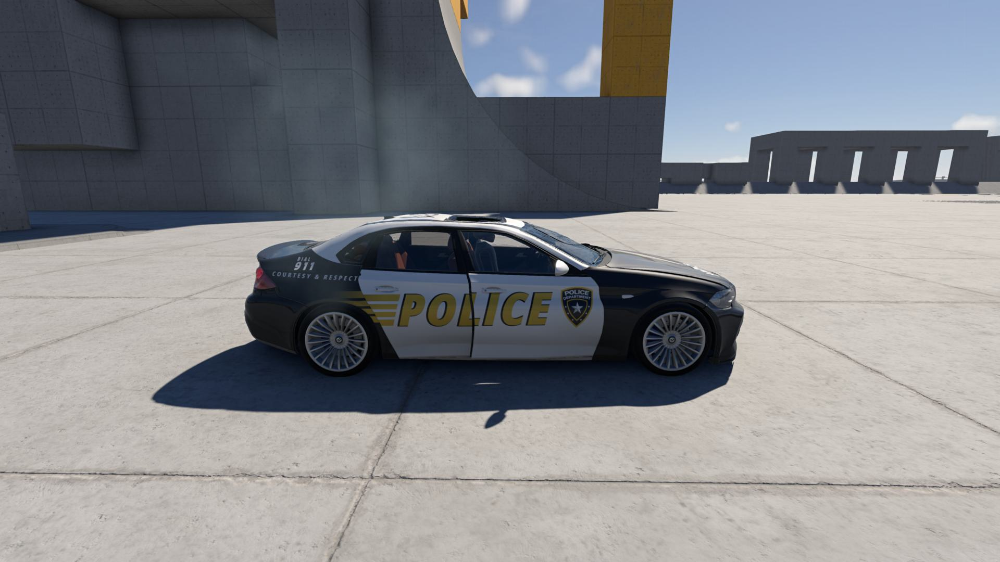
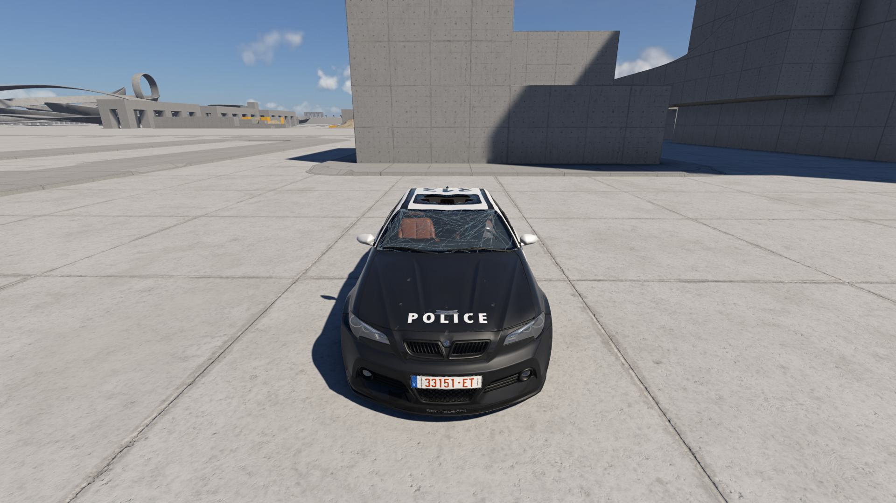
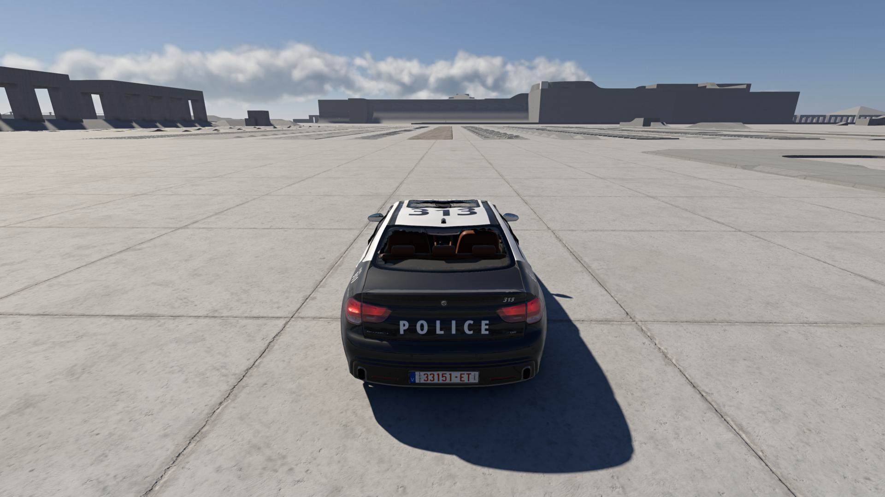
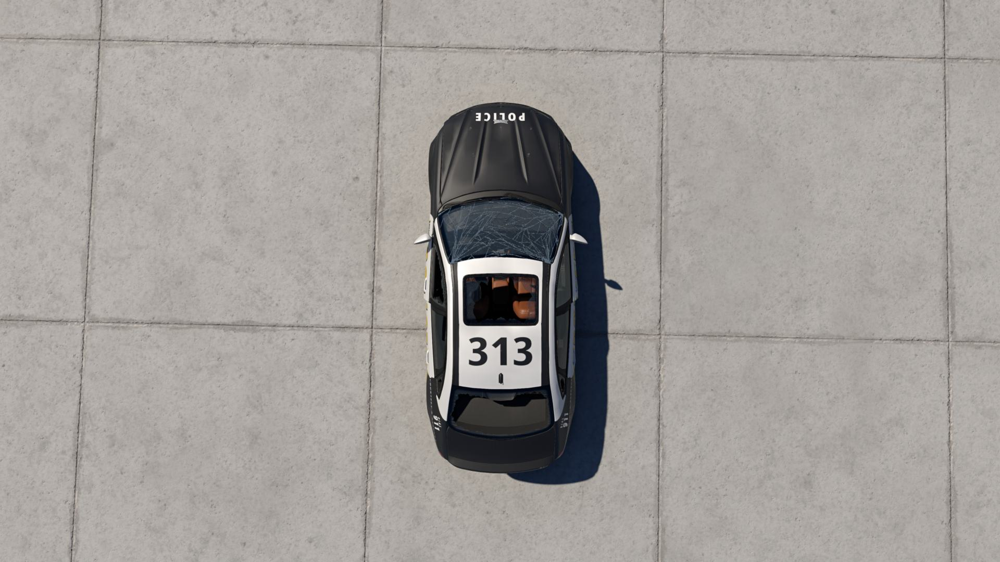

# roofdrop - 20261114-220654_roofdrop_synth-full-vk-cold_r1

_dropped upside down from about 1 m - roof impacts_

Remaining queues: `{"bake": 0, "jobs": 0, "stamps": 0}`

Tuning: `if scratches_detect then scratches_detect.setPaintEnabled(true) end; scratches_paint.setDamageResolution(4096); scratches_paint.setBakeBudget(3); scratches_paint.setFlushInterval(0.05); scratches_paint.setProjectionBudget(6); scratches_paint.setLayerBudget(24); scratches_paint.setCoverageCoalescing(false); scratches_paint.setPanelGrouping(true); scratches_paint.setSyntheticAnchors(true)`

Settled: True after 6.339 s - 495 frames, 78.0 fps average from sampled wall intervals (background limiter lifted)
Went past upside down: True (lowest up-vector z -1.0)

## Marks

| contacts | passed filters | impacts | streams | stamps | projections | bakes | missed | jobs dropped | deferred frames |
|---|---|---|---|---|---|---|---|---|---|
| 1378 | 55 | 55 | 0 | 53 | 16 | 25 | 0.0% | 0 | 0 |

Rejected contacts: PartExcluded 788, BelowThresh 535

Body materials: METAL 53, PLASTIC 2

Surfaces: ASPHALT 55

## Cost

| | avg | p95 | max |
|---|---|---|---|
| painter (GE), ms/frame | 0.203 | 0.944 | 12.526 |
| whole frame, ms | 12.742 (p50) | 16.632 | 23.191 |
| all GE Lua, ms | | 3.131 | 13.492 |
| physics + vehicle Lua, ms | | 0.091 | 0.26 |
| render, ms | | 2.088 | |

- Painter frames over 4 ms: 7; worst flush (project + bake) 1.252 ms, worst composite 0.076 ms.
- Detector: 1.672 us per contact, 5.385 ms total, worst frame 0.665 ms (profiled; the timer adds a little).

### Worst frames

| t (s) | frame ms | painter ms | GE Lua ms | physics+VLUA ms | render ms |
|---|---|---|---|---|---|
| 2.20 | 23.19 | 3.06 | 1.19 | 0.04 | 1.45 |
| 0.54 | 22.15 | 10.04 | 1.30 | 0.15 | 2.10 |
| 0.87 | 21.84 | 7.11 | 2.01 | 0.06 | 1.73 |
| 0.88 | 21.80 | 3.44 | 8.13 | 0.09 | 1.85 |
| 0.59 | 21.19 | 12.53 | 2.05 | 0.05 | 1.74 |

## Screenshots

