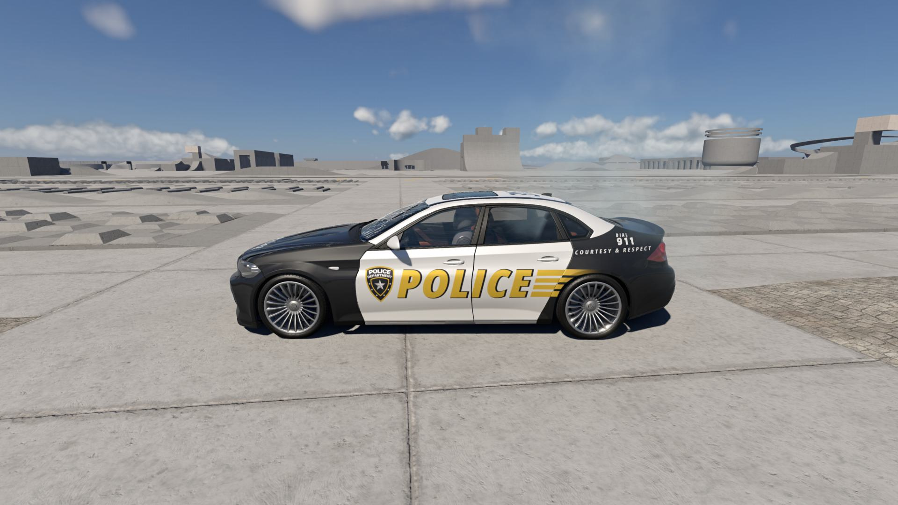
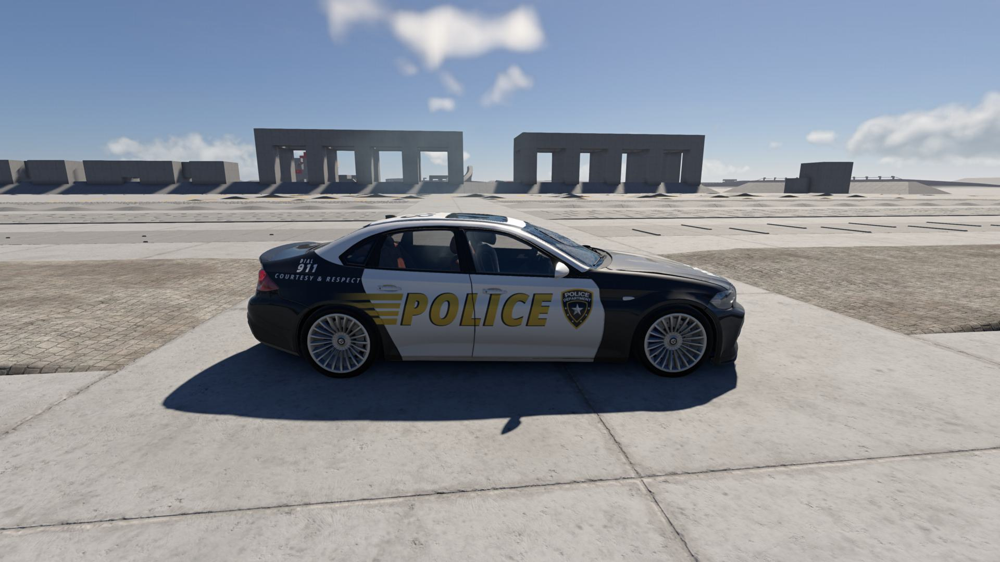
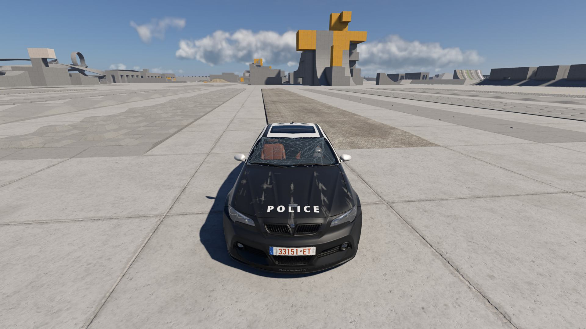
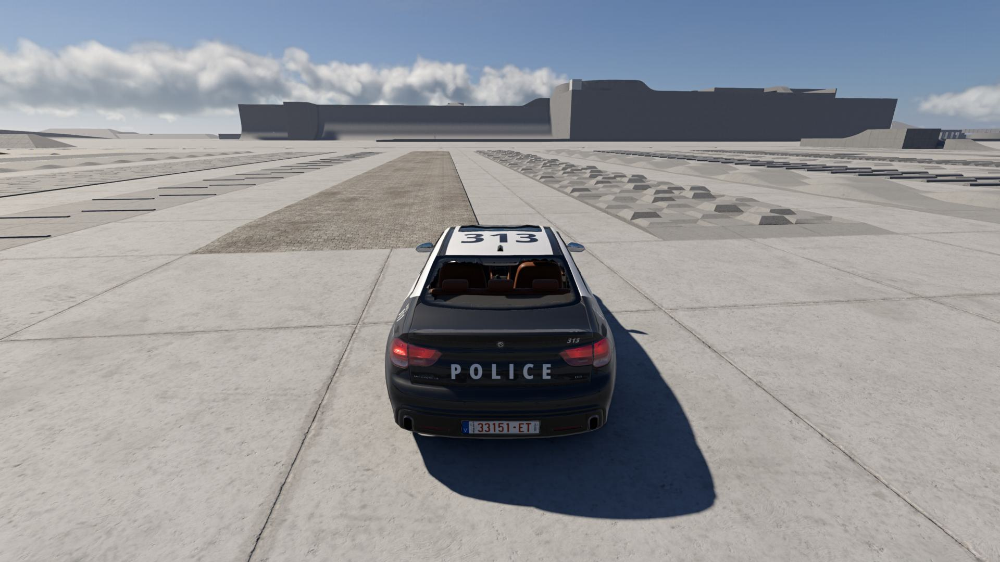
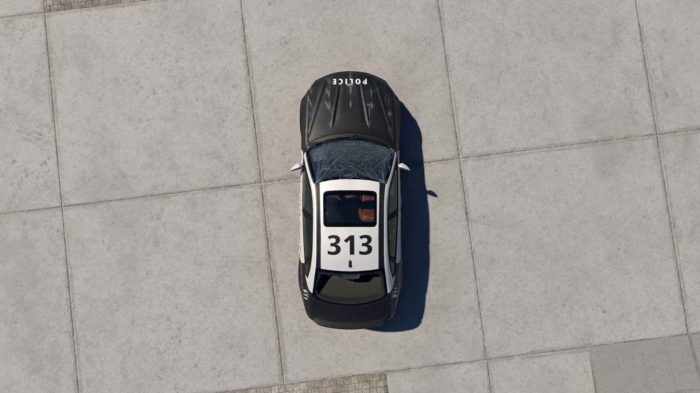

# sustained - 20261114-220713_sustained_synth-full-vk-cold_r1

_assisted roof scrape v2: additive translation to 4 m/s for 30 seconds, preserving internal node motion; real collisions_

Remaining queues: `{"bake": 0, "jobs": 0, "stamps": 0}`

Tuning: `if scratches_detect then scratches_detect.setPaintEnabled(true) end; scratches_paint.setDamageResolution(4096); scratches_paint.setBakeBudget(3); scratches_paint.setFlushInterval(0.05); scratches_paint.setProjectionBudget(6); scratches_paint.setLayerBudget(24); scratches_paint.setCoverageCoalescing(false); scratches_paint.setPanelGrouping(true); scratches_paint.setSyntheticAnchors(true)`

Settled: False after 30.0 s - 2451 frames, 81.7 fps average from sampled wall intervals (background limiter lifted)
Went past upside down: True (lowest up-vector z -1.0)

## Marks

| contacts | passed filters | impacts | streams | stamps | projections | bakes | missed | jobs dropped | deferred frames |
|---|---|---|---|---|---|---|---|---|---|
| 14546 | 7873 | 43 | 533 | 84 | 134 | 150 | 0.0% | 0 | 0 |

Rejected contacts: PartExcluded 5384, BelowThresh 1281, NormalForce 8

Body materials: METAL 7845, PLASTIC 28

Surfaces: ASPHALT 7746, COBBLESTONE 127

## Cost

| | avg | p95 | max |
|---|---|---|---|
| painter (GE), ms/frame | 0.218 | 1.453 | 16.776 |
| whole frame, ms | 12.18 (p50) | 15.216 | 28.182 |
| all GE Lua, ms | | 2.631 | 17.907 |
| physics + vehicle Lua, ms | | 0.09 | 0.451 |
| render, ms | | 2.039 | |

- Painter frames over 4 ms: 27; worst flush (project + bake) 1.477 ms, worst composite 0.088 ms.
- Detector: 3.483 us per contact, 72.628 ms total, worst frame 0.522 ms (profiled; the timer adds a little).

### Worst frames

| t (s) | frame ms | painter ms | GE Lua ms | physics+VLUA ms | render ms |
|---|---|---|---|---|---|
| 0.35 | 28.18 | 12.91 | 2.17 | 0.07 | 1.39 |
| 0.45 | 26.11 | 16.78 | 2.42 | 0.08 | 1.90 |
| 10.22 | 24.76 | 10.27 | 1.71 | 0.06 | 1.70 |
| 8.49 | 24.72 | 12.69 | 1.13 | 0.04 | 1.24 |
| 12.41 | 24.42 | 12.34 | 1.39 | 0.05 | 1.40 |

## Screenshots

