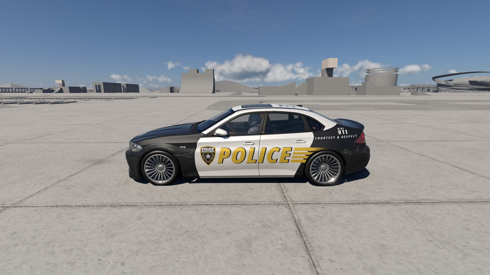
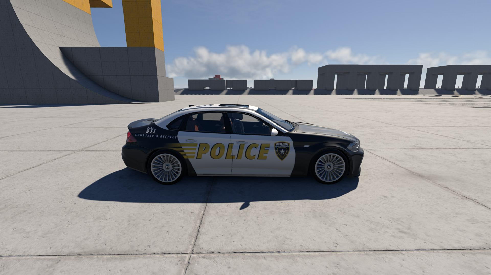
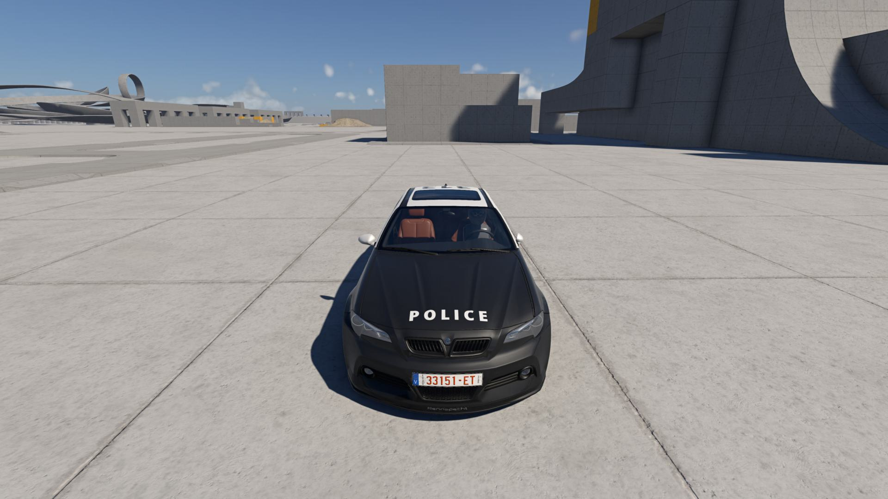
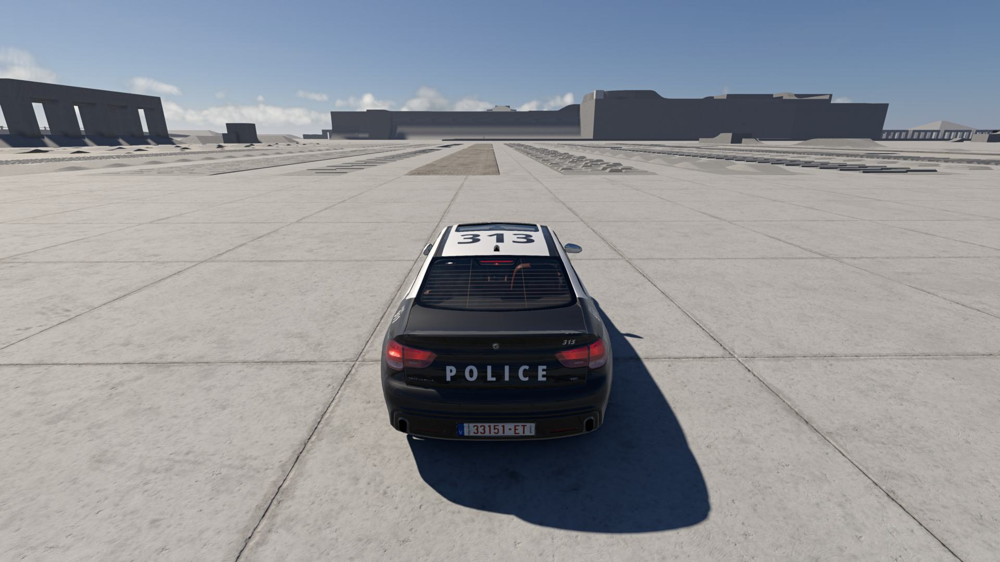
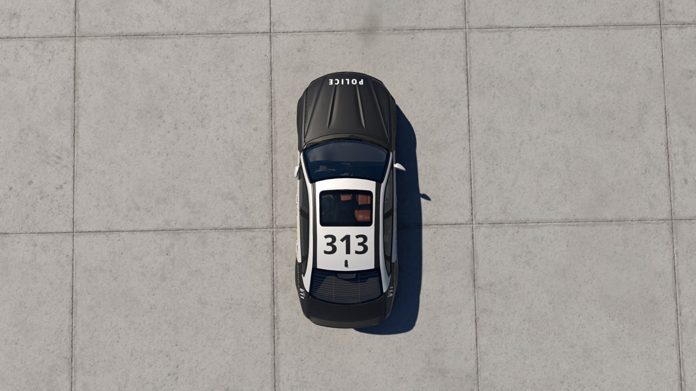

# sideslide - 20261114-221207_sideslide_synth-full-vk-warm_r1

_on its side, sliding along the ground at 14 m/s - one long scrape_

Remaining queues: `{"bake": 0, "jobs": 0, "stamps": 0}`

Tuning: `if scratches_detect then scratches_detect.setPaintEnabled(true) end; scratches_paint.setDamageResolution(4096); scratches_paint.setBakeBudget(3); scratches_paint.setFlushInterval(0.05); scratches_paint.setProjectionBudget(6); scratches_paint.setLayerBudget(24); scratches_paint.setCoverageCoalescing(false); scratches_paint.setPanelGrouping(true); scratches_paint.setSyntheticAnchors(true)`

Settled: True after 4.226 s - 329 frames, 74.9 fps average from sampled wall intervals (background limiter lifted)
Went past upside down: True (lowest up-vector z -0.164)

## Marks

| contacts | passed filters | impacts | streams | stamps | projections | bakes | missed | jobs dropped | deferred frames |
|---|---|---|---|---|---|---|---|---|---|
| 2412 | 639 | 92 | 125 | 119 | 107 | 136 | 0.0% | 0 | 1 |

Rejected contacts: Wheel 1125, BelowThresh 645, NormalForce 3

Body materials: METAL 487, PLASTIC 152

Surfaces: ASPHALT 639

## Cost

| | avg | p95 | max |
|---|---|---|---|
| painter (GE), ms/frame | 1.529 | 4.599 | 23.309 |
| whole frame, ms | 12.439 (p50) | 20.248 | 32.419 |
| all GE Lua, ms | | 5.82 | 24.658 |
| physics + vehicle Lua, ms | | 0.097 | 0.641 |
| render, ms | | 1.97 | |

- Painter frames over 4 ms: 27; worst flush (project + bake) 2.554 ms, worst composite 0.339 ms.
- Detector: 1.799 us per contact, 9.207 ms total, worst frame 0.724 ms (profiled; the timer adds a little).

### Worst frames

| t (s) | frame ms | painter ms | GE Lua ms | physics+VLUA ms | render ms |
|---|---|---|---|---|---|
| 0.27 | 32.42 | 23.31 | 7.34 | 0.08 | 1.72 |
| 0.36 | 26.46 | 12.20 | 3.35 | 0.05 | 1.87 |
| 0.37 | 26.06 | 9.57 | 13.17 | 0.06 | 1.64 |
| 2.43 | 25.77 | 4.62 | 6.84 | 0.08 | 1.96 |
| 0.78 | 24.11 | 3.63 | 3.69 | 0.10 | 2.83 |

## Screenshots

