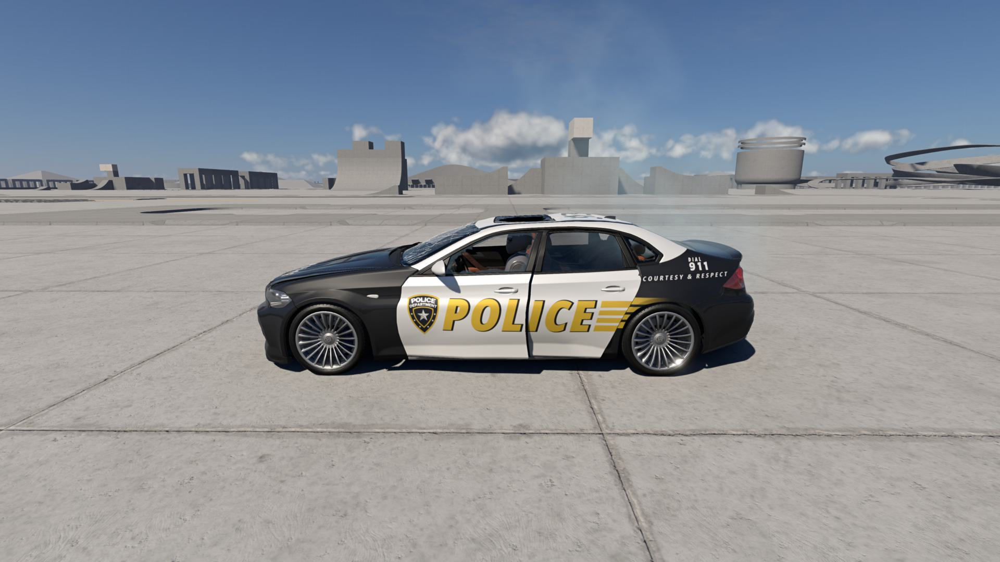
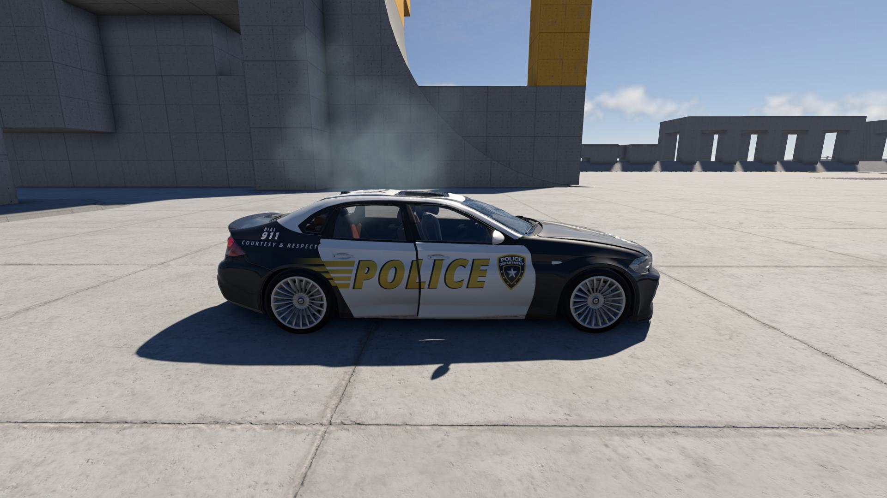
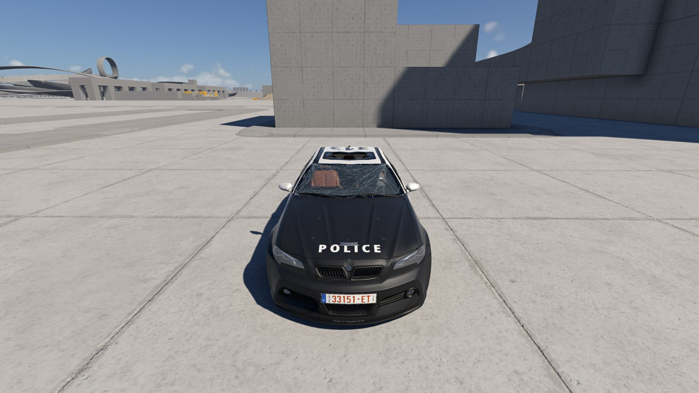
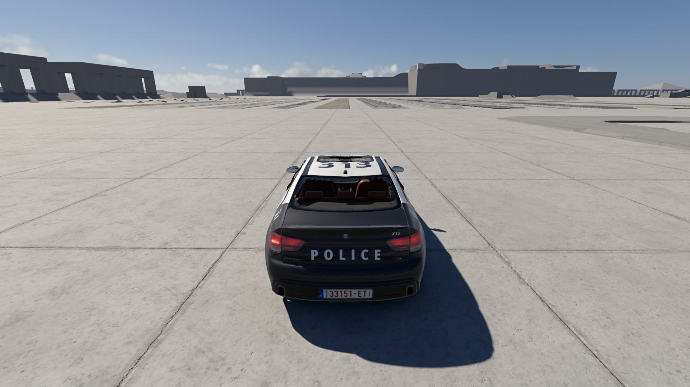
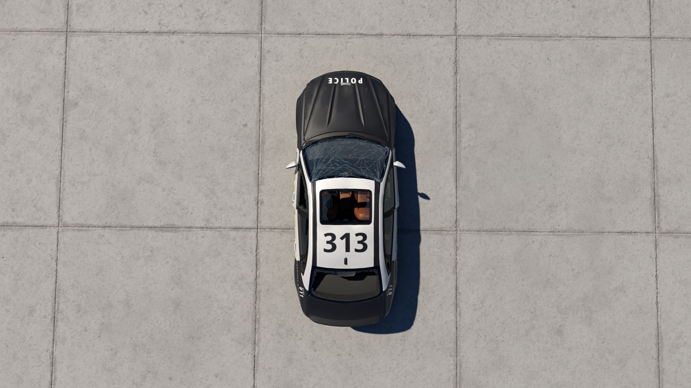

# roofdrop - 20261114-221224_roofdrop_synth-full-vk-warm_r1

_dropped upside down from about 1 m - roof impacts_

Remaining queues: `{"bake": 0, "jobs": 0, "stamps": 0}`

Tuning: `if scratches_detect then scratches_detect.setPaintEnabled(true) end; scratches_paint.setDamageResolution(4096); scratches_paint.setBakeBudget(3); scratches_paint.setFlushInterval(0.05); scratches_paint.setProjectionBudget(6); scratches_paint.setLayerBudget(24); scratches_paint.setCoverageCoalescing(false); scratches_paint.setPanelGrouping(true); scratches_paint.setSyntheticAnchors(true)`

Settled: True after 5.318 s - 415 frames, 77.8 fps average from sampled wall intervals (background limiter lifted)
Went past upside down: True (lowest up-vector z -1.0)

## Marks

| contacts | passed filters | impacts | streams | stamps | projections | bakes | missed | jobs dropped | deferred frames |
|---|---|---|---|---|---|---|---|---|---|
| 1042 | 50 | 50 | 0 | 55 | 17 | 26 | 0.0% | 0 | 0 |

Rejected contacts: PartExcluded 617, BelowThresh 375

Body materials: METAL 48, PLASTIC 2

Surfaces: ASPHALT 50

## Cost

| | avg | p95 | max |
|---|---|---|---|
| painter (GE), ms/frame | 0.231 | 1.249 | 11.627 |
| whole frame, ms | 12.77 (p50) | 16.749 | 28.902 |
| all GE Lua, ms | | 3.152 | 12.649 |
| physics + vehicle Lua, ms | | 0.088 | 0.521 |
| render, ms | | 1.832 | |

- Painter frames over 4 ms: 5; worst flush (project + bake) 1.002 ms, worst composite 0.083 ms.
- Detector: 1.688 us per contact, 4.533 ms total, worst frame 0.559 ms (profiled; the timer adds a little).

### Worst frames

| t (s) | frame ms | painter ms | GE Lua ms | physics+VLUA ms | render ms |
|---|---|---|---|---|---|
| 0.61 | 28.90 | 11.63 | 11.75 | 0.07 | 1.96 |
| 0.59 | 21.72 | 10.51 | 2.18 | 0.09 | 1.29 |
| 1.21 | 20.93 | 4.37 | 4.61 | 0.10 | 1.23 |
| 0.54 | 20.77 | 5.53 | 1.46 | 0.18 | 1.83 |
| 0.89 | 20.00 | 3.09 | 3.70 | 0.07 | 1.31 |

## Screenshots

