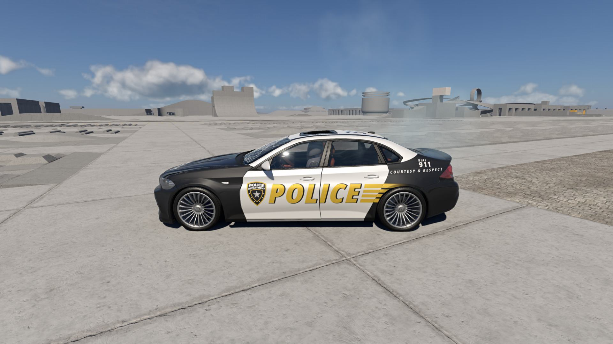
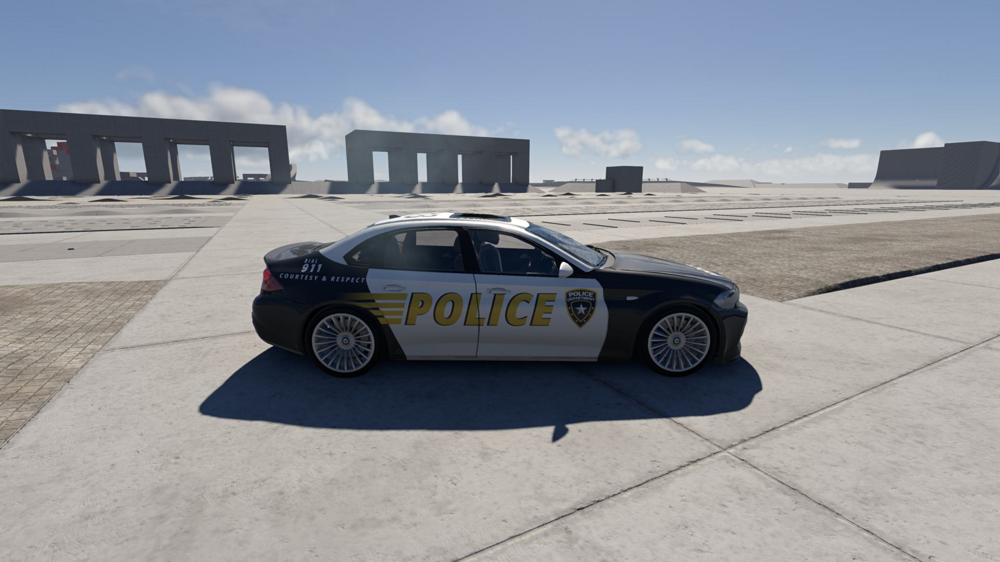
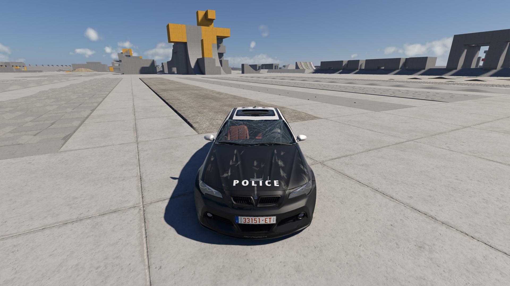
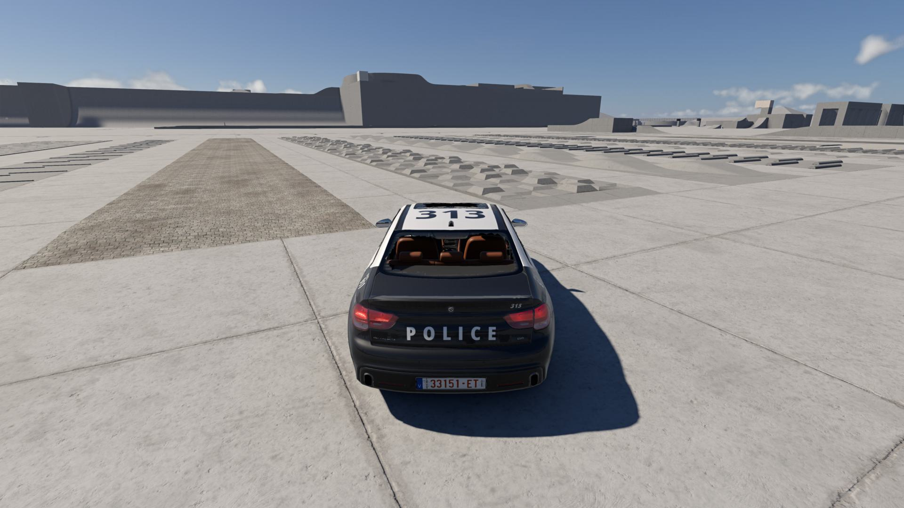
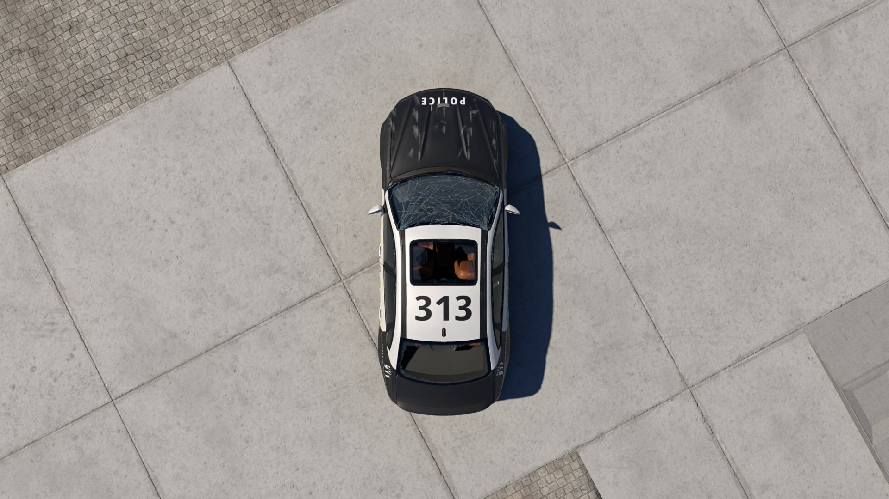

# sustained - 20261114-221242_sustained_synth-full-vk-warm_r1

_assisted roof scrape v2: additive translation to 4 m/s for 30 seconds, preserving internal node motion; real collisions_

Remaining queues: `{"bake": 0, "jobs": 0, "stamps": 0}`

Tuning: `if scratches_detect then scratches_detect.setPaintEnabled(true) end; scratches_paint.setDamageResolution(4096); scratches_paint.setBakeBudget(3); scratches_paint.setFlushInterval(0.05); scratches_paint.setProjectionBudget(6); scratches_paint.setLayerBudget(24); scratches_paint.setCoverageCoalescing(false); scratches_paint.setPanelGrouping(true); scratches_paint.setSyntheticAnchors(true)`

Settled: False after 30.012 s - 2499 frames, 83.2 fps average from sampled wall intervals (background limiter lifted)
Went past upside down: True (lowest up-vector z -1.0)

## Marks

| contacts | passed filters | impacts | streams | stamps | projections | bakes | missed | jobs dropped | deferred frames |
|---|---|---|---|---|---|---|---|---|---|
| 14911 | 7781 | 53 | 509 | 100 | 154 | 173 | 0.0% | 0 | 0 |

Rejected contacts: PartExcluded 5563, BelowThresh 1557, NormalForce 10

Body materials: METAL 7731, PLASTIC 50

Surfaces: ASPHALT 7639, COBBLESTONE 142

## Cost

| | avg | p95 | max |
|---|---|---|---|
| painter (GE), ms/frame | 0.22 | 1.405 | 14.94 |
| whole frame, ms | 11.956 (p50) | 14.674 | 29.899 |
| all GE Lua, ms | | 2.498 | 15.994 |
| physics + vehicle Lua, ms | | 0.081 | 0.242 |
| render, ms | | 1.84 | |

- Painter frames over 4 ms: 22; worst flush (project + bake) 2.122 ms, worst composite 0.123 ms.
- Detector: 3.244 us per contact, 71.383 ms total, worst frame 0.934 ms (profiled; the timer adds a little).

### Worst frames

| t (s) | frame ms | painter ms | GE Lua ms | physics+VLUA ms | render ms |
|---|---|---|---|---|---|
| 0.41 | 29.90 | 14.94 | 2.22 | 0.06 | 1.53 |
| 0.35 | 22.97 | 10.03 | 2.18 | 0.08 | 1.40 |
| 3.05 | 22.95 | 0.01 | 0.94 | 0.06 | 1.92 |
| 11.86 | 21.20 | 9.47 | 1.41 | 0.06 | 1.58 |
| 13.12 | 21.16 | 4.90 | 1.31 | 0.05 | 2.20 |

## Screenshots

