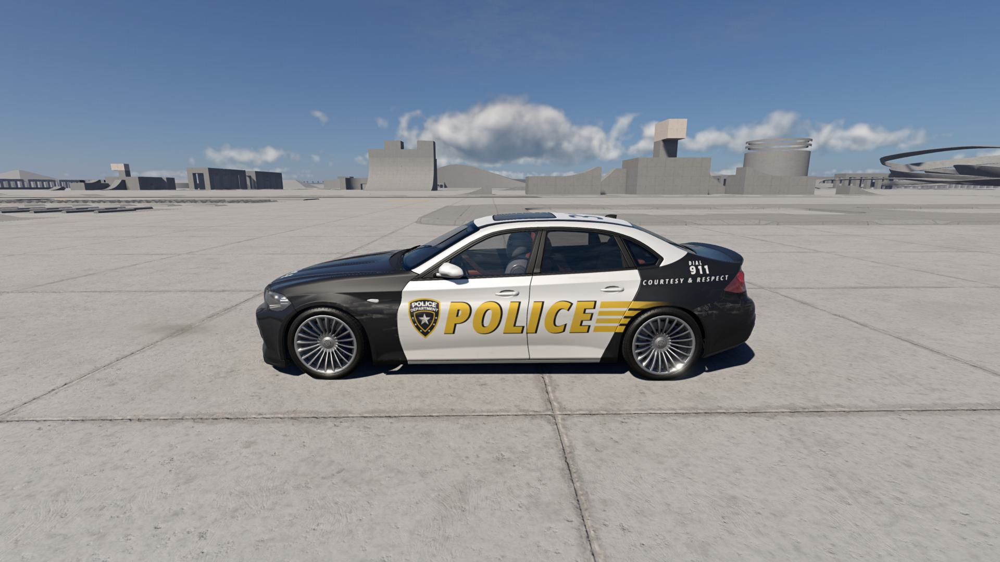
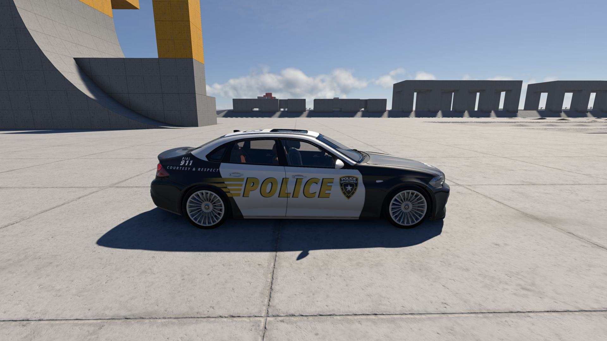
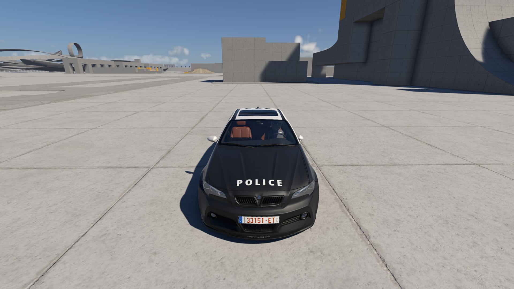
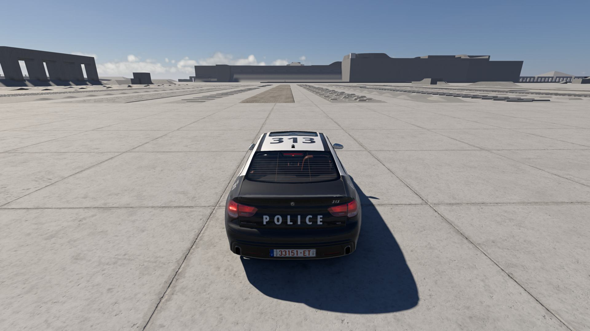
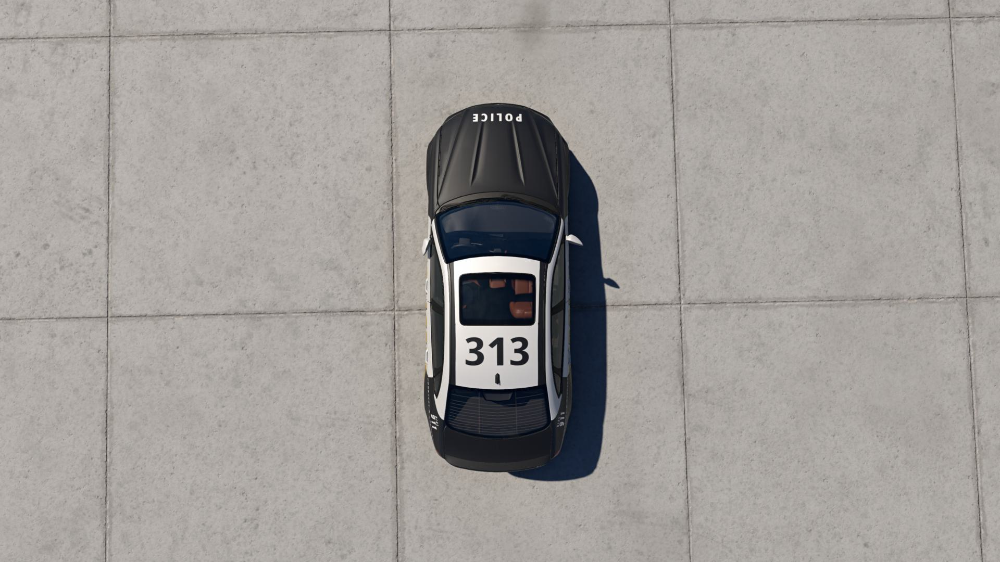

# sideslide - 20261114-221456_sideslide_synth-full-vk-warm2_r1

_on its side, sliding along the ground at 14 m/s - one long scrape_

Remaining queues: `{"bake": 0, "jobs": 0, "stamps": 0}`

Tuning: `if scratches_detect then scratches_detect.setPaintEnabled(true) end; scratches_paint.setDamageResolution(4096); scratches_paint.setBakeBudget(3); scratches_paint.setFlushInterval(0.05); scratches_paint.setProjectionBudget(6); scratches_paint.setLayerBudget(24); scratches_paint.setCoverageCoalescing(false); scratches_paint.setPanelGrouping(true); scratches_paint.setSyntheticAnchors(true)`

Settled: True after 4.135 s - 313 frames, 75.3 fps average from sampled wall intervals (background limiter lifted)
Went past upside down: True (lowest up-vector z -0.151)

## Marks

| contacts | passed filters | impacts | streams | stamps | projections | bakes | missed | jobs dropped | deferred frames |
|---|---|---|---|---|---|---|---|---|---|
| 2927 | 648 | 86 | 133 | 112 | 107 | 133 | 0.0% | 0 | 1 |

Rejected contacts: Wheel 1567, BelowThresh 708, NormalForce 4

Body materials: METAL 486, PLASTIC 162

Surfaces: ASPHALT 648

## Cost

| | avg | p95 | max |
|---|---|---|---|
| painter (GE), ms/frame | 1.571 | 4.312 | 12.633 |
| whole frame, ms | 12.446 (p50) | 19.073 | 25.582 |
| all GE Lua, ms | | 5.339 | 13.466 |
| physics + vehicle Lua, ms | | 0.095 | 0.234 |
| render, ms | | 1.798 | |

- Painter frames over 4 ms: 25; worst flush (project + bake) 2.837 ms, worst composite 0.144 ms.
- Detector: 1.417 us per contact, 8.861 ms total, worst frame 0.651 ms (profiled; the timer adds a little).

### Worst frames

| t (s) | frame ms | painter ms | GE Lua ms | physics+VLUA ms | render ms |
|---|---|---|---|---|---|
| 0.33 | 25.58 | 12.63 | 2.79 | 0.08 | 1.61 |
| 0.26 | 24.32 | 6.12 | 8.08 | 0.06 | 1.45 |
| 0.95 | 24.29 | 3.32 | 5.16 | 0.06 | 1.66 |
| 2.66 | 21.39 | 3.17 | 7.09 | 0.08 | 1.55 |
| 0.48 | 20.85 | 4.53 | 4.68 | 0.05 | 1.94 |

## Screenshots

