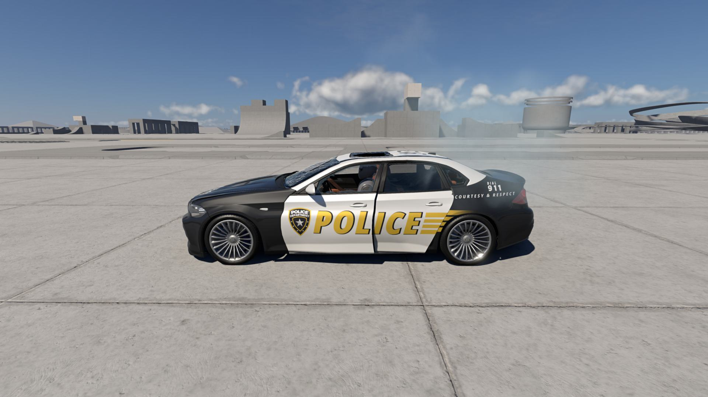
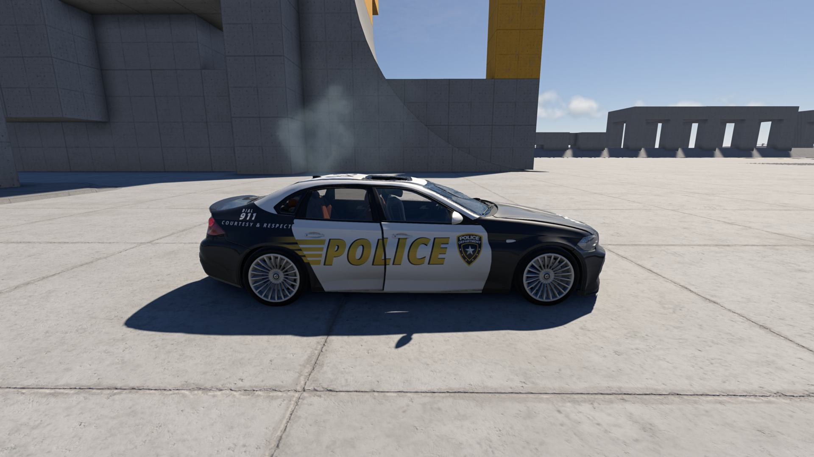
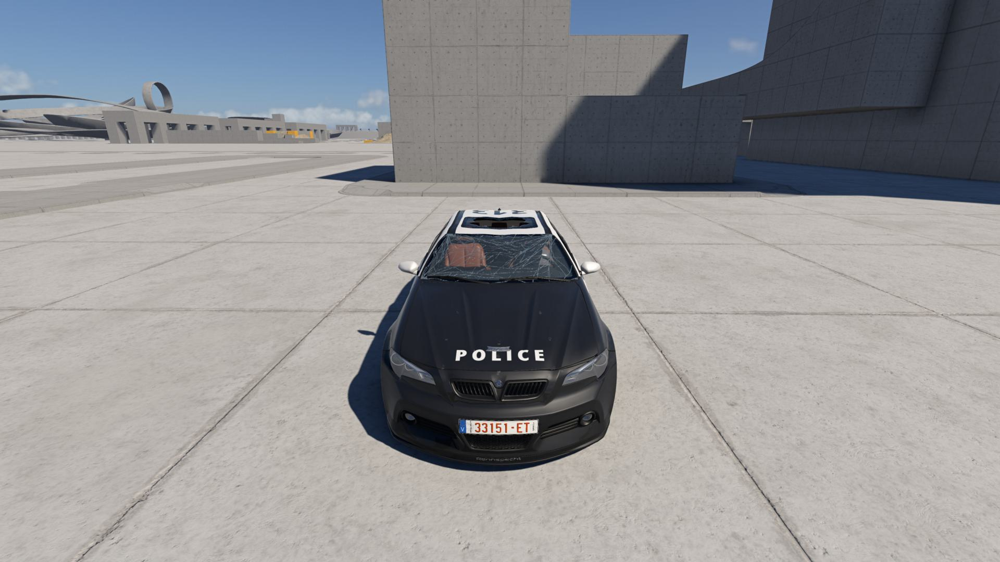
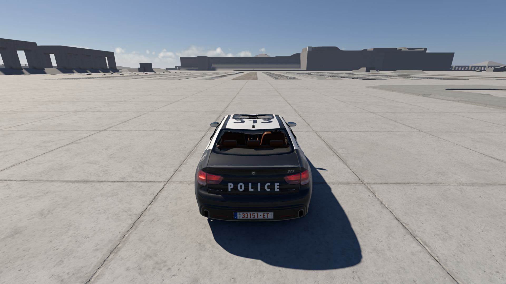
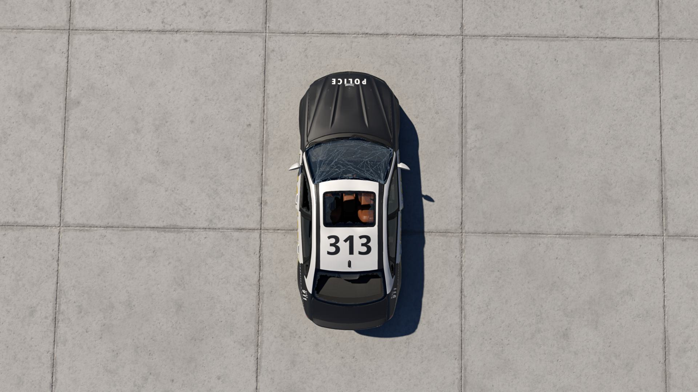

# roofdrop - 20261114-221512_roofdrop_synth-full-vk-warm2_r1

_dropped upside down from about 1 m - roof impacts_

Remaining queues: `{"bake": 0, "jobs": 0, "stamps": 0}`

Tuning: `if scratches_detect then scratches_detect.setPaintEnabled(true) end; scratches_paint.setDamageResolution(4096); scratches_paint.setBakeBudget(3); scratches_paint.setFlushInterval(0.05); scratches_paint.setProjectionBudget(6); scratches_paint.setLayerBudget(24); scratches_paint.setCoverageCoalescing(false); scratches_paint.setPanelGrouping(true); scratches_paint.setSyntheticAnchors(true)`

Settled: True after 4.946 s - 385 frames, 77.5 fps average from sampled wall intervals (background limiter lifted)
Went past upside down: True (lowest up-vector z -1.0)

## Marks

| contacts | passed filters | impacts | streams | stamps | projections | bakes | missed | jobs dropped | deferred frames |
|---|---|---|---|---|---|---|---|---|---|
| 973 | 52 | 52 | 0 | 51 | 14 | 22 | 0.0% | 0 | 0 |

Rejected contacts: PartExcluded 568, BelowThresh 353

Body materials: METAL 50, PLASTIC 2

Surfaces: ASPHALT 52

## Cost

| | avg | p95 | max |
|---|---|---|---|
| painter (GE), ms/frame | 0.236 | 0.893 | 13.593 |
| whole frame, ms | 12.854 (p50) | 15.962 | 25.231 |
| all GE Lua, ms | | 2.078 | 14.605 |
| physics + vehicle Lua, ms | | 0.085 | 0.132 |
| render, ms | | 2.125 | |

- Painter frames over 4 ms: 5; worst flush (project + bake) 1.148 ms, worst composite 0.086 ms.
- Detector: 1.492 us per contact, 3.85 ms total, worst frame 0.492 ms (profiled; the timer adds a little).

### Worst frames

| t (s) | frame ms | painter ms | GE Lua ms | physics+VLUA ms | render ms |
|---|---|---|---|---|---|
| 0.54 | 25.23 | 13.59 | 1.73 | 0.09 | 1.55 |
| 0.61 | 20.55 | 2.14 | 4.01 | 0.05 | 1.50 |
| 3.95 | 19.92 | 0.01 | 1.05 | 0.05 | 1.75 |
| 1.21 | 19.57 | 3.97 | 5.02 | 0.06 | 1.48 |
| 1.54 | 19.47 | 2.81 | 4.74 | 0.05 | 1.51 |

## Screenshots

