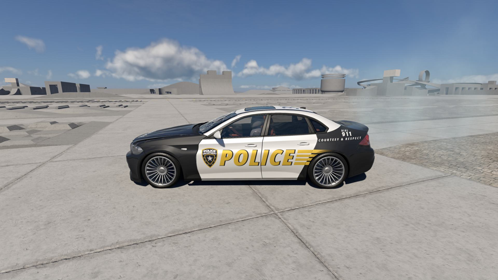
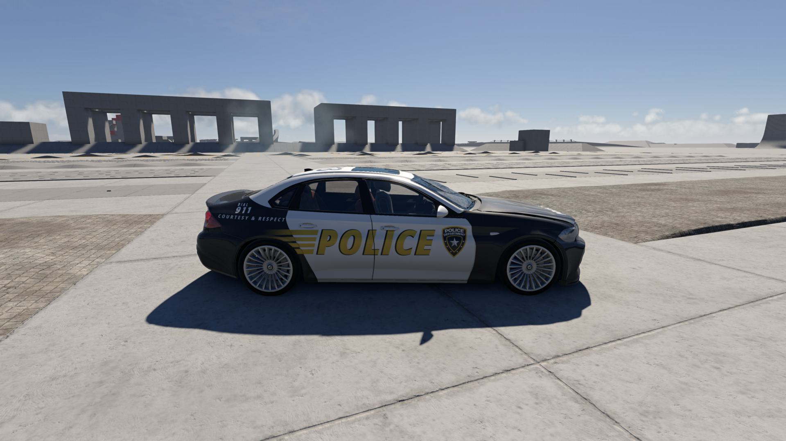
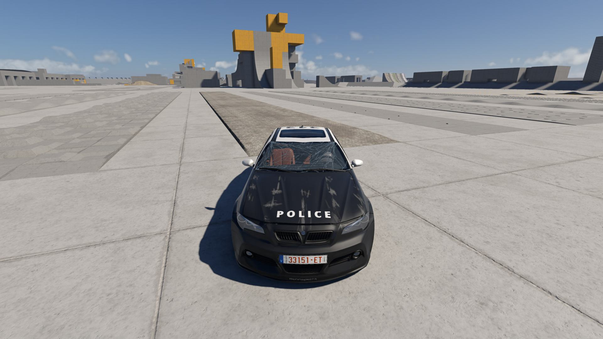
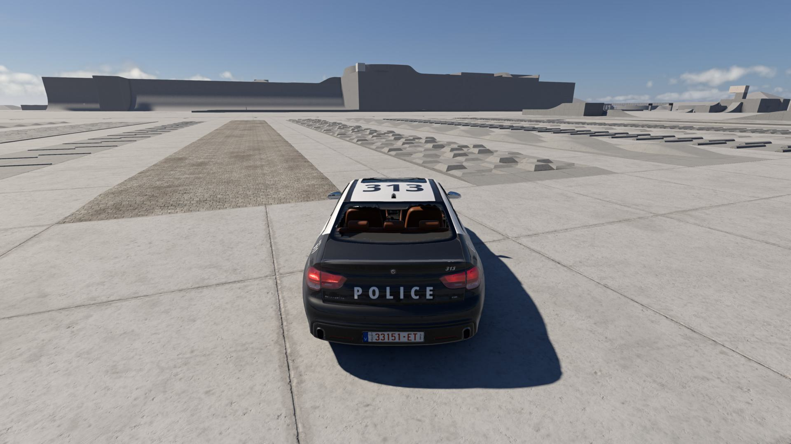
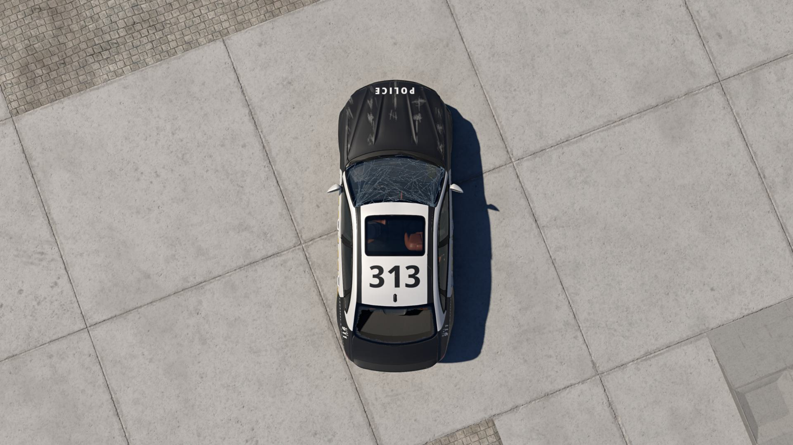

# sustained - 20261114-221530_sustained_synth-full-vk-warm2_r1

_assisted roof scrape v2: additive translation to 4 m/s for 30 seconds, preserving internal node motion; real collisions_

Remaining queues: `{"bake": 0, "jobs": 0, "stamps": 0}`

Tuning: `if scratches_detect then scratches_detect.setPaintEnabled(true) end; scratches_paint.setDamageResolution(4096); scratches_paint.setBakeBudget(3); scratches_paint.setFlushInterval(0.05); scratches_paint.setProjectionBudget(6); scratches_paint.setLayerBudget(24); scratches_paint.setCoverageCoalescing(false); scratches_paint.setPanelGrouping(true); scratches_paint.setSyntheticAnchors(true)`

Settled: False after 30.012 s - 2480 frames, 82.6 fps average from sampled wall intervals (background limiter lifted)
Went past upside down: True (lowest up-vector z -1.0)

## Marks

| contacts | passed filters | impacts | streams | stamps | projections | bakes | missed | jobs dropped | deferred frames |
|---|---|---|---|---|---|---|---|---|---|
| 16418 | 9181 | 52 | 584 | 133 | 202 | 206 | 0.0% | 0 | 0 |

Rejected contacts: PartExcluded 5638, BelowThresh 1580, NormalForce 19

Body materials: METAL 9147, PLASTIC 34

Surfaces: ASPHALT 8403, COBBLESTONE 778

## Cost

| | avg | p95 | max |
|---|---|---|---|
| painter (GE), ms/frame | 0.27 | 1.895 | 14.267 |
| whole frame, ms | 11.975 (p50) | 15.239 | 34.247 |
| all GE Lua, ms | | 3.004 | 15.319 |
| physics + vehicle Lua, ms | | 0.081 | 0.24 |
| render, ms | | 1.966 | |

- Painter frames over 4 ms: 29; worst flush (project + bake) 2.441 ms, worst composite 0.107 ms.
- Detector: 3.295 us per contact, 78.252 ms total, worst frame 0.721 ms (profiled; the timer adds a little).

### Worst frames

| t (s) | frame ms | painter ms | GE Lua ms | physics+VLUA ms | render ms |
|---|---|---|---|---|---|
| 0.35 | 34.25 | 13.80 | 1.87 | 0.06 | 2.87 |
| 0.41 | 26.12 | 13.94 | 2.70 | 0.09 | 2.75 |
| 12.62 | 24.10 | 1.80 | 5.86 | 0.06 | 1.74 |
| 0.71 | 22.63 | 3.51 | 4.17 | 0.07 | 1.99 |
| 13.38 | 22.49 | 5.28 | 5.72 | 0.13 | 2.24 |

## Screenshots

