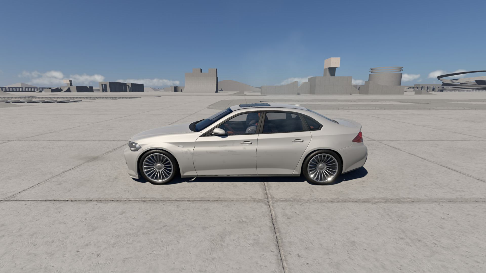
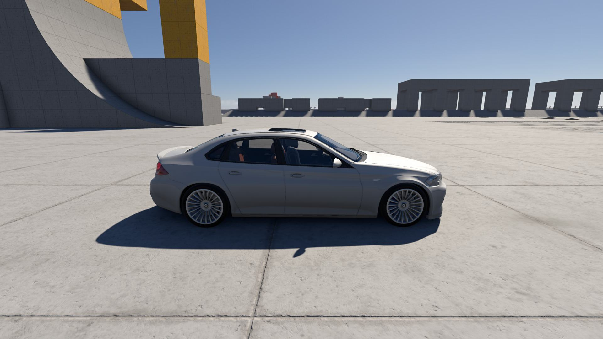
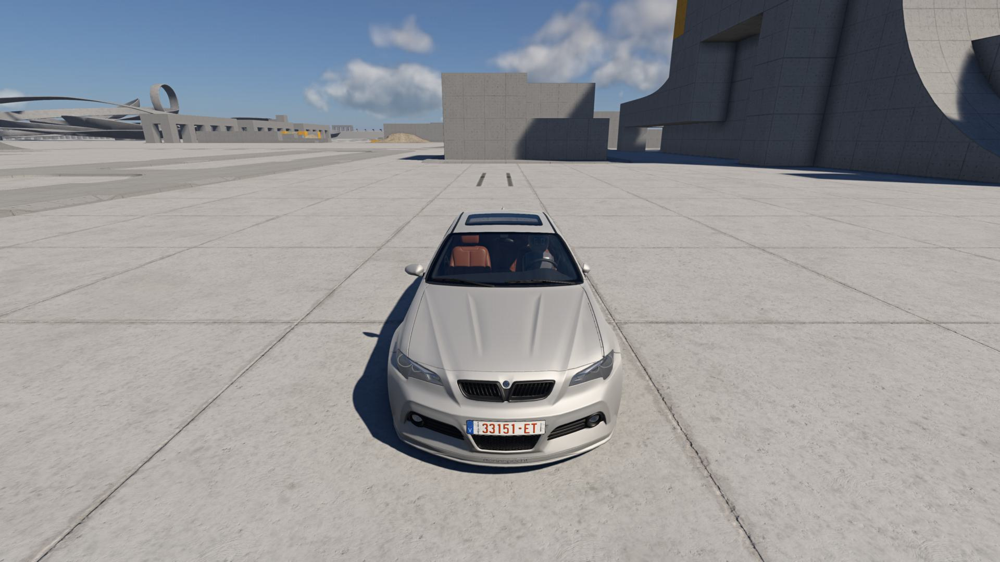
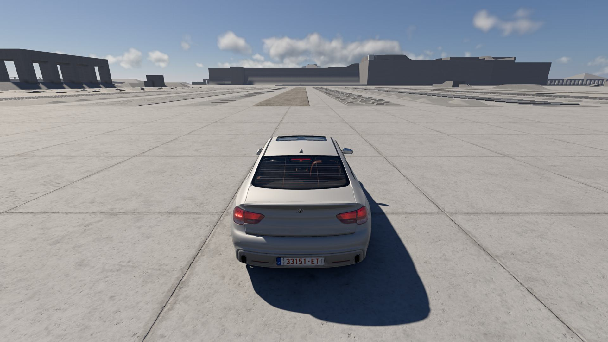
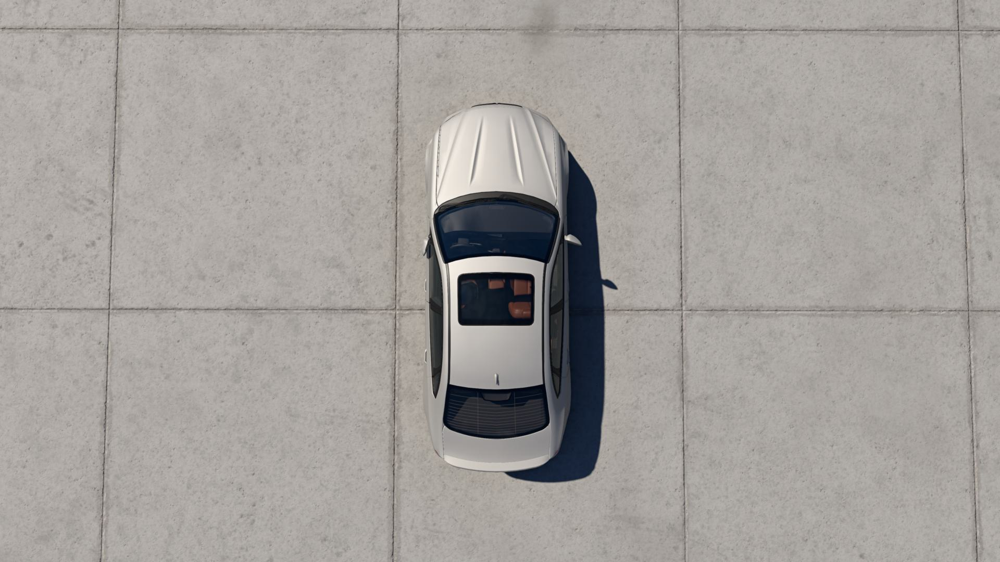

# sideslide - 20261114-171123_sideslide_m5-plain-visual

_on its side, sliding along the ground at 14 m/s - one long scrape_

Remaining queues: `{"bake": 0, "jobs": 0, "stamps": 0}`

Settled: True after 4.525 s - 107 frames, 21.6 fps average from sampled wall intervals (background limiter lifted)
Went past upside down: True (lowest up-vector z -0.155)

## Marks

| contacts | passed filters | impacts | streams | stamps | projections | bakes | missed | jobs dropped | deferred frames |
|---|---|---|---|---|---|---|---|---|---|
| 805 | 285 | 108 | 54 | 208 | 78 | 65 | 0.0% | 0 | 14 |

Rejected contacts: Wheel 377, BelowThresh 143

Body materials: METAL 215, PLASTIC 70

Surfaces: ASPHALT 285

## Cost

| | avg | p95 | max |
|---|---|---|---|
| painter (GE), ms/frame | 31.268 | 52.217 | 59.882 |
| whole frame, ms | 54.08 (p50) | 72.152 | 86.389 |
| all GE Lua, ms | | 54.066 | 61.525 |
| physics + vehicle Lua, ms | | 1.053 | 12.475 |
| render, ms | | 3.607 | |

- Painter frames over 4 ms: 82; worst flush (project + bake) 54.217 ms, worst composite 0.243 ms.
- Detector: 4.053 us per contact, 7.28 ms total, worst frame 0.968 ms (profiled; the timer adds a little).

### Worst frames

| t (s) | frame ms | painter ms | GE Lua ms | physics+VLUA ms | render ms |
|---|---|---|---|---|---|
| 0.39 | 86.39 | 51.73 | 1.08 | 2.02 | 3.30 |
| 2.79 | 75.66 | 49.43 | 17.18 | 0.08 | 3.25 |
| 2.34 | 75.24 | 59.88 | 43.28 | 0.09 | 2.79 |
| 3.68 | 75.10 | 53.96 | 38.59 | 0.08 | 2.94 |
| 4.28 | 72.71 | 54.28 | 35.97 | 0.07 | 3.13 |

## Screenshots

