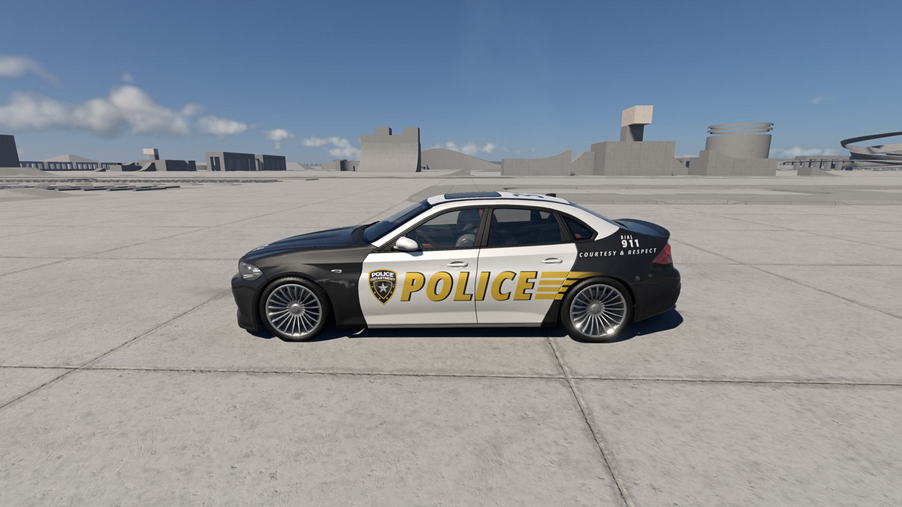
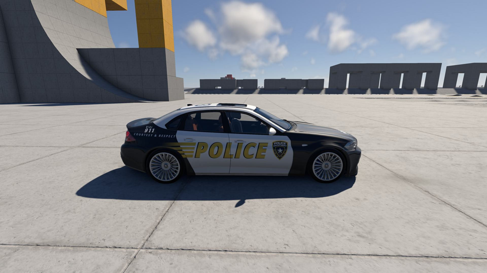
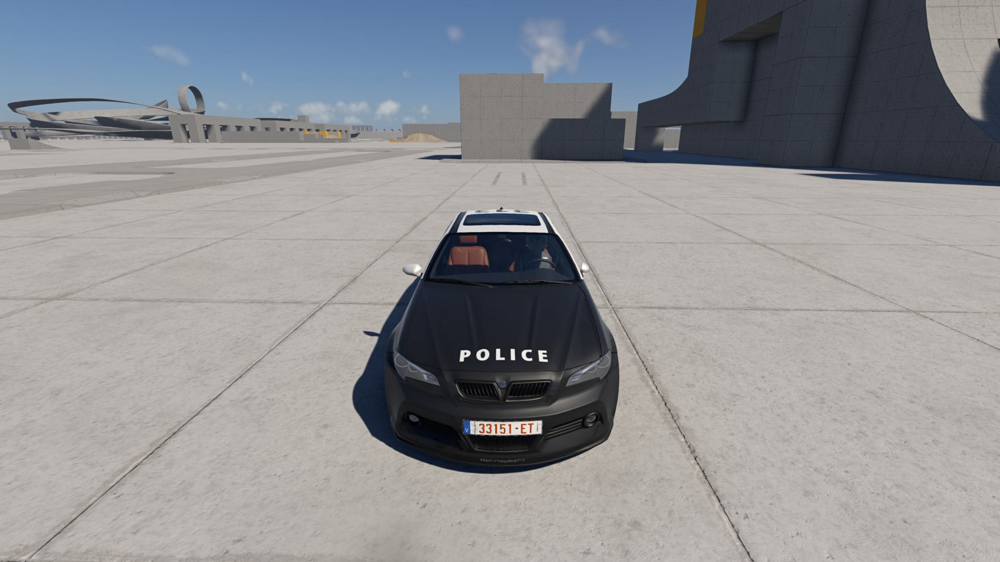
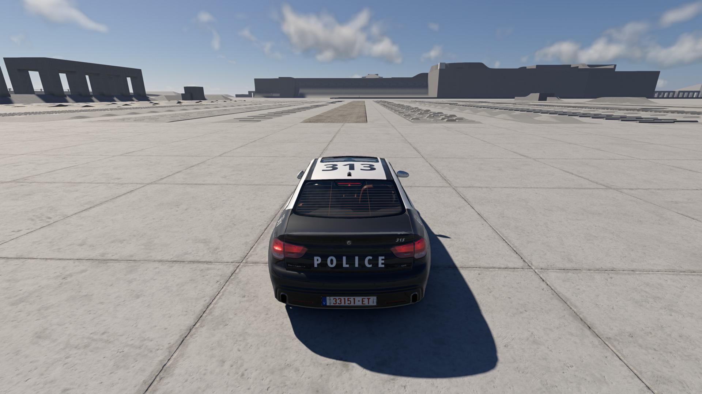
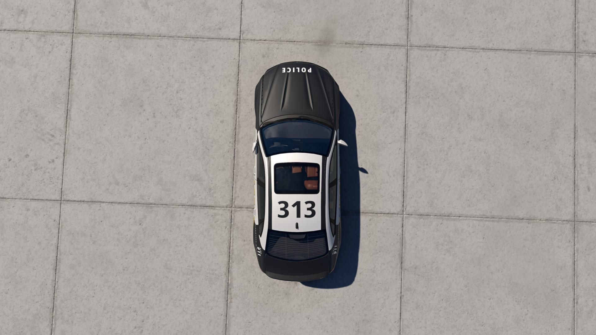

# sideslide - 20261114-165221_sideslide_m5-candidate-visual

_on its side, sliding along the ground at 14 m/s - one long scrape_

Settled: True after 4.716 s - 109 frames, 22.9 fps average (background limiter lifted)
Went past upside down: True (lowest up-vector z -0.175)

## Marks

| contacts | passed filters | impacts | streams | stamps | projections | bakes | missed | jobs dropped | deferred frames |
|---|---|---|---|---|---|---|---|---|---|
| 751 | 224 | 104 | 39 | 196 | 85 | 54 | 0.0% | 0 | 7 |

Rejected contacts: Wheel 371, BelowThresh 155, NormalForce 1

Body materials: METAL 161, PLASTIC 63

Surfaces: ASPHALT 224

## Cost

| | avg | p95 | max |
|---|---|---|---|
| painter (GE), ms/frame | 28.198 | 56.455 | 68.628 |
| whole frame, ms | 53.027 (p50) | 73.185 | 79.72 |
| all GE Lua, ms | | 58.079 | 70.409 |
| physics + vehicle Lua, ms | | 12.612 | 13.301 |
| render, ms | | 2.887 | |

- Painter frames over 4 ms: 71; worst flush (project + bake) 60.53 ms, worst composite 0.163 ms.
- Detector: 2.908 us per contact, 5.464 ms total, worst frame 0.854 ms (profiled; the timer adds a little).

### Worst frames

| t (s) | frame ms | painter ms | GE Lua ms | physics+VLUA ms | render ms |
|---|---|---|---|---|---|
| 1.83 | 79.72 | 60.58 | 45.05 | 0.11 | 2.77 |
| 0.20 | 79.48 | 68.63 | 39.13 | 0.11 | 2.78 |
| 3.05 | 79.38 | 58.32 | 14.65 | 0.55 | 2.70 |
| 1.55 | 76.62 | 58.49 | 45.73 | 0.10 | 2.54 |
| 2.05 | 74.90 | 56.45 | 52.56 | 0.17 | 2.82 |

## Screenshots

