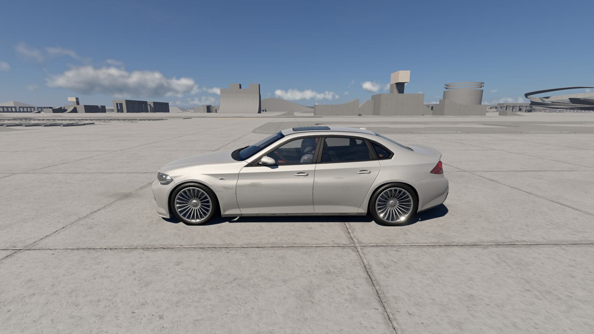
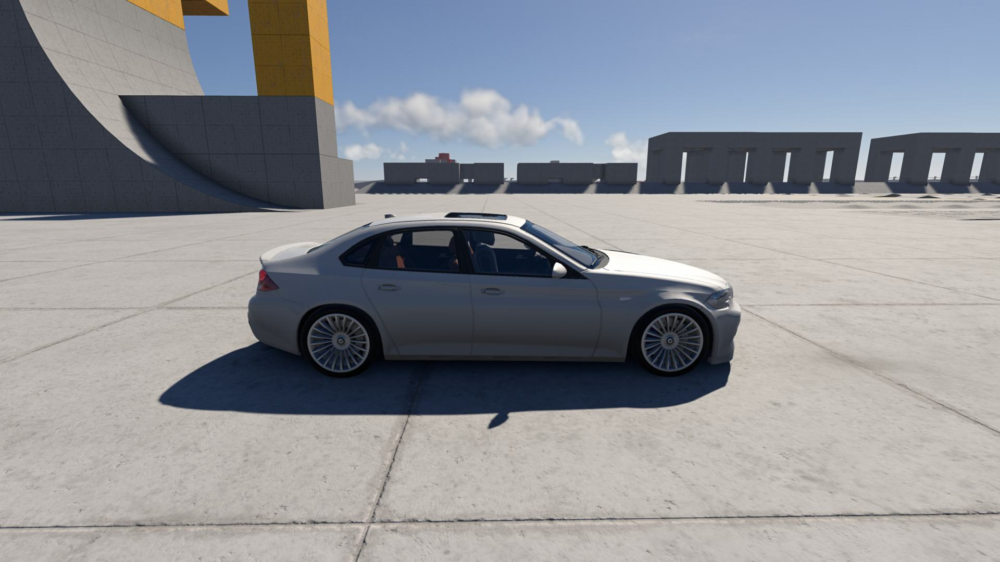
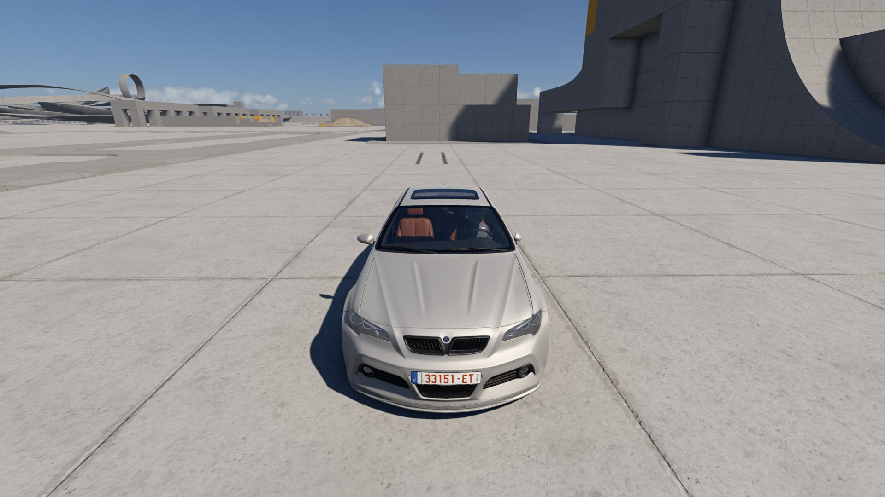
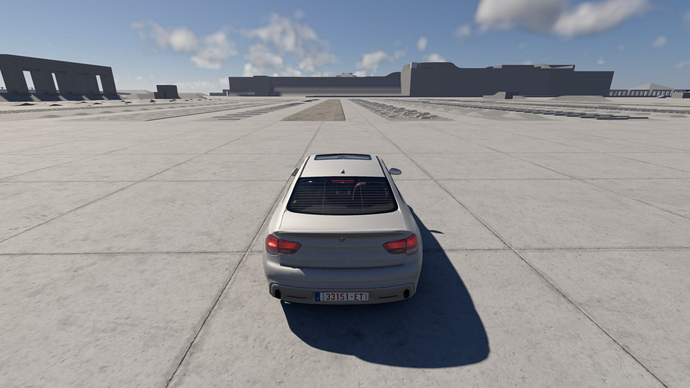
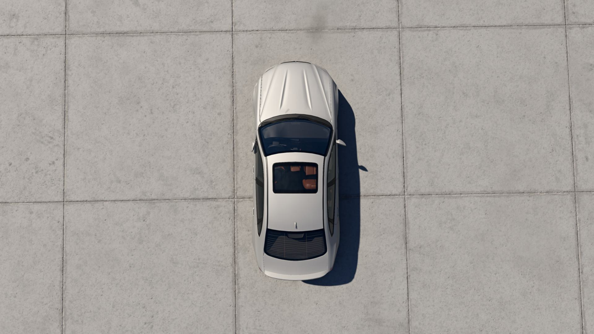

# sideslide - 20261114-172148_sideslide_m5-vulkan-plain

_on its side, sliding along the ground at 14 m/s - one long scrape_

Remaining queues: `{"bake": 0, "jobs": 0, "stamps": 0}`

Settled: True after 4.637 s - 265 frames, 56.4 fps average from sampled wall intervals (background limiter lifted)
Went past upside down: True (lowest up-vector z -0.164)

## Marks

| contacts | passed filters | impacts | streams | stamps | projections | bakes | missed | jobs dropped | deferred frames |
|---|---|---|---|---|---|---|---|---|---|
| 2248 | 386 | 102 | 90 | 153 | 94 | 72 | 0.0% | 0 | 16 |

Rejected contacts: Wheel 1152, BelowThresh 709, NormalForce 1

Body materials: METAL 288, PLASTIC 98

Surfaces: ASPHALT 386

## Cost

| | avg | p95 | max |
|---|---|---|---|
| painter (GE), ms/frame | 3.843 | 21.315 | 65.912 |
| whole frame, ms | 15.62 (p50) | 36.981 | 79.497 |
| all GE Lua, ms | | 22.451 | 66.847 |
| physics + vehicle Lua, ms | | 0.162 | 3.721 |
| render, ms | | 2.616 | |

- Painter frames over 4 ms: 84; worst flush (project + bake) 65.877 ms, worst composite 0.088 ms.
- Detector: 1.99 us per contact, 8.872 ms total, worst frame 0.734 ms (profiled; the timer adds a little).

### Worst frames

| t (s) | frame ms | painter ms | GE Lua ms | physics+VLUA ms | render ms |
|---|---|---|---|---|---|
| 0.38 | 79.50 | 65.91 | 1.01 | 0.06 | 2.09 |
| 0.17 | 50.77 | 37.06 | 1.05 | 0.08 | 2.04 |
| 2.07 | 48.85 | 20.07 | 1.14 | 0.14 | 2.32 |
| 2.27 | 45.31 | 23.40 | 1.13 | 0.07 | 2.28 |
| 1.86 | 42.68 | 22.53 | 1.06 | 0.15 | 2.09 |

## Screenshots

