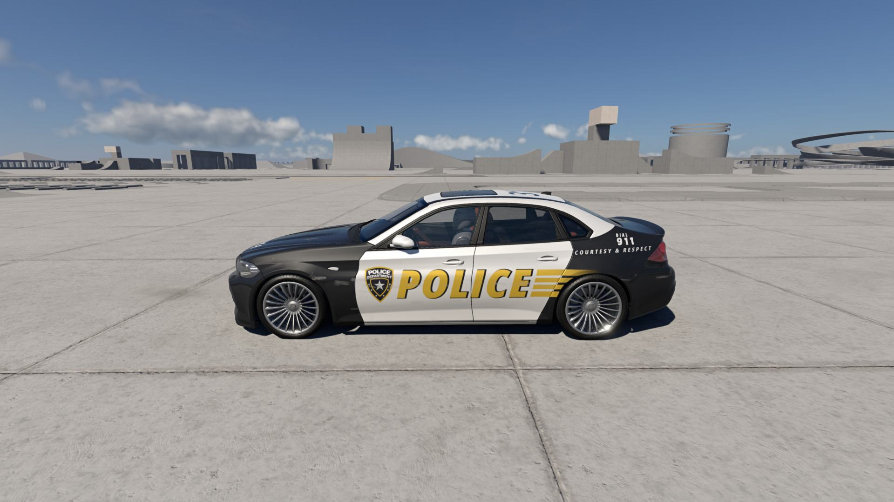
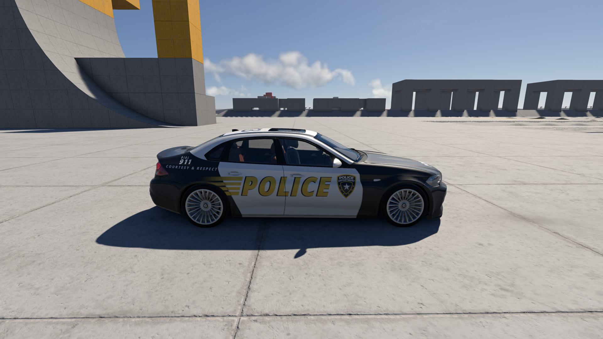
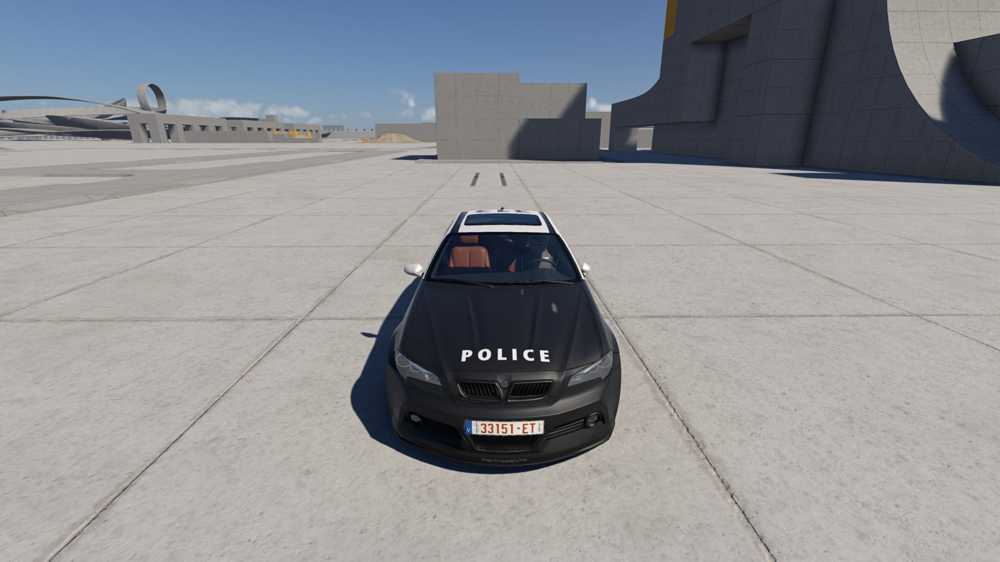
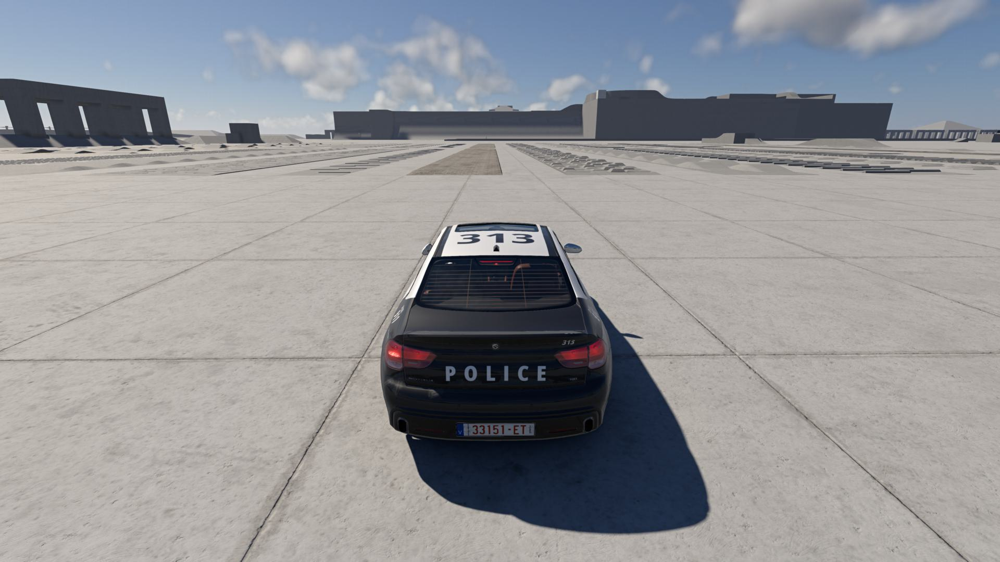
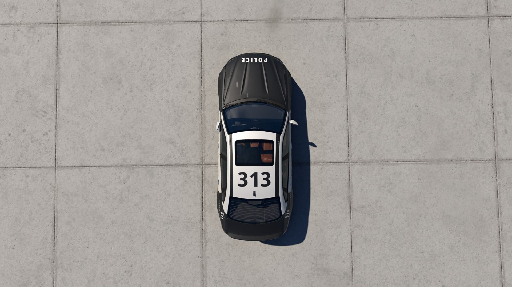

# sideslide - 20261114-172123_sideslide_m5-vulkan-police

_on its side, sliding along the ground at 14 m/s - one long scrape_

Remaining queues: `{"bake": 0, "jobs": 0, "stamps": 0}`

Settled: True after 4.204 s - 248 frames, 60.1 fps average from sampled wall intervals (background limiter lifted)
Went past upside down: True (lowest up-vector z -0.152)

## Marks

| contacts | passed filters | impacts | streams | stamps | projections | bakes | missed | jobs dropped | deferred frames |
|---|---|---|---|---|---|---|---|---|---|
| 2312 | 553 | 91 | 122 | 138 | 86 | 82 | 0.0% | 0 | 16 |

Rejected contacts: Wheel 1275, BelowThresh 482, NormalForce 2

Body materials: METAL 404, PLASTIC 149

Surfaces: ASPHALT 553

## Cost

| | avg | p95 | max |
|---|---|---|---|
| painter (GE), ms/frame | 4.277 | 22.969 | 56.292 |
| whole frame, ms | 14.921 (p50) | 36.692 | 70.342 |
| all GE Lua, ms | | 24.087 | 57.182 |
| physics + vehicle Lua, ms | | 0.12 | 1.754 |
| render, ms | | 2.281 | |

- Painter frames over 4 ms: 91; worst flush (project + bake) 56.262 ms, worst composite 0.133 ms.
- Detector: 1.765 us per contact, 8.853 ms total, worst frame 0.645 ms (profiled; the timer adds a little).

### Worst frames

| t (s) | frame ms | painter ms | GE Lua ms | physics+VLUA ms | render ms |
|---|---|---|---|---|---|
| 0.40 | 70.34 | 56.29 | 0.75 | 0.04 | 1.93 |
| 0.18 | 60.94 | 45.72 | 1.19 | 0.12 | 2.65 |
| 2.52 | 49.21 | 37.18 | 0.98 | 0.07 | 1.62 |
| 2.10 | 42.72 | 36.38 | 1.09 | 0.05 | 1.37 |
| 3.35 | 40.97 | 21.09 | 1.23 | 0.06 | 1.49 |

## Screenshots

