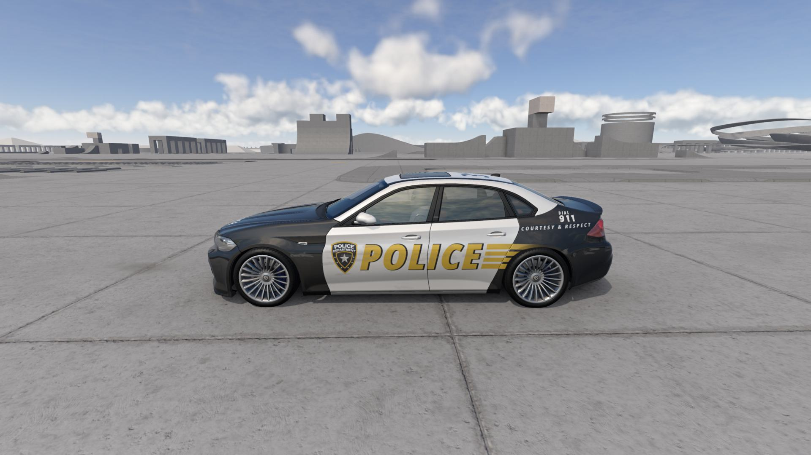
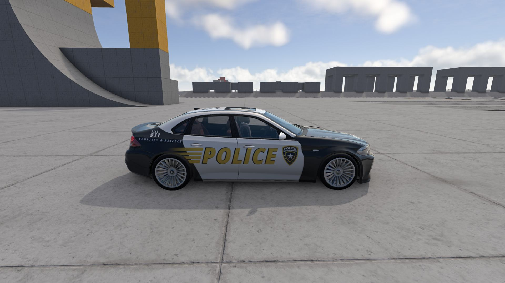
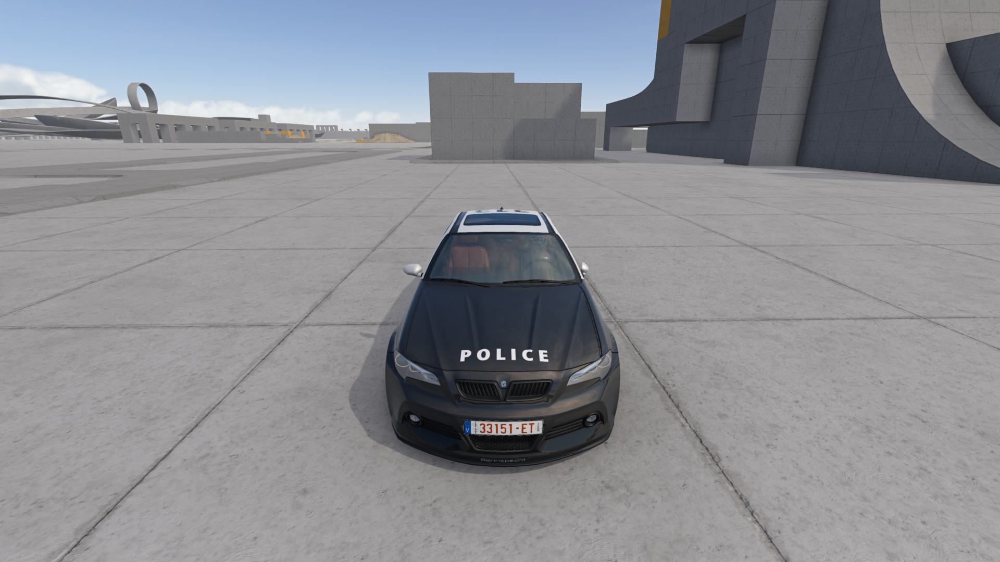
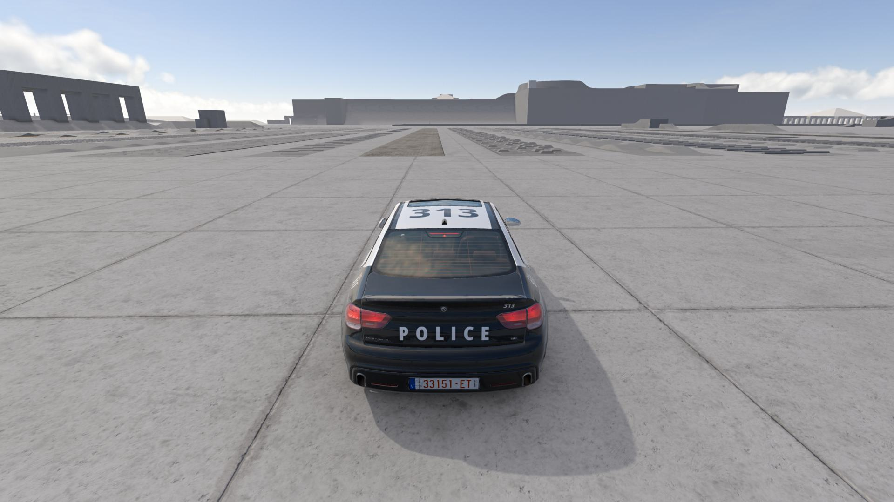
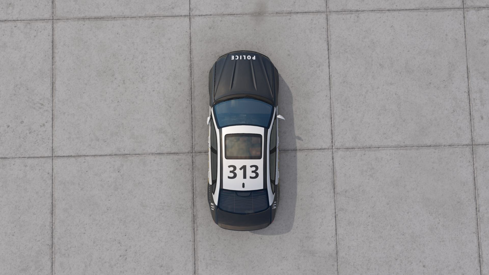

# sideslide - 20261114-172704_sideslide_m5-vulkan-wash-start

_on its side, sliding along the ground at 14 m/s - one long scrape_

Remaining queues: `{"bake": 0, "jobs": 0, "stamps": 0}`

Settled: True after 4.178 s - 255 frames, 62.2 fps average from sampled wall intervals (background limiter lifted)
Went past upside down: True (lowest up-vector z -0.163)

## Marks

| contacts | passed filters | impacts | streams | stamps | projections | bakes | missed | jobs dropped | deferred frames |
|---|---|---|---|---|---|---|---|---|---|
| 2120 | 543 | 88 | 109 | 131 | 87 | 74 | 0.0% | 0 | 16 |

Rejected contacts: Wheel 1118, BelowThresh 459

Body materials: METAL 406, PLASTIC 137

Surfaces: ASPHALT 543

## Cost

| | avg | p95 | max |
|---|---|---|---|
| painter (GE), ms/frame | 4.117 | 25.982 | 42.573 |
| whole frame, ms | 14.547 (p50) | 35.897 | 54.106 |
| all GE Lua, ms | | 27.191 | 43.403 |
| physics + vehicle Lua, ms | | 0.242 | 1.637 |
| render, ms | | 2.267 | |

- Painter frames over 4 ms: 80; worst flush (project + bake) 42.534 ms, worst composite 0.18 ms.
- Detector: 2.105 us per contact, 8.613 ms total, worst frame 0.502 ms (profiled; the timer adds a little).

### Worst frames

| t (s) | frame ms | painter ms | GE Lua ms | physics+VLUA ms | render ms |
|---|---|---|---|---|---|
| 0.40 | 54.11 | 42.57 | 0.99 | 0.05 | 2.04 |
| 1.64 | 52.89 | 40.87 | 0.97 | 0.07 | 1.31 |
| 0.19 | 52.75 | 39.61 | 1.08 | 0.08 | 1.52 |
| 1.85 | 52.35 | 41.41 | 0.89 | 0.05 | 1.21 |
| 2.05 | 51.09 | 36.93 | 1.12 | 0.07 | 1.73 |

## Screenshots

