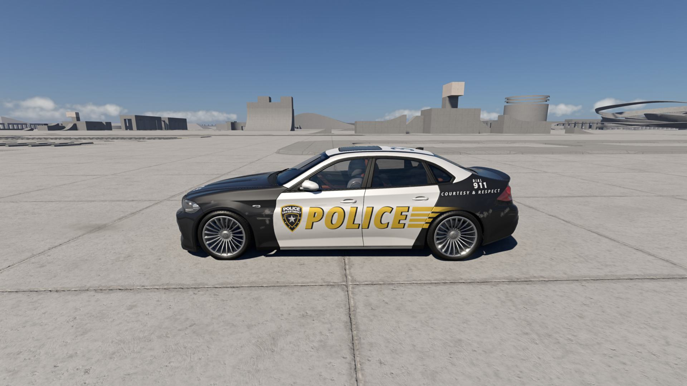
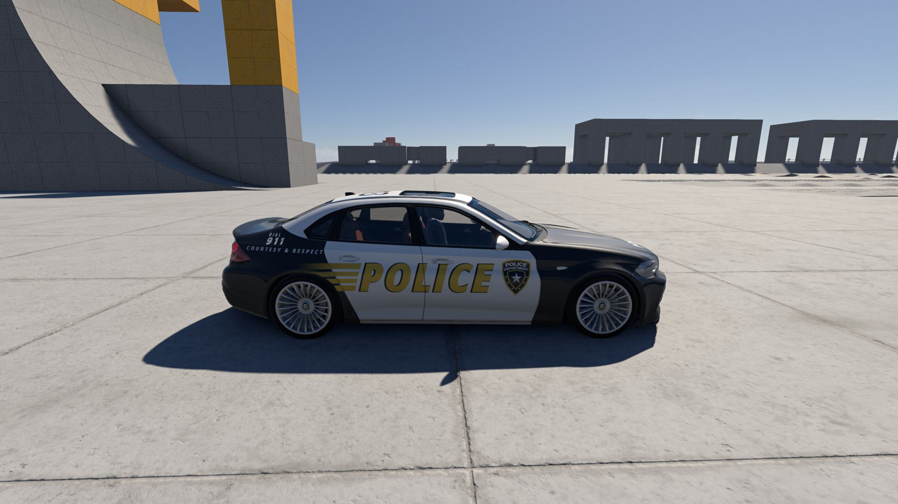
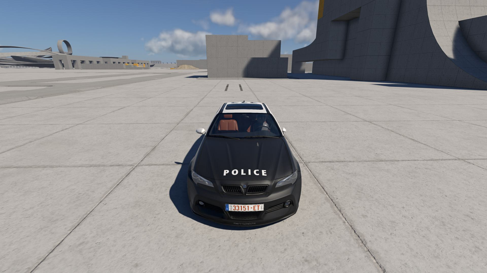
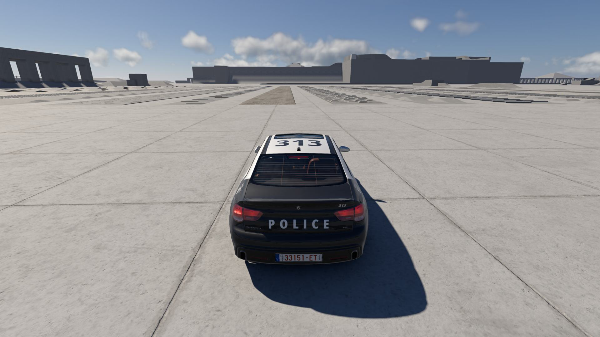
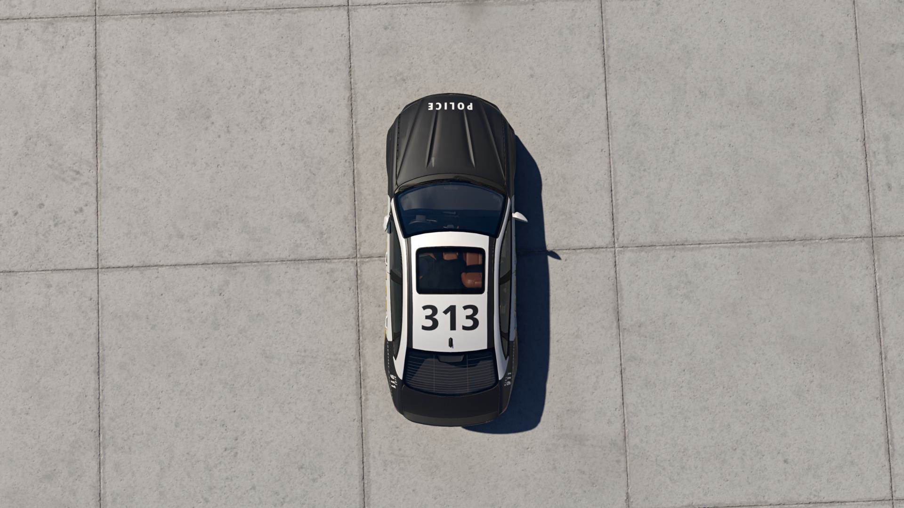

# sideslide - 20261114-171203_sideslide_m5-wash-start

_on its side, sliding along the ground at 14 m/s - one long scrape_

Remaining queues: `{"bake": 0, "jobs": 0, "stamps": 0}`

Settled: True after 4.552 s - 101 frames, 21.0 fps average from sampled wall intervals (background limiter lifted)
Went past upside down: True (lowest up-vector z -0.162)

## Marks

| contacts | passed filters | impacts | streams | stamps | projections | bakes | missed | jobs dropped | deferred frames |
|---|---|---|---|---|---|---|---|---|---|
| 835 | 248 | 98 | 42 | 204 | 73 | 56 | 0.0% | 0 | 13 |

Rejected contacts: Wheel 443, BelowThresh 143, NormalForce 1

Body materials: METAL 186, PLASTIC 62

Surfaces: ASPHALT 248

## Cost

| | avg | p95 | max |
|---|---|---|---|
| painter (GE), ms/frame | 31.22 | 57.27 | 70.002 |
| whole frame, ms | 55.065 (p50) | 78.14 | 93.009 |
| all GE Lua, ms | | 58.77 | 71.753 |
| physics + vehicle Lua, ms | | 9.117 | 14.529 |
| render, ms | | 3.703 | |

- Painter frames over 4 ms: 71; worst flush (project + bake) 65.604 ms, worst composite 0.142 ms.
- Detector: 2.914 us per contact, 7.45 ms total, worst frame 2.572 ms (profiled; the timer adds a little).

### Worst frames

| t (s) | frame ms | painter ms | GE Lua ms | physics+VLUA ms | render ms |
|---|---|---|---|---|---|
| 0.41 | 93.01 | 61.30 | 1.51 | 2.55 | 9.74 |
| 2.21 | 85.62 | 60.45 | 23.93 | 0.19 | 3.09 |
| 1.33 | 85.45 | 65.66 | 1.51 | 5.12 | 3.00 |
| 0.21 | 84.20 | 70.00 | 34.25 | 0.16 | 3.70 |
| 2.75 | 81.62 | 59.55 | 55.76 | 0.10 | 3.41 |

## Screenshots

