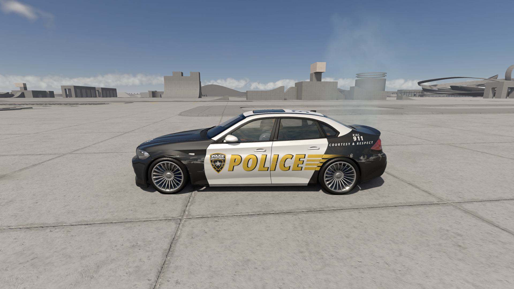
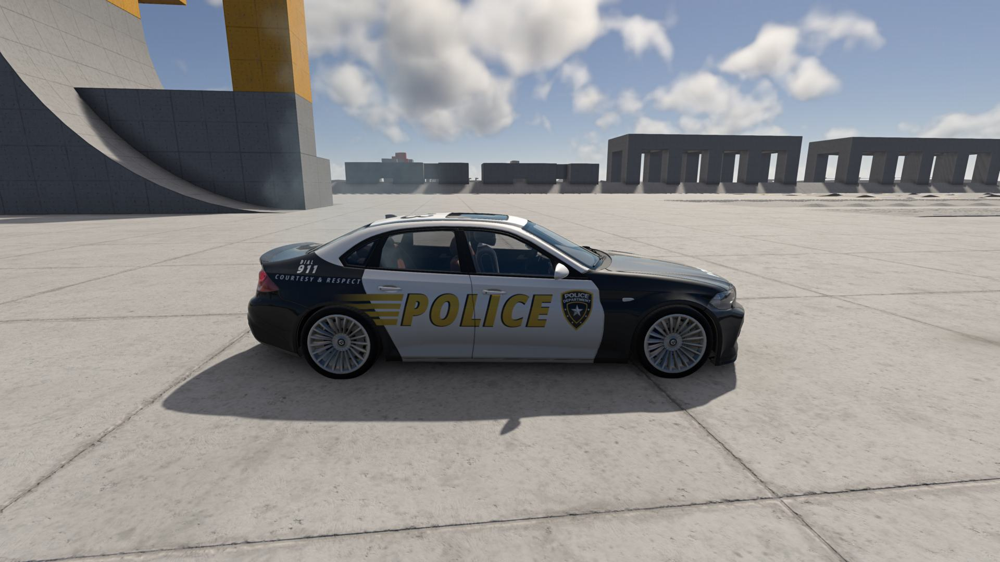
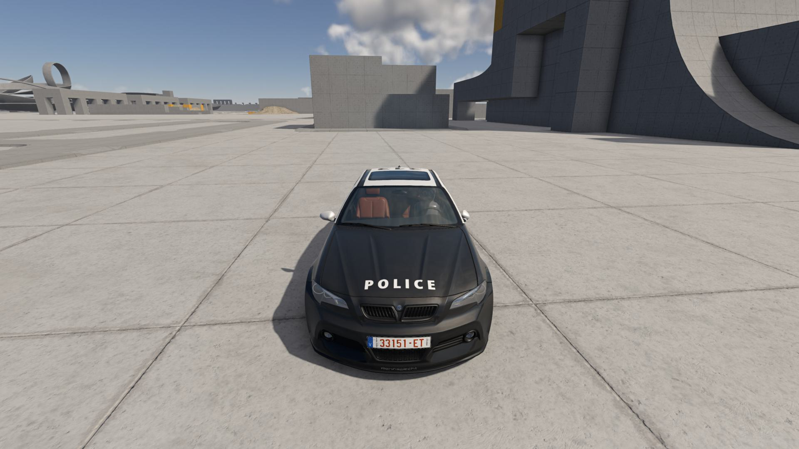
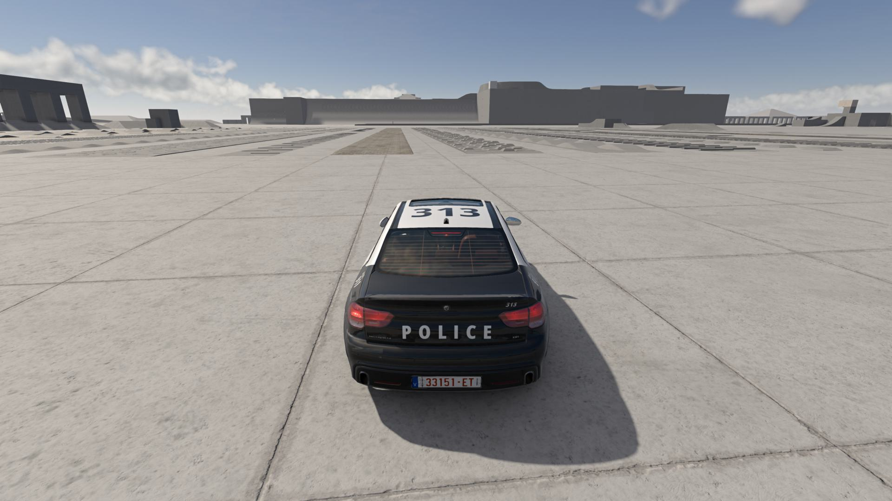
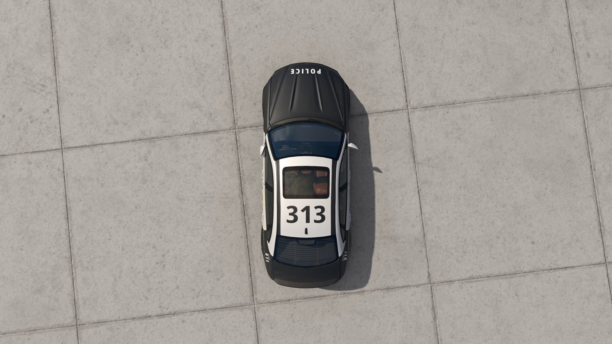

# sideslide - 20261115-084358_sideslide_zip-install-test

_on its side, sliding along the ground at 14 m/s - one long scrape_

Remaining queues: `{"bake": 0, "jobs": 0, "stamps": 0}`

Settled: True after 6.906 s - 529 frames, 139.3 fps average from sampled wall intervals (background limiter lifted)
Went past upside down: True (lowest up-vector z -0.079)

## Marks

| contacts | passed filters | impacts | streams | stamps | projections | bakes | missed | jobs dropped | deferred frames |
|---|---|---|---|---|---|---|---|---|---|
| 2456 | 954 | 48 | 118 | 78 | 61 | 52 | 0.0% | 0 | 13 |

Rejected contacts: Wheel 1144, BelowThresh 355, NormalForce 3

Body materials: METAL 752, PLASTIC 202

Surfaces: ASPHALT 954

## Cost

| | avg | p95 | max |
|---|---|---|---|
| painter (GE), ms/frame | 1.537 | 7.153 | 23.902 |
| whole frame, ms | 3.031 (p50) | 17.555 | 476.982 |
| all GE Lua, ms | | 8.389 | 25.034 |
| physics + vehicle Lua, ms | | 0.121 | 0.869 |
| render, ms | | 2.107 | |

- Painter frames over 4 ms: 51; worst flush (project + bake) 4.758 ms, worst composite 0.118 ms.
- Detector: 2.545 us per contact, 10.355 ms total, worst frame 0.409 ms (profiled; the timer adds a little).

### Worst frames

| t (s) | frame ms | painter ms | GE Lua ms | physics+VLUA ms | render ms |
|---|---|---|---|---|---|
| 1.35 | 476.98 | 0.00 | 1.23 | 0.05 | 1.25 |
| 0.79 | 32.56 | 23.90 | 3.61 | 0.05 | 1.38 |
| 1.26 | 30.63 | 22.05 | 7.38 | 0.07 | 1.85 |
| 0.38 | 22.80 | 11.21 | 1.60 | 0.10 | 2.25 |
| 6.29 | 21.94 | 0.00 | 0.95 | 0.07 | 1.56 |

## Screenshots

