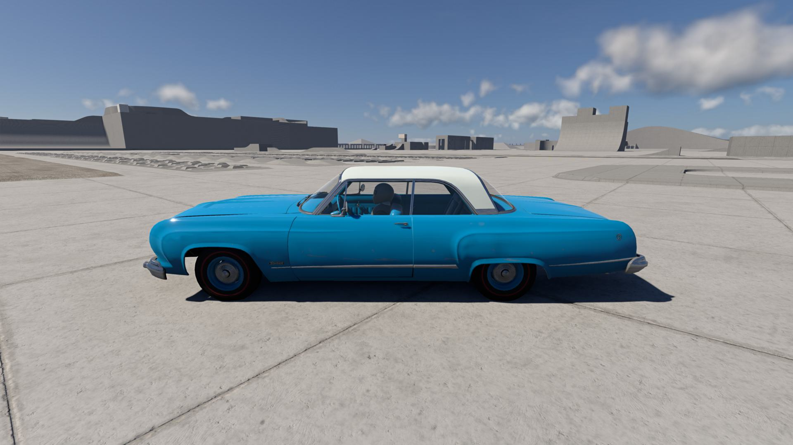

# sideslide - 20261115-104358_sideslide_v020-zip-bluebuck

_on its side, sliding along the ground at 14 m/s - one long scrape_

Remaining queues: `{"bake": 0, "jobs": 0, "stamps": 0}`

Settled: True after 4.092 s - 305 frames, 68.5 fps average from sampled wall intervals (background limiter lifted)
Went past upside down: True (lowest up-vector z -0.0)

## Marks

| contacts | passed filters | impacts | streams | stamps | projections | bakes | missed | jobs dropped | deferred frames |
|---|---|---|---|---|---|---|---|---|---|
| 3219 | 102 | 18 | 17 | 23 | 20 | 13 | 0.0% | 0 | 2 |

Rejected contacts: Wheel 3117

Body materials: METAL 102

Surfaces: ASPHALT 102

## Cost

| | avg | p95 | max |
|---|---|---|---|
| painter (GE), ms/frame | 0.402 | 0.961 | 29.942 |
| whole frame, ms | 13.124 (p50) | 17.305 | 455.654 |
| all GE Lua, ms | | 2.259 | 31.168 |
| physics + vehicle Lua, ms | | 0.109 | 0.375 |
| render, ms | | 2.037 | |

- Painter frames over 4 ms: 9; worst flush (project + bake) 2.954 ms, worst composite 0.05 ms.
- Detector: 0.813 us per contact, 5.101 ms total, worst frame 0.614 ms (profiled; the timer adds a little).

### Worst frames

| t (s) | frame ms | painter ms | GE Lua ms | physics+VLUA ms | render ms |
|---|---|---|---|---|---|
| 0.89 | 455.65 | 0.01 | 0.83 | 0.10 | 1.50 |
| 0.44 | 41.34 | 29.94 | 3.33 | 0.07 | 1.57 |
| 0.66 | 28.54 | 14.04 | 7.86 | 0.08 | 1.50 |
| 0.23 | 23.81 | 9.83 | 1.22 | 0.06 | 1.53 |
| 0.85 | 22.08 | 8.86 | 1.45 | 0.08 | 1.60 |

## Screenshots

