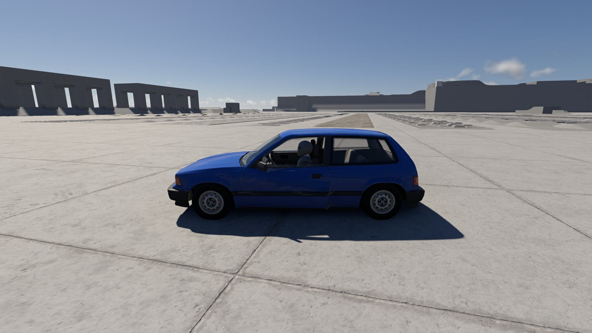

# sideslide - 20261115-104326_sideslide_v020-zip-covet

_on its side, sliding along the ground at 14 m/s - one long scrape_

Remaining queues: `{"bake": 0, "jobs": 0, "stamps": 0}`

Settled: True after 4.77 s - 371 frames, 77.5 fps average from sampled wall intervals (background limiter lifted)
Went past upside down: True (lowest up-vector z -0.01)

## Marks

| contacts | passed filters | impacts | streams | stamps | projections | bakes | missed | jobs dropped | deferred frames |
|---|---|---|---|---|---|---|---|---|---|
| 3135 | 1058 | 22 | 92 | 31 | 66 | 41 | 0.0% | 0 | 4 |

Rejected contacts: Wheel 1519, BelowThresh 553, NormalForce 5

Body materials: METAL 657, PLASTIC 401

Surfaces: ASPHALT 1058

## Cost

| | avg | p95 | max |
|---|---|---|---|
| painter (GE), ms/frame | 0.774 | 5.672 | 23.832 |
| whole frame, ms | 12.761 (p50) | 18.378 | 33.297 |
| all GE Lua, ms | | 6.687 | 24.712 |
| physics + vehicle Lua, ms | | 0.089 | 0.148 |
| render, ms | | 2.071 | |

- Painter frames over 4 ms: 33; worst flush (project + bake) 2.966 ms, worst composite 0.069 ms.
- Detector: 2.454 us per contact, 12.093 ms total, worst frame 0.454 ms (profiled; the timer adds a little).

### Worst frames

| t (s) | frame ms | painter ms | GE Lua ms | physics+VLUA ms | render ms |
|---|---|---|---|---|---|
| 0.42 | 33.30 | 23.83 | 3.59 | 0.06 | 1.99 |
| 0.62 | 29.33 | 20.60 | 3.86 | 0.06 | 1.50 |
| 2.53 | 25.69 | 0.01 | 0.78 | 0.04 | 1.66 |
| 2.13 | 25.13 | 0.01 | 0.92 | 0.09 | 1.43 |
| 1.51 | 25.08 | 0.05 | 0.99 | 0.04 | 1.43 |

## Screenshots

