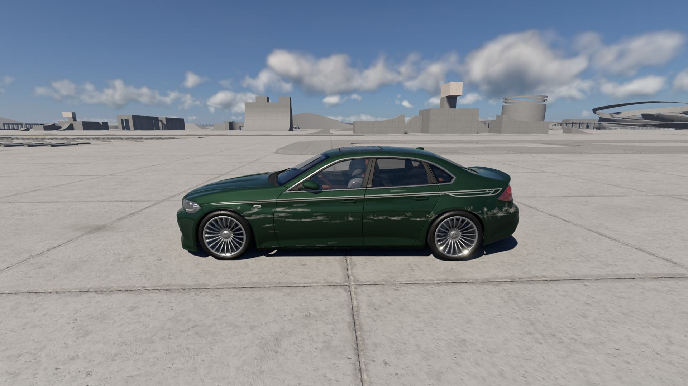

# sideslide - 20261115-104255_sideslide_v020-zip-etk800

_on its side, sliding along the ground at 14 m/s - one long scrape_

Remaining queues: `{"bake": 0, "jobs": 0, "stamps": 0}`

Settled: True after 4.093 s - 294 frames, 71.1 fps average from sampled wall intervals (background limiter lifted)
Went past upside down: True (lowest up-vector z -0.159)

## Marks

| contacts | passed filters | impacts | streams | stamps | projections | bakes | missed | jobs dropped | deferred frames |
|---|---|---|---|---|---|---|---|---|---|
| 2820 | 673 | 74 | 115 | 115 | 83 | 60 | 0.0% | 0 | 15 |

Rejected contacts: Wheel 1568, BelowThresh 577, NormalForce 2

Body materials: METAL 500, PLASTIC 173

Surfaces: ASPHALT 673

## Cost

| | avg | p95 | max |
|---|---|---|---|
| painter (GE), ms/frame | 1.634 | 8.07 | 31.475 |
| whole frame, ms | 13.738 (p50) | 21.24 | 41.992 |
| all GE Lua, ms | | 9.141 | 32.289 |
| physics + vehicle Lua, ms | | 0.103 | 1.023 |
| render, ms | | 2.082 | |

- Painter frames over 4 ms: 57; worst flush (project + bake) 4.017 ms, worst composite 0.093 ms.
- Detector: 1.836 us per contact, 11.021 ms total, worst frame 1.831 ms (profiled; the timer adds a little).

### Worst frames

| t (s) | frame ms | painter ms | GE Lua ms | physics+VLUA ms | render ms |
|---|---|---|---|---|---|
| 0.40 | 41.99 | 31.47 | 3.48 | 0.05 | 1.51 |
| 3.18 | 26.65 | 0.01 | 1.03 | 0.04 | 1.45 |
| 1.94 | 26.22 | 0.02 | 0.91 | 0.04 | 1.42 |
| 1.73 | 25.70 | 0.01 | 0.83 | 0.03 | 1.33 |
| 3.31 | 25.33 | 13.49 | 3.26 | 0.05 | 1.42 |

## Screenshots

