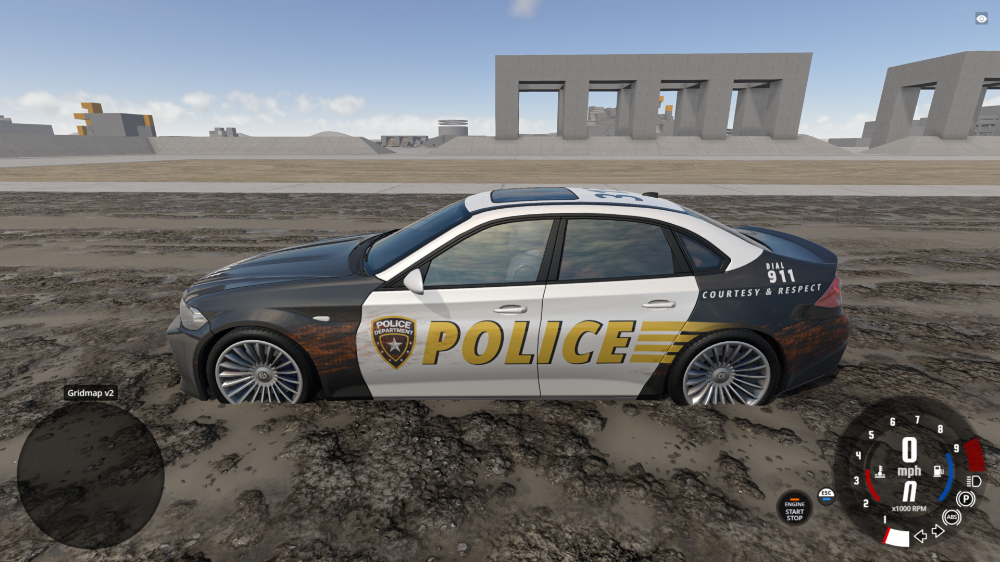
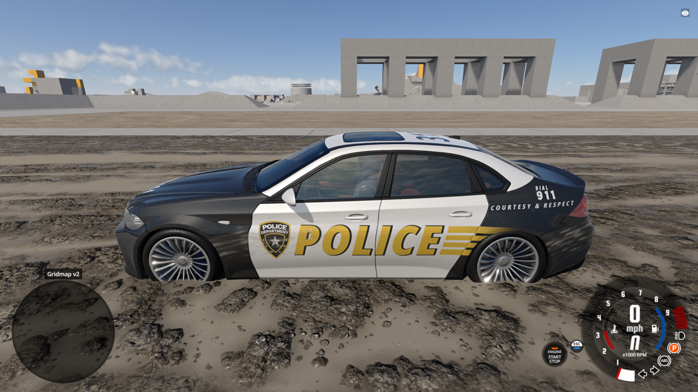

# Terrain-aware soil color

November 15, 2026. BeamNG 0.40.5.0 build 302427, Vulkan, RTX 3090,
Gridmap v2, ETK Rennspecht sedan with the stock Police skin. This is a short
visual regression, not a performance certification or a stable release.

## What changed

The old mud tint was a fixed orange-brown `(0.62, 0.36, 0.16)`. The new resolver
looks up the terrain material at each accepted world contact, verifies its
ground model matches the deposit kind, and samples a 3x3 neighborhood in its
local base-color map. Averaged macro/detail offsets use the material's near
strength settings. Modern terrain albedo is encoded for the vehicle decal's
sRGB base-color map; legacy diffuse-map averages retain their encoded color.

The final fixture's decal RGB varied with position, approximately
`(0.61, 0.59, 0.55)`, tagged `terrain-local`, material `Mud`.
It no longer uses the orange palette on this gray-brown strip.




These are separate real drives, not a pixel-matched A/B. Before had 31 deposits;
the final after run had 29. Camera distance is the same but final pose and marks
differ. The screenshots retain the ground for comparison. They show mud on the
front fender and rear quarter; the marks are less conspicuous on white doors.
This color change does not redesign the existing splash brush.

## Verification

`python tools/package.py`: 358 mock checks, Lua syntax/global checks and brush
sidecars passed. Added checks cover local coordinates, Y flip/wrap, color
encoding, texture reuse, terrain changes, memory/read bounds, missing textures,
invalid channels, unsupported APIs, ground-model mismatch and elevated contacts.

The six-second real mud drive produced **29 deposits and 29 baked layers**,
zero drops/failures, empty final queues, and zero filtered scratch calls,
impact events or scratch streams. Stationary count stayed at 29. The existing
main/extra body bindings and Police artwork remain visible. The fixture used
4096 damage width, bake3, flush 0.05 seconds, grouping on, coalescing off.
[Complete live state](mud.json).

Only the terrain resolver was separately timed: [first and cached timings](resolver-timing.json).
First use decodes textures synchronously and can hitch; cached contacts avoid
file reads. The painter's update/bake timers do **not** include this ingest cost.
No cold-process performance claim follows from this check. Existing Vulkan
frame stalls and D3D12 native-bake failures remain release blockers.

## Reproduce

With Gridmap v2 and a supported ETK already loaded, from the repository root:

```powershell
python tools/dev.py deploy
python tools/dev.py lua 'scratches_paint.setBakeBudget(3);scratches_paint.setFlushInterval(0.05);scratches_paint.setPanelGrouping(true);return true'
python tools/soil_probe.py mud --x -313 --seconds 6 --output docs/evidence/my-terrain-color
python tools/dev.py lua 'return jsonEncode(scratches_paint.getSurfaceState())'
python tools/dev.py lua 'core_camera.setByName(0,"orbit");simTimeAuthority.pause(false);getPlayerVehicle(0):queueLuaCommand([[input.event("throttle",0,1);input.event("brake",0,1);input.event("parkingbrake",0,1)]]);return true'
```

The probe resets/repositions the car, clears marks, drives the strip, captures
clean/early/late/stationary images and records JSON. The last command restores
the orbit camera and releases probe controls. No overnight/endurance run is used.

## Limits and remaining checks

- This is an albedo approximation, not a sample of rendered lighting. Terrain
  layer blends, puddles, decals, shadows, wet terrain and fine local macro/detail
  variation are not reproduced. Local base sampling assumes an unrotated terrain.
- Matching kind and proximity within one metre guard against unrelated terrain
  beneath mesh roads. Coincident mesh surfaces cannot be identified perfectly.
- Missing APIs, unreadable base maps and incompatible contacts use restrained
  fallback colors. Legacy/oversized base maps can use whole-texture averages.
- Caches hold at most 32 texture records per terrain. Retained base bitmaps share
  an 8M-pixel budget (about 32 MiB for RGBA); detail bitmaps are released after
  averaging. Texture decoding still has temporary memory and first-use cost.
  A terrain change or painter reload clears the cache. Runtime edits to the same
  terrain's texture files require a painter reload.
- New tint applies to new deposits; baked marks retain their original color.
  Dirt/snow color, reverse spray and washing across both body materials still
  need live regression. Other terrains/renderers are not certified by this pass.
