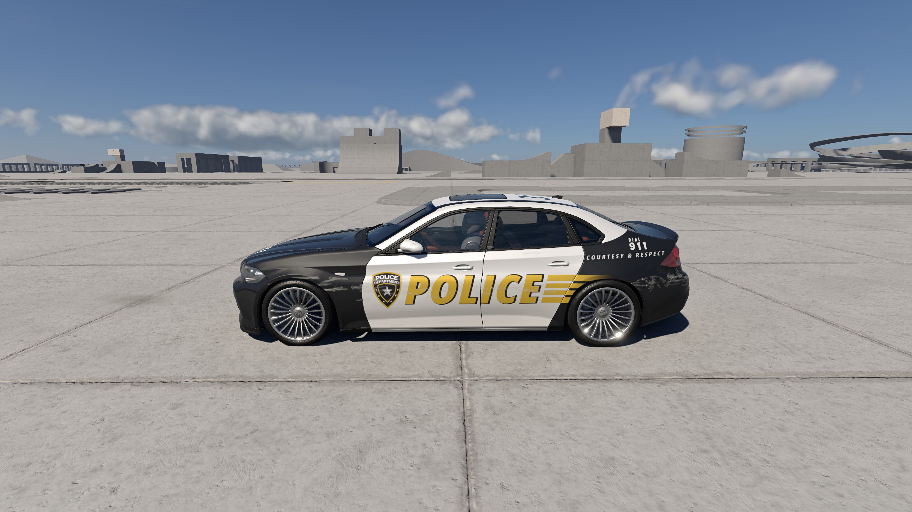
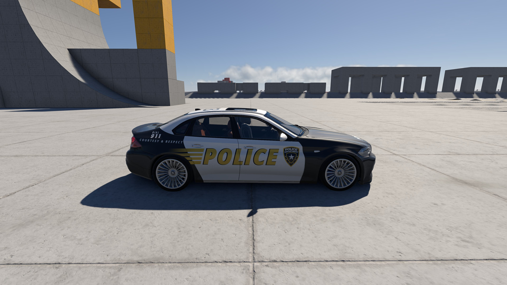
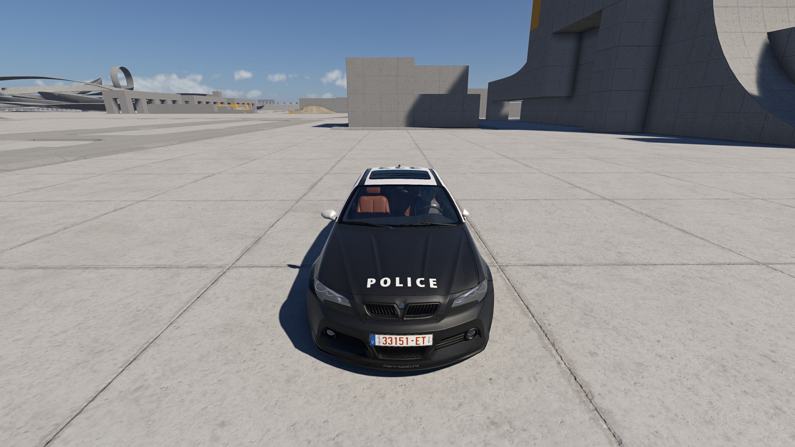
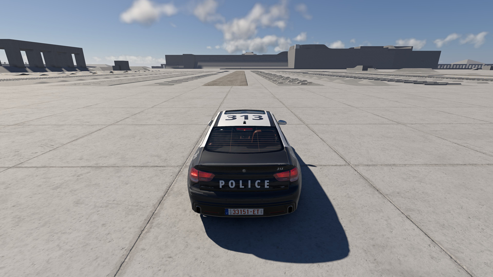
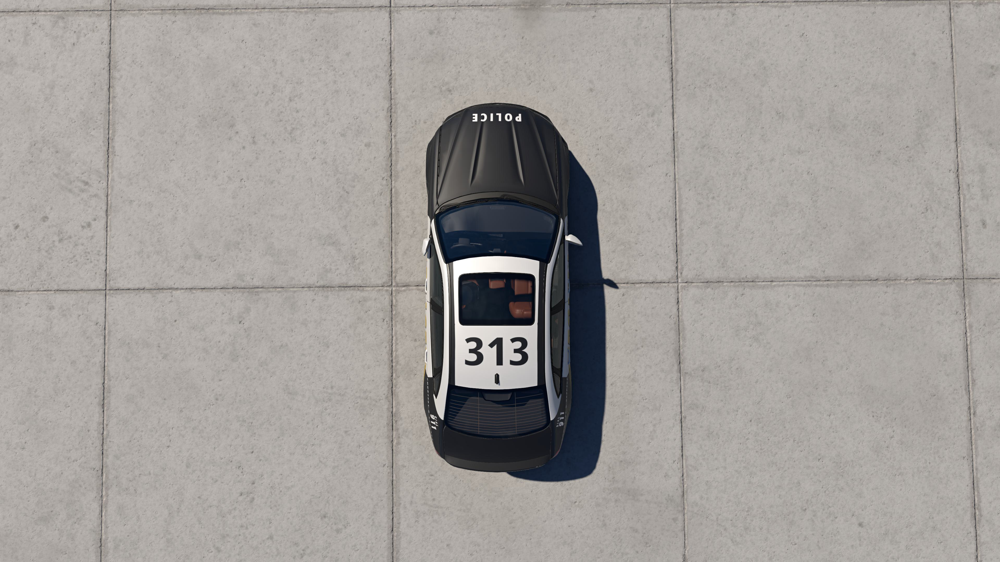

# sideslide - 20261114-232332_sideslide_visibility-fix

_on its side, sliding along the ground at 14 m/s - one long scrape_

Remaining queues: `{"bake": 0, "jobs": 0, "stamps": 0}`

Settled: True after 4.08 s - 304 frames, 74.6 fps average from sampled wall intervals (background limiter lifted)
Went past upside down: True (lowest up-vector z -0.145)

## Marks

| contacts | passed filters | impacts | streams | stamps | projections | bakes | missed | jobs dropped | deferred frames |
|---|---|---|---|---|---|---|---|---|---|
| 3032 | 765 | 73 | 128 | 101 | 75 | 60 | 0.0% | 0 | 14 |

Rejected contacts: Wheel 1632, BelowThresh 629, NormalForce 6

Body materials: METAL 581, PLASTIC 184

Surfaces: ASPHALT 765

## Cost

| | avg | p95 | max |
|---|---|---|---|
| painter (GE), ms/frame | 1.734 | 7.048 | 44.605 |
| whole frame, ms | 12.581 (p50) | 21.047 | 55.35 |
| all GE Lua, ms | | 8.128 | 45.507 |
| physics + vehicle Lua, ms | | 0.096 | 0.168 |
| render, ms | | 3.387 | |

- Painter frames over 4 ms: 58; worst flush (project + bake) 3.025 ms, worst composite 0.079 ms.
- Detector: 1.91 us per contact, 10.695 ms total, worst frame 0.674 ms (profiled; the timer adds a little).

### Worst frames

| t (s) | frame ms | painter ms | GE Lua ms | physics+VLUA ms | render ms |
|---|---|---|---|---|---|
| 0.20 | 55.35 | 44.61 | 2.61 | 0.09 | 2.79 |
| 0.40 | 45.07 | 35.51 | 3.23 | 0.06 | 3.08 |
| 0.21 | 28.25 | 21.16 | 45.51 | 0.07 | 2.17 |
| 3.36 | 27.93 | 0.01 | 0.95 | 0.05 | 2.36 |
| 0.62 | 26.11 | 18.55 | 3.11 | 0.06 | 2.32 |

## Screenshots

