# Features

[Docs index](README.md) · [Back to the project front page](../README.md)

The detailed write-up of everything the mod does today. For the short version
see the [front page](../README.md); for costs see [performance](performance.md);
for the internals see [how it works](how-it-works.md).

**Contact-driven paint damage, mud, snow and washing for BeamNG.drive.**
Slide along the tarmac and the panels that touched get scrape bands running
the way the car slid. Clip a wall and that corner chips. Drive through mud or
snow and it builds up behind the wheels. Drive into deep water and it washes
off, while the scratches stay. Every mark comes from a physics contact that
actually happened and is baked into the car's paint without touching its livery.

> **Status: development preview.** Everything on this page runs in game today on
> BeamNG.drive 0.40.6.0, on **all 38 stock cars, trucks and buses that ship
> Dynamic Textures**, with any paint colour or factory livery.
> **[Download v0.2.0-preview](https://github.com/stephenfjohnson/beamng-scratches-mod/releases/tag/v0.2.0-preview)** (MIT licensed), or
> [build the ZIP yourself](development.md#packaging-for-release).
> Release blockers, open bugs and ideas parked on archived branches live in
> **[TODO.md](../TODO.md)**.

It is purely cosmetic: the mod paints texture damage on top of whatever the
soft-body physics already did. It never changes deformation.

All images below are crops of real in-game captures from the
[evidence folders](evidence/). Before/after pairs come from the same run,
with the mod's stage switched on and off. `python tools/make_showcase.py`
rebuilds them.

- [Scrapes that follow the slide](#scrapes-that-follow-the-slide)
- [Impact chips and gouges](#impact-chips-and-gouges)
- [Your paint and livery stay underneath](#your-paint-and-livery-stay-underneath)
- [Works across the fleet](#works-across-the-fleet)
- [Mud, dirt and snow build up as you drive](#mud-dirt-and-snow-build-up-as-you-drive)
- [Splashes cross panel seams](#splashes-cross-panel-seams)
- [Mud the color of the ground](#mud-the-color-of-the-ground)
- [Soil that catches the light](#soil-that-catches-the-light)
- [Water washes soil off; scratches stay](#water-washes-soil-off-scratches-stay)
- [Soft ground doesn't scratch](#soft-ground-doesnt-scratch)
- [Stays out of your frame time](performance.md)
- [Editor-safe, lifecycle-safe](#editor-safe-lifecycle-safe)
- [In-game debug and tuning panel](#in-game-debug-and-tuning-panel)
- [Developer tooling](#developer-tooling)

## Scrapes that follow the slide

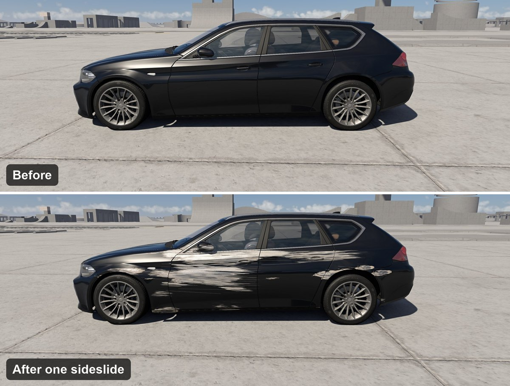

Sustained sliding contact is tracked per body node, then folded into **contact
patches**: an oriented box on one panel that grows over every node scraping
there. A patch is painted as one decal sized to that extent and aligned with the
slide, so a sideslide leaves long continuous bands with combed ends instead of a
scatter of small marks. A patch is worn in three tiers by how far it has been
dragged: clear-coat hairlines, primer ground through along the streaks, then
bands of bare metal inside a primer margin.

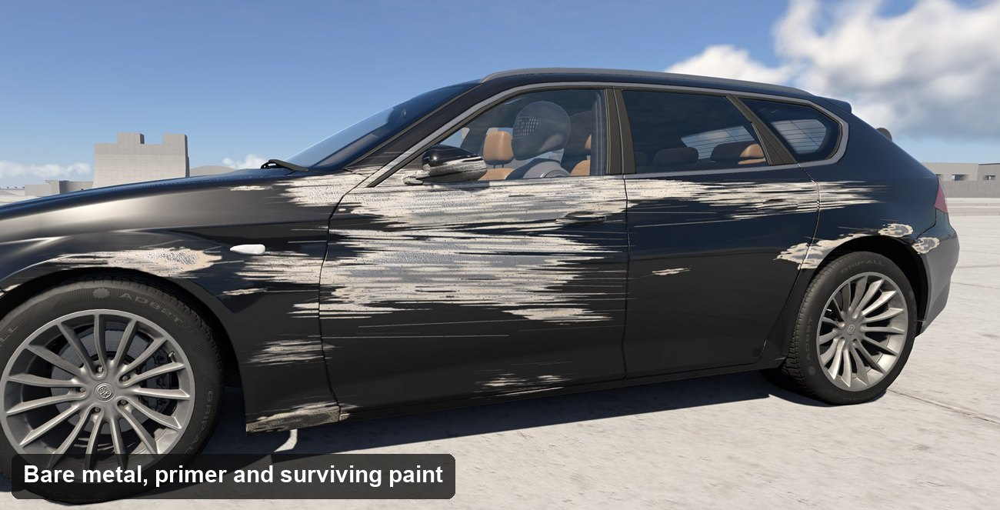

Bare metal is really metallic and primer is matte: tier 2 and 3 brushes carry
their own metallic and roughness maps, and a fine tiling detail layer adds
abrasion relief and specks of surviving paint that the 1.5 mm canvas can't hold.
On plain light paint the exposed tone is darker so damage contrasts the right way.

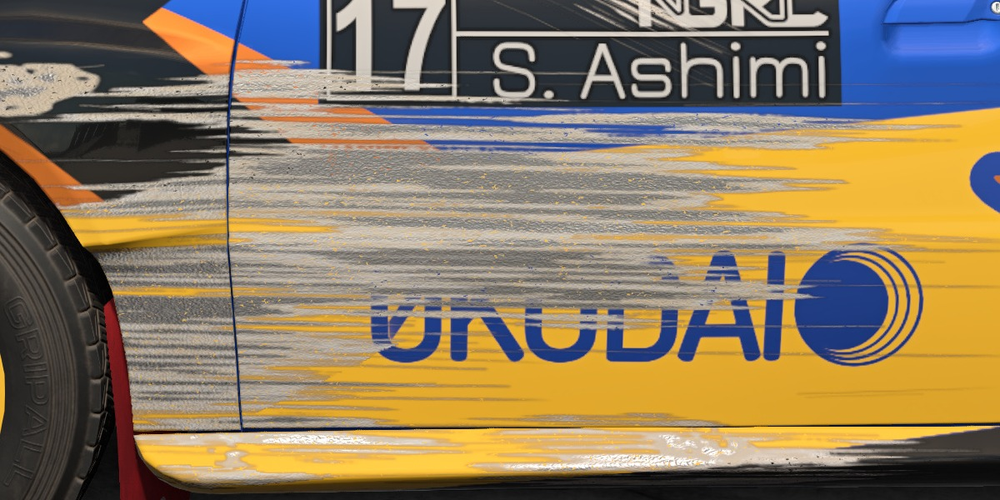

## Impact chips and gouges

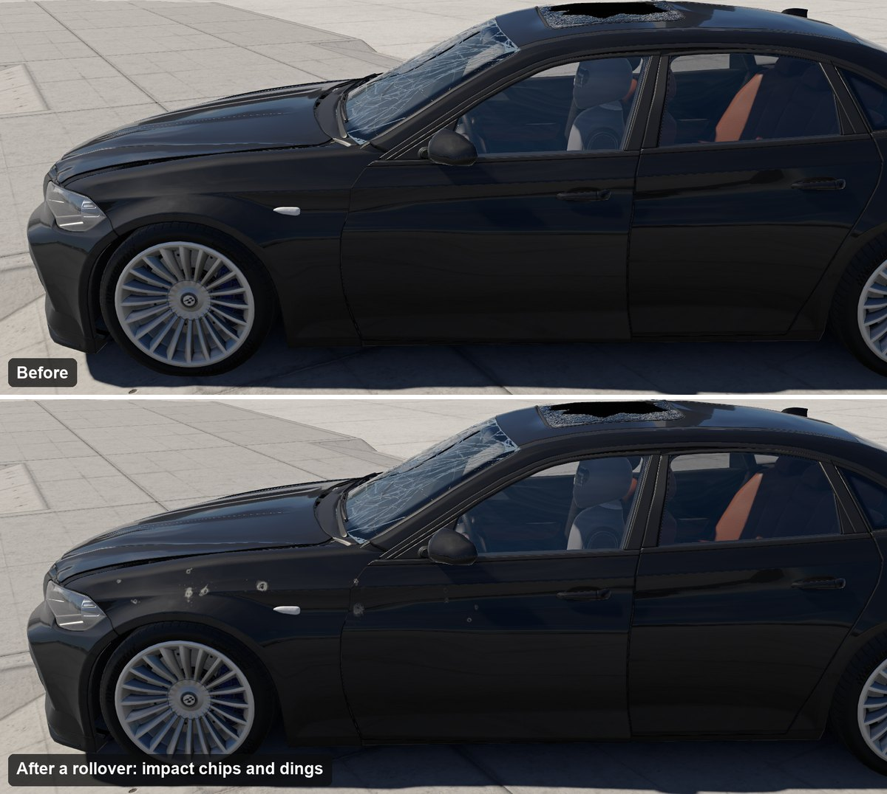

Hard hits past a normal-force threshold gather into impact patches: every hit
within about 17 cm becomes one cluster of flaked paint, sized by how hard and how
often the spot was struck, with bare-metal cores on heavier hits. A glancing hit
uses a scored brush dragged along the slip direction the detector reports.

## Your paint and livery stay underneath

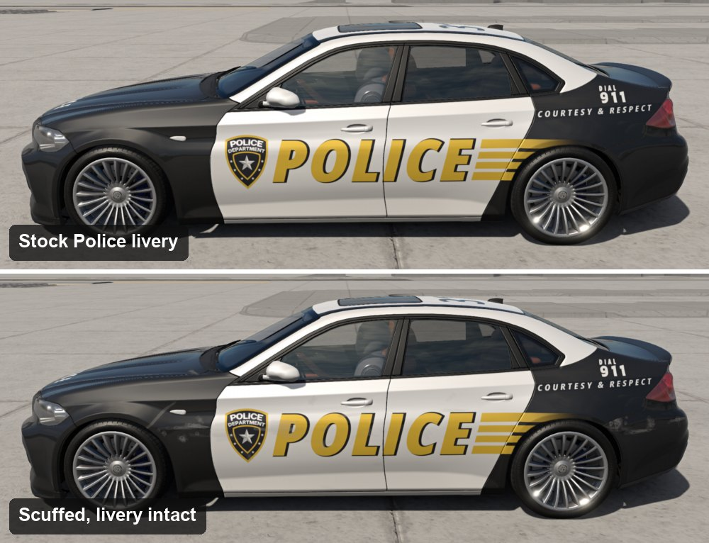

The body adapter clones the car's own body materials per vehicle and appends a
damage stage and a soil stage. The original paint, palette, normal and detail
maps, metallic, roughness, clearcoat and livery artwork all render unchanged
beneath the marks. The Paint Design slot is never rewritten. It finds the body
the same way the game does: every mesh material that has a Dynamic Textures
variant in the vehicle's own folder (the ETK's main body and separate
`etk800_extra` rear quarters, the SBR's four body kits, both Semi cabs). It
clones whichever material the renderer would use for the chosen livery.
Anything unexpected (non-PBR or already-full materials, another mod's body
override, your own Dynamic Textures editor design) is skipped, never overwritten.

## Works across the fleet

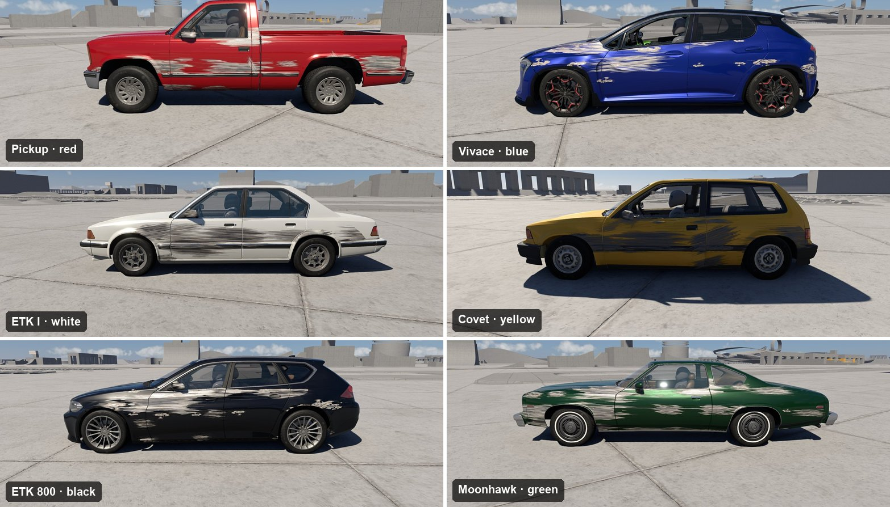

The same crash on six different bodies and paints. Each car keeps its own factory
finish. Exposed primer and metal read light on dark paint and darker on plain
light paint.

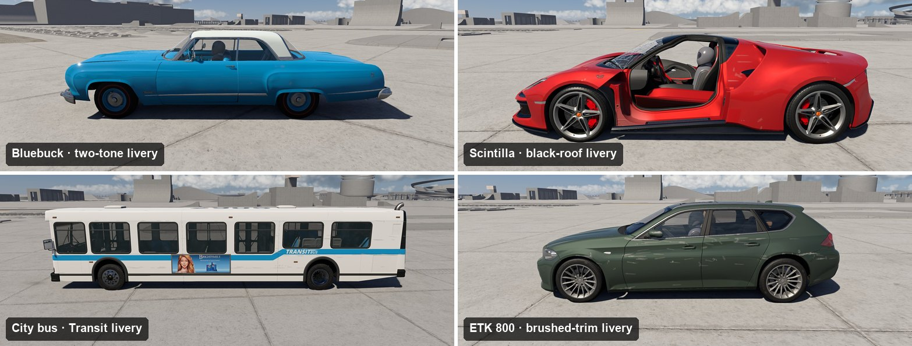

Factory liveries survive too: two-tones, police and rally artwork and the city
bus's Transit graphics are untouched wherever the car wasn't scraped. Damage on
white livery panels is subtler than on plain paint.

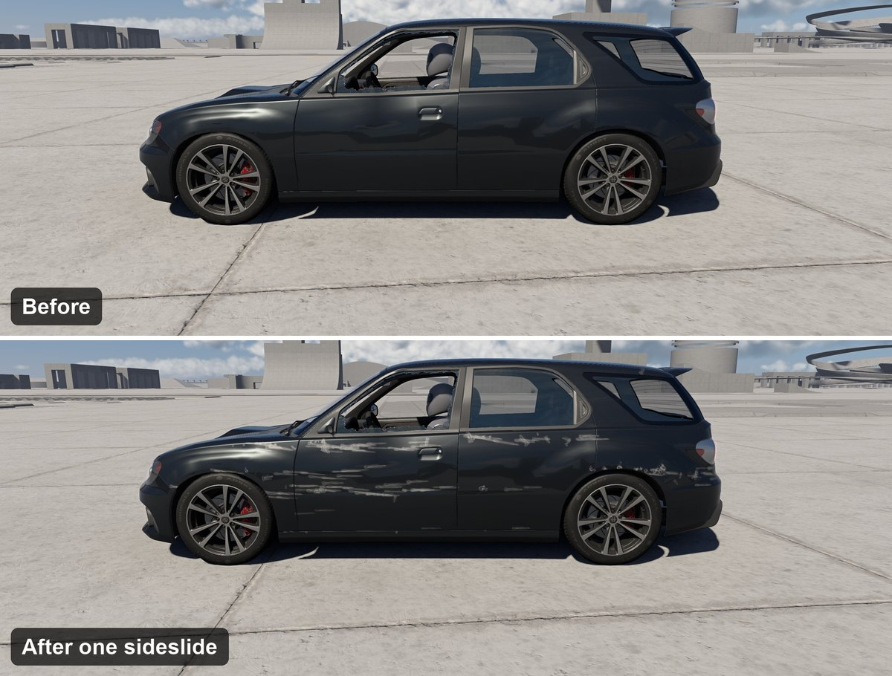

In a sweep of every stock vehicle, **38 of 38** that ship Dynamic Textures attach
to the adapter ([survey](evidence/adapter-survey/survey.json)). With contact
patches, ten were crashed on Vulkan and six on D3D12: every clone matched its
source material in every original stage and no mark was missed
([Vulkan](evidence/contact-patches/fleet-vulkan/fleet.json),
[D3D12](evidence/contact-patches/fleet-d3d12/fleet.json)). Mud, snow, washing
and wet gloss use the same appended stages on every vehicle, but so far they've
only been driven live on the ETK 800 and through Gridmap mud on a Covet.

## Mud, dirt and snow build up as you drive

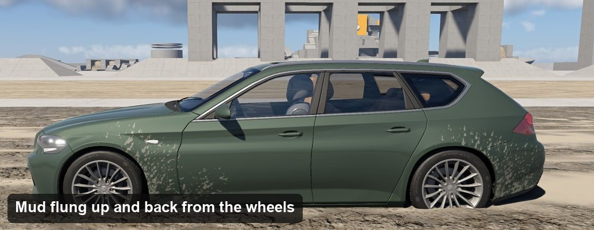

Rolling over real `MUD`, `DIRT` or `SNOW` ground materials deposits soil around
the wheels and lower panels. No wheelspin is needed, and stationary wheelspin adds
nothing. Mud and dirt are **flung**: each deposit is a fan thrown up and back from
the rear of the tyre, with drops stretched along their flight. Successive deposits
step through throw angles from about 25° to 85°, so a wheel builds a rooster tail
up the panel behind it; faster driving flattens and lengthens the throw, and
reversing flips it. Snow lands as soft coverage patches. Soil lives on its own
2048×1024 layer above the paint and damage, capped at 96 deposits per cycle.
(The [earlier flat splashes](showcase/mud-splashes.jpg) are what this replaced.)

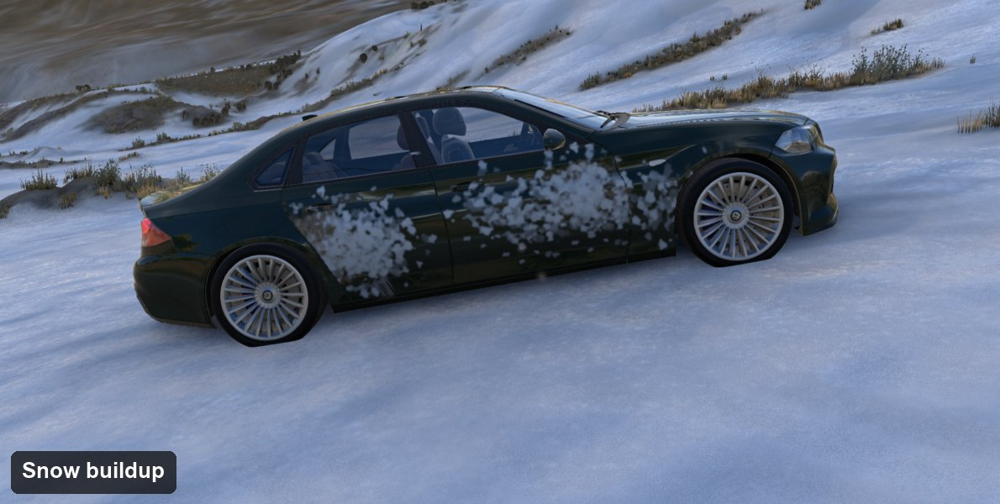

## Splashes cross panel seams

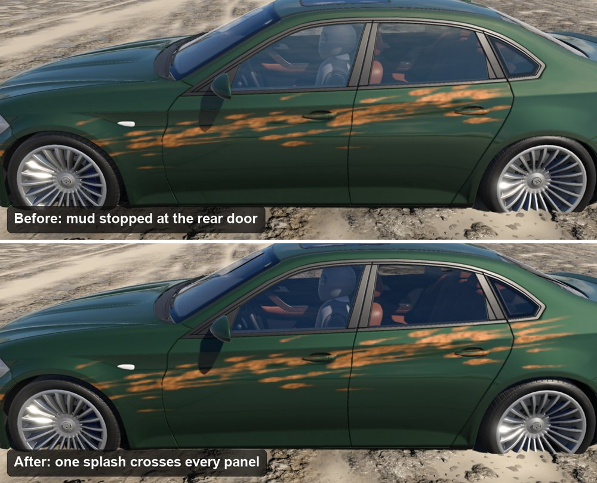

Each wheel fling is a single projection that spans neighbouring panels,
oriented in body space rather than restarted per panel (the image predates the
fling artwork). The ETK's rear
quarters use a different material from the doors. The adapter now clones and
binds that material too, so mud no longer stops dead at the rear door.

## Mud the color of the ground

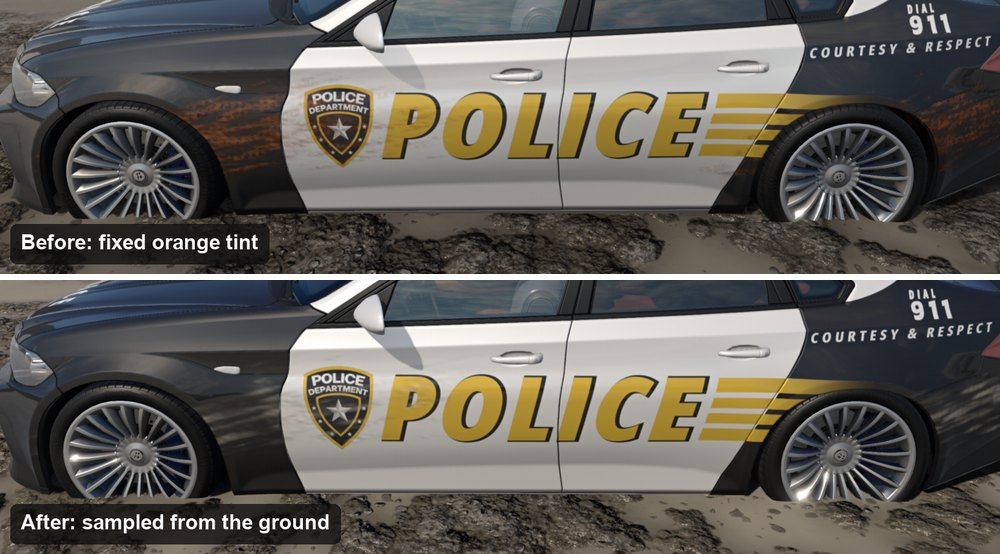

Soil tint is sampled from the terrain material under the wheel: the local base
map color plus averaged detail and macro color, converted into the vehicle
decal's color space. On Gridmap's grey mud strip the result is grey-brown grime
rather than the old fixed orange, which is why the after image looks so much
quieter. Mesh surfaces and unreadable maps fall back to a default tint. The
splash captures above predate this change, so they still show the orange tint.

## Soil that catches the light

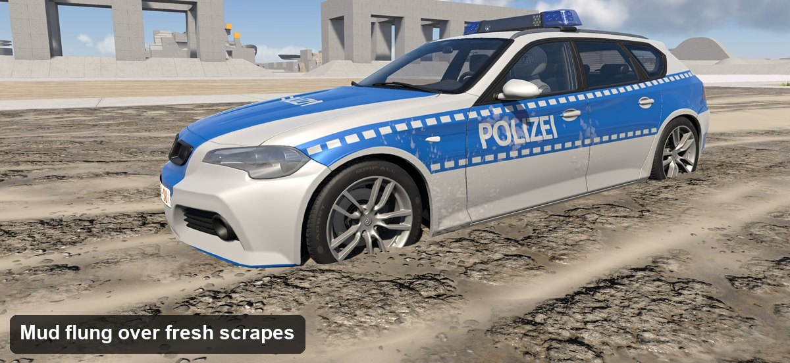

The soil layer carries a masked detail normal, so lumps and grain pick up
highlights while the factory body normal stays intact. The relief fades with the
soil when it washes off. This car slid first and drove through mud afterwards:
the scrapes stay on their own layer under the fling.

## Water washes soil off; scratches stay

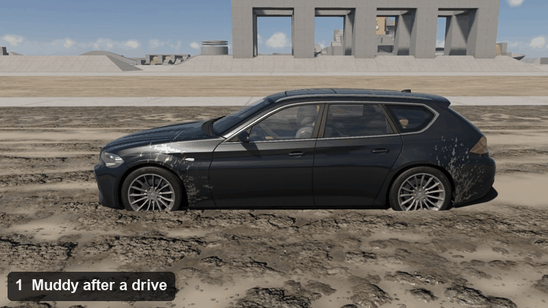

Submerge the body and the soil fades over about eight simulated seconds. Damage
lives on a separate layer, so baked scratches survive the wash. Back out of the
water, the clearcoat stays wet and dries back to its exact original values in
about 20 s. A fully washed car collects fresh soil again, and pausing the game
freezes all of it. The wash is a uniform fade rather than a waterline, so
puddles that only reach the wheels may do nothing.

## Soft ground doesn't scratch

Mud, snow and grass never emit scratch damage, even when a sunk body node pushes
into them hard. They only deposit soil. Dirt, sand, gravel and hard surfaces stay
abrasive. The contact's ground material decides which applies.

## Stays out of your frame time

Player car only, cheap detection, no native projection, one rich decal per
contact patch, composite only when needed, bounded everything. The measurements
and tables are on the [performance page](performance.md).

## Editor-safe, lifecycle-safe

The painter uses a private instance of the Dynamic Decals API, so clearing
scratches never wipes your decal-editor artwork. It pauses while the world or
livery editor owns rendering and resumes afterwards. Reset (`Ctrl+R`), vehicle
switching, vehicle/extension reloads and map changes are all handled cleanly.
They clear cosmetic marks; nothing persists across a reset. Two identical ETKs get separate private materials, and those are reclaimed once
the car and every mesh reference to them are gone.

## In-game debug and tuning panel

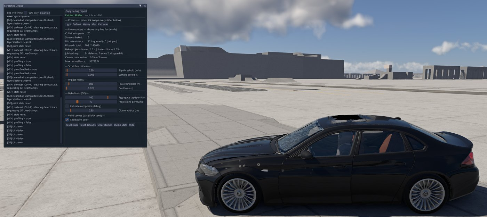

A bindable two-pane window. It has a live log merged from both Lua VMs, one-click
**Copy debug report**, Light→Extreme presets, live counters (impacts, streams,
bakes, backlog, composites) and sliders for every threshold and limit. See
[the debug panel](debug-panel.md).

## Developer tooling

- [`tools/dev.py`](../tools/dev.py) deploys and hot-reloads into the running game
  through BeamNG's built-in MCP server in about 2.5 s, and fails the deploy if
  the mod logs an error.
- [`tools/bench.py`](../tools/bench.py) runs scripted crash scenarios with
  per-frame timing and five-angle screenshots.
- [`tools/sim/harness.lua`](../tools/sim/harness.lua) has **492 headless checks**
  against mocked engine objects. No game is needed.
- [`tools/package.py`](../tools/package.py) builds the release ZIP behind a syntax,
  stray-global, harness and brush-sidecar preflight.
- `tools/perf_*.py` covers renderer cohorts, endurance sessions, ETW traces and
  allocation probes.
