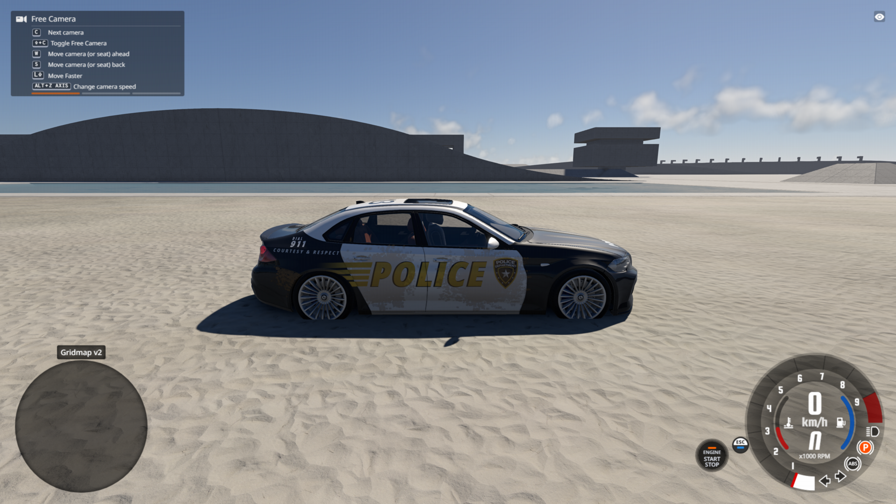
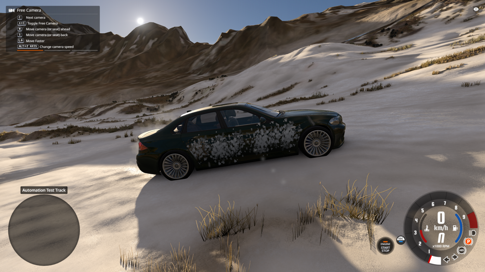
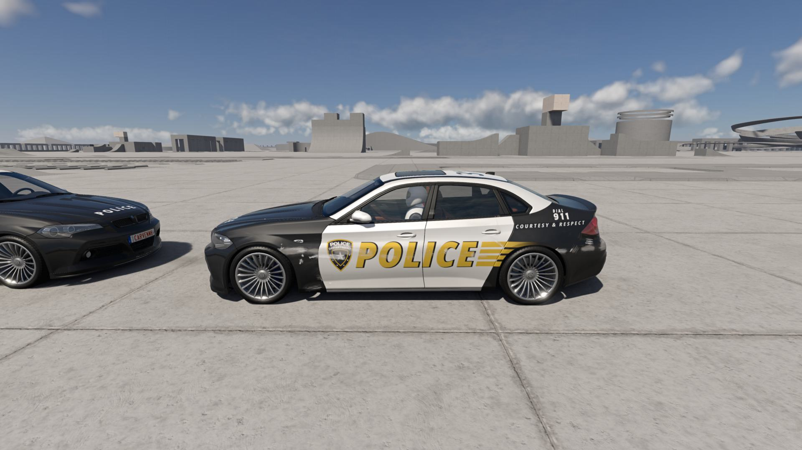

# Milestone history

How the mod got here, newest first. Each milestone links its investigation,
real in-game captures and the exact build/renderer/vehicle it was verified on.
The [README](../README.md) shows the current feature set; [TODO.md](../TODO.md)
tracks what is still open; the [changelog](../CHANGELOG.md) has the short version.

## Milestone 5: performance investigation (release blocked)

**Projection-free synthetic anchors (current default).** The native
`projectDynamicDecals` pass only read back the plane a decal is baked against; the
detector already knows each contact point and normal. Captured layers are now
anchored directly at their own contacts, so the scratch path makes **no native
projection calls**. On the exact tested setup (BeamNG 0.40.5.0, RTX 3090, ETK 800
Police, full 4096x2048 detail, every accepted layer kept):

* **Vulkan**: largest native call **35.4 ms** across 57 untraced fixtures including a
  ten-minute endurance (previously 508 ms); oldest input-to-completed-layer age
  **318 ms** (previously 1,012 ms). Intermittent ~410 ms engine render-phase frame
  pauses still occur (2 of 18 short fixtures; none above 250 ms in the endurance).
* **D3D12**: delivery age passes (max 600 ms), but **446/447 ms bake batches** still
  occur, so the native-call gate fails on D3D12.

The remaining stall is traced to the engine's native bake: every baked layer creates
and destroys about 112 MiB of full-resolution transient textures, which Lua cannot
pool or defer. `scratches_paint.setSyntheticAnchors(false)` restores the legacy
projected path for comparison. Stable release remains blocked; see
[investigation 12](../investigations/12-synthetic-anchors.md) for measurements,
captures and the allocation evidence.

The private ETK projection is reused across attachments, and captured layers drain
before more projection work. The full-detail experiment uses three-layer native
bake batches, faster flushing and same-panel grouping, with explicit conservation
of every accepted layer. Optional lower-resolution targets and representative
coalescing remain documented quality tradeoffs. Original paint/livery and the
separate washable soil target retain their resolution and materials. Default
damage remains 4096x2048.

Merged stream bands no longer duplicate later paths in the first band's haze.
ETK construction now prevents cached private materials from reaching another
vehicle, and unreferenced owned clones are reclaimed after destruction. This
requires invalidating the engine's JBeam construction cache for ETK spawns/reloads;
it can increase construction cost and does not run during steady scraping.

The corrected sustained fixture preserves internal vehicle motion and rejects
mid-run resets. Before synthetic anchors, the full-resolution Vulkan build reproduced a
**508 ms native projection** and a separate **965 ms frame interval** during
endurance, despite favorable cold and warm runs. The latter pushed completed-layer
age to 1,012 ms, failing the one-second gate. D3D12 warm tests of that build reached
**444 ms projection at full resolution and 184 ms at half resolution**. A separate
ETW diagnostic captured a graphics paging packet spanning about 423 ms of a
426 ms native call; the engine/driver root cause remains unresolved. The prior
6.52-second delays came from an older, physically unstable stress fixture and
must not be presented as directly comparable throughput evidence.

Milestone 5 code was merged to `master` on 2026-11-15 as a development preview
(`56ba091`); its acceptance gates are still open on D3D12 (see [TODO](../TODO.md)).
No milestone 6, stable release or all-hardware FPS claim. See the
[synthetic-anchor results](../investigations/12-synthetic-anchors.md),
[resumed implementation, criteria and limits](../investigations/11-quality-throughput.md),
[measured cohorts and charts](evidence/milestone5/resumed-summary.md),
[exact compatibility matrix](compatibility.md) and
[reproducible experimental settings](examples.md#resumed-quality-and-throughput-experiments).

## Milestone 4: scratch and impact polish

Play-test visibility adjustment: the damage stage now uses 1.6 opacity and an
unmuted diffuse factor on dark/plain and Police paint; light plain paint retains
its darker coating response. This increases existing baked-mark visibility without
adding projection work or changing soil. A real Police sideslide confirms visible
fender/rear-quarter scuffs, but marks across the white doors remain subtle. This is
a partial visibility improvement, not a completed mixed-livery contrast fix.
[Test report and screenshots](evidence/visibility/report.md).

Smaller, irregular depth-colored scuffs, chips and gouges replace the bright
single-tone brush marks. Four scrape/chip variants avoid immediate family
repeats; narrower bands and sub-centimeter jitter keep marks closer to contact.
The private ETK damage stage adjusts contrast without darkening washable soil.
Original PBR/livery stages and editor isolation remain intact.

[Matched engine captures, rejected experiments, measured costs and limitations](../investigations/09-scratch-impact-polish.md).
Light-paint scuffs are deliberately subtle; this is cosmetic color/roughness
approximation, not physical paint-layer fracture or per-mark metal shading.
Support remains ETK 800 main body, empty Paint Design or stock Police. No stable
release, generic compatibility, or milestone 5 certification is claimed.

## Milestone 3: water, washing and drying

On the supported ETK 800 main body (empty Paint Design or stock Police), water
progressively removes mud, dirt and snow while baked scratches remain. A separate
bounded soil texture sits above the original paint/livery and lasting damage.
Wet clearcoat dries back to its exact original values in about 20 simulated seconds.

Enter water that reaches the body and stay immersed to clean; wheel-only puddles
may do nothing. Full body immersion takes about eight simulated seconds for a full
soil cycle. Stationary immersion works, pause freezes progress, and a fully washed
car can collect fresh soil. This is uniform cosmetic fading, not a waterline mask;
partial washing also attenuates new deposits until that soil cycle is fully removed.
Reset, switch, reload and editor suspension still discard all cosmetic marks.

[Engine captures, reproducible probes, measured costs and limitations](../investigations/08-water-washing.md).
Milestone 3 evidence predates the milestone 4 polish described above.

## Milestone 2: progressive surface deposits

Soil now has a masked detail normal for small lumps and grain that catch the
light. It preserves the factory body normal and fades with soil opacity during
washing. This is lighting relief, not displacement or raised splash outlines.
Mud, dirt and snow share this detail because they share the soil layer. See the [before/after evidence and
reproduction steps](evidence/soil-relief/report.md).

Wheel mud/dirt now uses discrete droplet heads with tapered tails, aligned
against local travel rather than randomly rotated coverage patches. Faster
travel produces longer, flatter trails; reversing flips their direction. This
is baked splash art, not ongoing fluid movement. Snow and direct body contacts
keep their coverage brushes. A [real mud-strip capture](evidence/directional-soil/mud-close.png)
shows the first directional pass; dirt artwork and reverse motion still need
their own live visual validation.

Wheel splashes now span adjacent panels with one elongated projection and a
body-space direction. Both stock body materials are supported, including the
separate `etk800_extra` quarter panels and their Police skin; each retains its
own factory paint, normals and livery. Mud, scratches, washing and detail relief
reach both materials. [Panel-seam captures and reproduction steps](evidence/soil-continuity/report.md)
cover plain and Police paint. This fixes the previously clean rear quarters.

Soil tint now follows the contacted terrain material: local base-map color plus
averaged detail/macro color, converted for the vehicle decal's color space.
The Gridmap mud strip now deposits gray-brown mud instead of the old orange.
Mesh surfaces, unreadable maps and unmatched ground models use a fallback.
This approximates surface albedo; it does not copy shadows, puddles or terrain
layer blending. [Color captures, limits and reproduction](evidence/terrain-color/report.md).

Driving over real MUD, DIRT or SNOW collision materials adds overlapping soil
patches around the wheels and lower side panels. Rolling tires work without
wheelspin; stationary wheelspin adds nothing. Dedicated mud clumps, fine dirt
coverage and soft snow patches replace the tinted scratch-haze placeholders.
Deposits stop at 96 attempts per reset and share the bounded scratch scheduler.

Validated on the isolated ETK 800 main-body adapter, stock Police and plain
paint, BeamNG 0.40.5.0 build 302427 / D3D12. Gridmap v2 supplied mud/dirt;
Automation Test Track supplied snow. [Actual captures, exact configuration,
resource measurements and limits](../investigations/07-progressive-deposits.md).

This is a cosmetic coverage approximation, not volumetric snow or simulated
spray. Projection/bake spikes remain: the rolling cap run peaked at 27.3 ms
painter main-thread elapsed time, including native waits. Broad performance/vehicle certification remains future work.
Milestone 3 adds selective visual washing and wetness for this ETK scope.
Reset clears soil and scratches together.

This is a development build, not a stable public release. See
[compatibility](compatibility.md) and [driving examples](examples.md).

## Milestone 1: ETK 800 paint and police livery

A narrow material-preserving adapter supports the ETK 800 main body with an
**empty Paint Design or stock Police (`etk800_skin_police`)**. It keeps the
original paint/livery material channels beneath a separate scratch layer;
it does not replace the selected design or flatten it into a color image.
Other liveries and pre-existing Dynamic Textures designs are safely skipped.

Actual scratches, clean/reset fidelity, two-car switching, vehicle/extension
reload and editor ownership were checked on **0.40.5.0 build 302427 / Vulkan**.
[Exact scope, matched captures and evidence](../investigations/06-etk-material-adapter.md).
This is a development prototype, not generic livery or renderer certification.

The adapter can reload/repair the current car once on first activation to prepare
its private material. Reset, switching, reload and editor suspension discard
cosmetic marks. It pauses while the world/livery editor owns rendering and
resumes after closure. Save editor work before changing vehicles or designs.
Non-ETK plain vehicles retain the older Dynamic Textures path and its material
fidelity limitations. Never remove artwork to force the painter to start.
