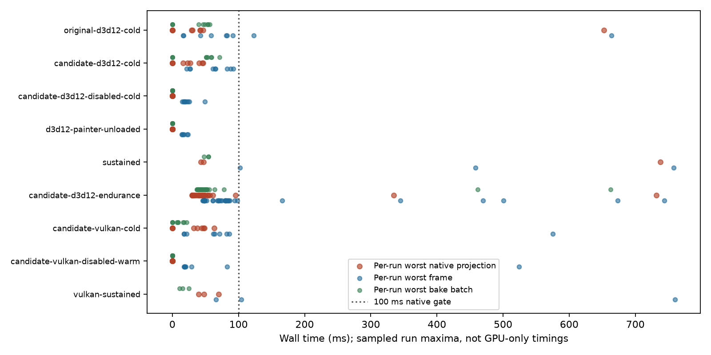
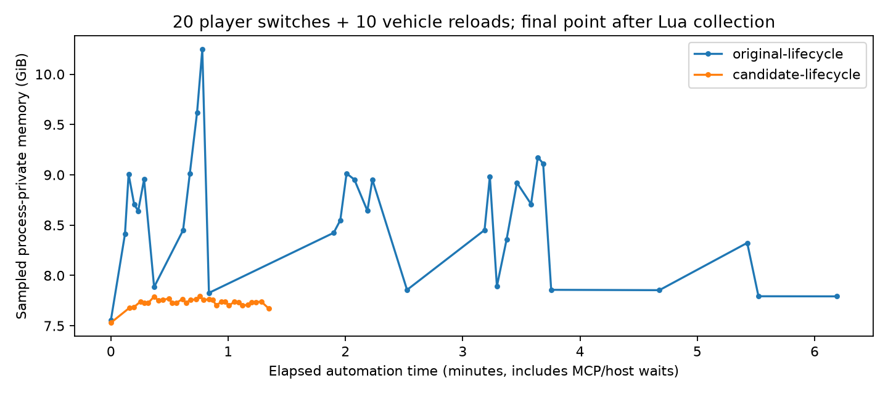
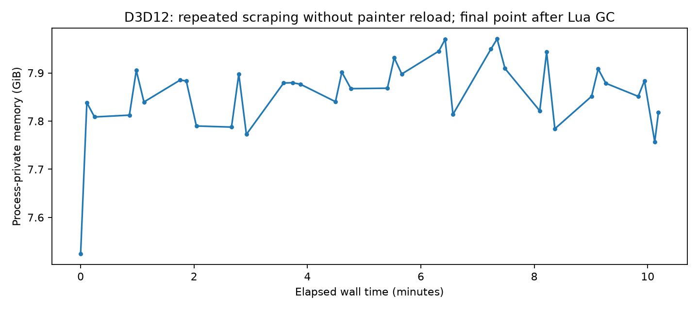

# Milestone 5: performance and compatibility investigation

Started from c8bcae6. Milestone 6/public release is excluded.

## Acceptance criteria (set before tuning)

- Repeat enabled and painting-disabled identical physics scenarios at least three
  times warm and across fresh processes. Preserve raw frame samples, p95/p99/max,
  native projection/bake maxima, failures, drops and remaining queues. Process-cold
  is not shader-cache-cold; do not delete user caches to manufacture cold results.
- Native calls above 100 ms remain a stable-release blocker. A scheduler cannot
  preempt one native call. No favorable average or mock count waives this gate.
- Preserve full-resolution damage, private ETK source channels, Police lettering,
  separate removable soil, lasting scratches and editor isolation; review captures.
- Repeated reset/switch/reload/map tests must stay ready without stale references;
  inactive vehicles must not acquire marks. Record resource samples over sustained
  work; bounded Lua queues alone do not prove bounded native/GPU resources.
- Record exact installed build, renderer, config and settings. D3D12 and Vulkan
  require separate evidence. Unsupported vehicles remain unverified or skipped,
  not implicitly supported. No claim about all hardware FPS.

**Prior run verdict at f414136: BLOCKED.** [Same-thread resumed implementation and new evidence](11-quality-throughput.md) supersede this run-completion statement. The scoped mitigations and investigation are
complete for this run; milestone 5 feature acceptance is incomplete. Do not merge
this branch or start milestone 6 on the strength of the mock suite. Last merged
baseline remains c8bcae6.

## Reproduced native stall and diagnostic boundary

Original-code fresh-process D3D12 repeat 2, roofdrop:
`original-d3d12-cold/20261114-164346_roofdrop_original-d3d12-cold_r2`.
One `projectDynamicDecals` call took **652.4749 ms**, with a **663.8656 ms**
whole frame. Before that sample, aggregate projection time was already 159.7567 ms:
this was not simply the first projection after launch. Queued captured layers
went 0, 1, 0 around the stall; queued jobs were zero in all three samples.
The following engine metrics row reports Lua 654.5434 ms, consistent with the
metrics API's one-frame delay. LuaGC was approximately 0.06-0.08 ms; sampled
physics and renderer CPU sections were small. No growing Lua backlog explains
this event. This localizes the wait inside native projection, **not** its C++
root cause: these main-thread elapsed timers cannot distinguish GPU synchronization, driver
allocation, shader work or native resource contention. No GPU trace attribution
is claimed, and no shader cache was purged.

## Candidate changes

- Reuse the private installed Dynamic Decals API/projection across ETK
  attachments within one painter instance, retaining 4096x2048 damage resolution.
  Rebind the new shape before clearing/selecting its exact material indices.
  The independent 1024x512 soil target remains reusable. Extension reload still
  constructs a new instance; no unsafe native destructor or shared editor cache
  is introduced.
- Drain captured layers before issuing another projection batch. Previously a
  frame longer than the flush interval could repeatedly prioritize projection
  over baking. The new slow-frame mock fails on c8bcae6 and passes on the
  candidate. Count budgets, brush quality and source material fields are retained.
- Add frame-by-frame cumulative projection/bake timings and queue depths to the
  developer bench, plus repeatable process-cold and lifecycle probes.

The first candidate matched Police capture preserves lettering, visible side
scuffs and original-stage fields. This is visual verification, not proof that
native stalls are fixed. Original lifecycle: 20 player switches and 10 vehicle
reloads retained ready status; memory fluctuated and returned after collection.
Whole-process memory alone does not establish a leak or its absence.

## Candidate failure retained (not waived by favorable cold repeats)

All three candidate D3D12 process-cold repeats drained their queues, without
reproducing the long native stall. The subsequent sustained roof-scrape series
**did reproduce it**: repeat 3 had projection 738.0238 ms, painter 739.6770 ms,
and worst whole frame 757.8555 ms. All three 30-second sustained repeats exceeded
throughput: 38/26/47 jobs and 215/110/17 aggregate inputs dropped respectively;
32/39/26 jobs remained at the three-second drain cutoff (repeat 1 also had 28
captured layers pending). Zero thrown jobs is not a throughput pass.

The one-projection alternative also fails latency: 34/35/38 jobs remained after
its sideslide drain cutoff. Reduced peaks cannot be interpreted as equivalent
rendering when so much work is delayed. Default resolution and brush quality
remain unchanged. A shorter flush interval was tested separately and rejected below. It cannot
preempt a single native call. Stable release remains blocked.

## Functional and resource regression observations

- Original vs candidate lifecycle: 20 switches and 10 vehicle reloads each;
  all 32 snapshots ready with unchanged original fields. Original process-private
  memory 7.56-10.25 GiB, ending 7.79 GiB after collection; candidate 7.53-7.79 GiB,
  ending 7.67 GiB. Automation elapsed 371.4 vs 80.8 seconds includes MCP and host
  sampling waits, so it is not a frame-time benchmark. This supports reduced
  allocation churn, not proof of multi-hour native/GPU memory safety.
- Five candidate extension reloads passed; stock Heritage and unicycle skipped;
  return to Police ready. Nonempty editor test layer UID A3A8-EABF was unchanged
  through mod clear/reload, then the fixture was removed.
- Three moving stock `simple_traffic` vehicles had zero detector impacts/streams;
  the player ETK produced 83 projections. This is a three-car functional test,
  not heavy-traffic performance certification.
- Matched plain/Police D3D12 captures retain visible scratches and original fields.
  Real mud/water regression starts with 26 deposits, shallow unchanged, removes
  soil while photographed gray scratches remain, dries to original fields,
  freezes while paused and re-dirties to 27 deposits. No fake contacts or water
  sensor values are injected; Gridmap's real WaterBlock is temporarily repositioned and restored.

## Final repeated measurements

Build **0.40.5.0 x64 302427**, Windows 11, Ryzen 9 3900XT, RTX 3090;
3840x2160 Custom, Ultra lighting, High shaders, Normal textures, SMAA,
dynamic reflections enabled except the named diagnostic. Full 4096x2048 damage
and separate 1024x512 soil remain. Main performance fixture:
`vehicles/etk800/rennspecht_8r_A.pc` with `etk800_skin_police`, Gridmap v2.
This is a Police **paint design on Rennspecht**; exact stock configurations were
checked separately. Each cold set uses three fresh processes and three scenarios
(slide, roofdrop, coast). Startup/setup are outside the timed window; caches are
retained. Warm physics repetitions are not deterministic contact replays.

Ranges below are the lowest/highest **per-run** percentile, not pooled percentiles.
All times are milliseconds. Bake is a timed batch of up to six captured layers;
these damage-only cases call native `bakeLayers` once per batch. Timers include
possible native waits and are not GPU-only execution measurements.

| Series | Runs | Frame p95 range | Frame p99 range | Worst frame | Worst projection | Worst bake batch |
| --- | ---: | ---: | ---: | ---: | ---: | ---: |
| Original D3D12 process-cold | 9 | 13.59–65.75 | 15.51–80.84 | 663.87 | 652.47 | 56.21 |
| Candidate D3D12 warm | 9 | 13.31–69.52 | 14.64–77.56 | 101.35 | 46.30 | 59.94 |
| Candidate D3D12 process-cold | 9 | 14.24–72.04 | 15.87–87.46 | 91.91 | 46.70 | 71.62 |
| Candidate D3D12 painting-disabled, process-cold | 9 | 12.15–17.80 | 13.85–21.91 | 49.39 | 0 | 0 |
| D3D12 painter-unloaded warm control | 6 | 11.97–12.95 | 13.26–14.75 | 23.94 | 0 | 0 |
| Candidate D3D12 sustained, default cutoff | 3 | 52.84–55.84 | 62.58–64.74 | 757.86 | 738.02 | 54.46 |
| Candidate D3D12 ten-minute endurance | 35 | 15.46–67.08 | 42.63–78.33 | 744.12 | 731.93 | 662.81 |
| Candidate Vulkan process-cold | 9 | 14.49–46.61 | 15.30–54.05 | 575.04 | 63.35 | 21.68 |
| Candidate Vulkan painting-disabled warm | 9 | 13.77–15.72 | 15.52–18.81 | 524.39 | 0 | 0 |
| Candidate Vulkan sustained | 3 | 40.77–45.02 | 51.78–53.98 | 760.25 | 69.91 | 25.10 |

[All 148 retained runs, raw-derived percentiles, drops, queues and settings](../docs/evidence/milestone5/all-runs.json),
[all-run frame tails](../docs/evidence/milestone5/frame-tails.png),
[original warm controls](../docs/evidence/milestone5/original-warm),
[cold baseline](../docs/evidence/milestone5/original-d3d12-cold),
[candidate D3D12](../docs/evidence/milestone5/candidate-d3d12-cold),
[painting-disabled D3D12](../docs/evidence/milestone5/candidate-d3d12-disabled-cold),
[painter-unloaded control](../docs/evidence/milestone5/d3d12-painter-unloaded),
[Vulkan](../docs/evidence/milestone5/candidate-vulkan-cold),
[Vulkan disabled](../docs/evidence/milestone5/candidate-vulkan-disabled-warm).

Disabled controls leave the adapter/detector loaded but disable paint submission.
The additional unloaded control disables the detector and unloads the painter;
private clone stages return to their original two layers. Neither is a clean
ZIP uninstall. The FPS report was corrected to use sampled wall intervals rather
than smoothed model time; derived reports were refreshed without changing raw
samples. Inspect raw frame arrays for attribution; engine metric rows lag a frame.

### What the experiments separate

- **Scheduler defect:** slow frames could starve captured-layer baking. The added
  backpressure fixes that specific defect; regression test and repeated rendering
  pass. It does not make native work preemptible or solve input throughput.
- **Resource churn:** reusing the private projection avoids constructing a new API
  on each attachment. The lifecycle samples improve, with preserved originals and
  successful resets/reloads. This does not establish native/GPU leak freedom.
- **Native projection/bake:** the endurance series reproduced 731.93 and 334.40 ms
  projection calls, plus 461.72 and 662.81 ms bake batches, without a painter reload.
  Projection totals jump by the long call while queues are empty beforehand;
  bake totals jump while layers drain. LuaGC remains small. A hot reload or an
  accumulating Lua backlog cannot explain all these stalls.
- **Other frame stalls:** Vulkan sustained repeat 1 has a 760.25 ms whole frame
  while painter time is 0.0095 ms and projection/bake totals do not advance.
  Vulkan disabled coast also has a 524.39 ms frame with no painting. These are
  separate game/driver/OS/host disturbances of unresolved origin; do not attribute
  every frame outlier to this mod, or claim Vulkan eliminates frame stalls.
- **Renderer workload:** Vulkan's cold slide/roof median of per-run bake time per
  layer was 1.17 ms versus 7.91 ms D3D12. Different physics and native waits prevent
  a GPU-only or universal FPS inference. The limited Vulkan sample did not reproduce
  a >100 ms projection/bake call, but still dropped 83 aggregate inputs over three
  sustained runs and needed up to 3.95 seconds after input stopped to drain.
- **Trace limitation:** both bench Optick capture and the installed official MCP
  `profiler_run` reported/planned output but produced no `.opt` file. The bindings
  exist; no usable native/GPU trace was obtained. [Smoke response and attempt](../docs/evidence/milestone5/optick-attempt).
  GPU synchronization, driver allocation, shader work and native resource
  contention remain unseparated. A profiling-capable engine/driver capture is
  required before naming or claiming to fix that root cause.

### Rejected tuning and latency

[One projection per flush](../docs/evidence/milestone5/candidate-one-project)
left 34/35/38 jobs after the three-second drain cutoff. [Flush interval 0.05](../docs/evidence/milestone5/fastflush)
still dropped 5/24/54 jobs and 48/76/83 aggregate inputs, drained in
5.95/5.14/2.07 seconds and incurred a 475.83 ms bake batch. It is not adopted.
[Reflections disabled](../docs/evidence/milestone5/candidate-reflections-off)
still had roughly 38–49 ms projection and 41–53 ms bake peaks in short repeats;
absence of a rare outlier there does not identify reflections as the cause.
Default projection budget 6 and flush interval 0.20 remain. No resolution or
brush-quality downgrade was substituted for acceptance.

The [ten-minute same-instance run](../docs/evidence/milestone5/candidate-d3d12-endurance)
completed 35 alternating slide/roof/sustained runs over 607.46 seconds, with no
painter reload or forced Lua collection until the end. All eventually drained
within the extended 15-second observation window, but drain latency reached
**6.52 seconds**; 348 jobs and 997 aggregate inputs were dropped. This measures
post-input drain latency, not each mark's age. Final empty queues do not erase
those losses. Sampled whole-process private memory was **7.52–7.97 GiB**, ending
7.82 GiB after collection. Total-device VRAM samples are retained; they do not
isolate mod allocations. Ten minutes is not multi-hour resource certification.

## Compatibility and rendering evidence

See the [exact compatibility matrix](../docs/compatibility.md). D3D12 stock
`844_150_A.pc` and `844_police_A.pc` both rendered actual side-slide marks with
unchanged original material fields and empty final queues. Stock `854_police_A.pc`
(`etk800_skin_polizei`) remained skipped. [Config states and matched captures](../docs/evidence/milestone5/stock-configs).
The installed Scintilla GT3 `gt3_balanced.pc` loaded with `scintilla_skin_exblue`
and was skipped, preserving the livery; its prior disabled mod state was restored.
[Archive hash, state, capture and restoration](../docs/evidence/milestone5/mod-config).
This certifies a safe skip, not support for that mod or its plain variants.

D3D12 and Vulkan [matched plain/Police captures](../docs/evidence/milestone5/visual)
were visually reviewed. Both retain Police lettering and visible gray scuffs,
with the known weak light-paint coverage described in milestone 4.
[Water/soil D3D12](../docs/evidence/milestone5/wash) and
[Vulkan](../docs/evidence/milestone5/vulkan-wash) show actual mud deposition,
shallow-water invariance, partial fade, full removal to zero, dry original fields,
pause invariance and re-dirtying while photographed scratches persist.
[Traffic evidence](../docs/evidence/milestone5/candidate-traffic),
[extension reload/unsupported checks](../docs/evidence/milestone5/candidate-matrix),
[four Vulkan map transitions](../docs/evidence/milestone5/candidate-vulkan-maps),
[editor sentinel](../docs/evidence/milestone5/editor.json).

## Acceptance disposition and remaining gates

| Gate | Result | Disposition |
| --- | --- | --- |
| Repeated baseline/enabled warm and process-cold measurements | Retained raw controls, failures, tails and source/settings evidence | Pass as an investigation; no FPS certification |
| No native calls over 100 ms | 738.02 ms projection; later 731.93 ms projection and 662.81 ms bake batch | **FAIL; release blocker** |
| Sustained rendering keeps up with accepted contacts | Dropped work, three-second cutoffs fail; extended drain up to 6.52 s | **FAIL; release blocker** |
| Full-resolution private material, Police, soil/wash/scratch persistence | Matched captures and original-field checks on both renderers | Pass for matrix scope |
| Resets/switch/reloads/maps/editor/player-only traffic | Recorded fixtures passed | Pass for tested counts/configurations |
| Long-session native/GPU resources | Ten-minute process samples; no isolated native/GPU allocation trace | Limited evidence; multi-hour gate remains open |
| Exact supported/unsupported compatibility | Matrix records tested configs and safe skips | Pass as documentation; no broad support claim |
| Mock/syntax/globals/sidecars | 226 behavior checks and preflight | Pass; cannot waive engine failures |

Required before stable acceptance: obtain usable native/GPU profiling to identify
and mitigate the long calls; address sustained mark loss/latency without hiding it
behind lower output; repeat the same warm/cold/endurance/control and visual matrix
with the fixes; then extend session duration and native/GPU resource accounting.
Any later preview must explicitly disclose these freezes and lost/delayed marks;
this run does not authorize or publish one. Clean ZIP-only install/uninstall,
release version/license/credits and public artifacts remain milestone 6 gates.

The game was returned to D3D12, Gridmap v2, Rennspecht with Police design,
default scheduler settings, reflections enabled, detector/painting enabled,
unpaused with parking brake and cleared cosmetics. [Final material state](../docs/evidence/milestone5/final-state.json).
No milestone 6 work, merge or public release was performed in this run.
